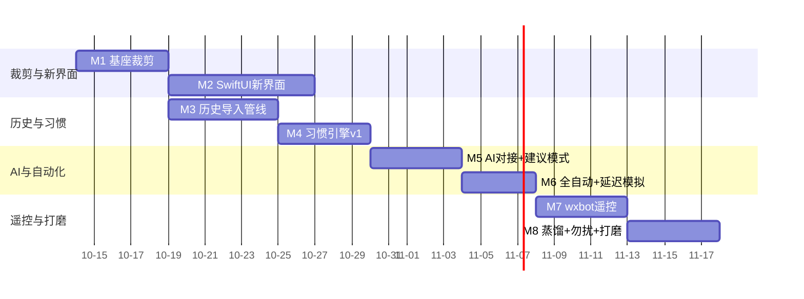

# 需求文档 — 个人微信自动回复助手（项目代号：微信机器人自动回复）

> 版本：v0.1 · 2026-10-13
> 基座：`/Volumes/2t/it/微信机器人框架/` 现役 zmybot（Frida Hook + Rust 运行时），**裁剪复用**
> 界面：**SwiftUI 原生桌面应用**（macOS），视觉按 `西瓜狗2.0ui` 风格重设计
> 定位一句话：学习登录用户的回复习惯，模拟本人延迟思考后，以本人身份自动回复微信消息；界面看消息、勾选、手动回复；wxbot（iLink）做手机远程遥控通道。

---

## 1. 一句话定位与设计原则

**做一个「数字分身」**：程序挂上本机微信，学习"我平时怎么回消息"，然后在我不想自己回的时候，用我的口吻、我的节奏替我回。

设计原则：

1. **像本人，不像机器人** —— 回复以本人身份发出，带人类节奏：读条、正在输入、随机延迟。绝不能有机器腔。
2. **人对 AI 有最终控制权** —— AI 只建议，默认建议模式；全自动模式是显式开关，且可被一条手机指令随时叫停。
3. **最小能力面** —— 只保留收发消息 + 图片 + 文件。插件、MCP、webhook 上报、web 界面、授权系统等一切外部对接全部不要。
4. **本机数据不外泄** —— 对话数据、习惯数据全部存本机 SQLite；外发只有两类流量：调 AI 接口拿回复、wxbot 通道收发控制消息。
5. **Mac 单机应用** —— 一个 SwiftUI 界面壳拉起 Rust 运行时，无服务器、无独立后端，默认只监听 127.0.0.1。

---

## 2. 背景：从基座裁剪什么、保留什么

基座（`微信机器人框架/wechat_chatter`）现役能力处置：

| 基座能力 | 本项目 | 处置 |
|---|---|---|
| Frida Hook 收消息（文本/图片/语音/视频/文件） | 自动回复触发源 | ✅ 保留 |
| 文本发送（triggerX0/triggerX1Payload 链路） | 手动/AI 回复 | ✅ 保留 |
| 图片发送（CDN 上传链路） | 手动回复发图 | ✅ 保留 |
| 文件发送（sendfile 链路） | 手动回复发文件；收到的文件经 UI 保存/转发 | ✅ 保留 |
| 微信管理（枚举/attach/detach/多开） | 「微信管理」页 | ✅ 保留 |
| 事件库（SQLite）与 `/api/events/query` | 消息列表数据源 | ✅ 保留（并入唯一主库 `autoreply.db`） |
| HTTP `/api/*` + WS `/ws`（Bearer token，仅本机） | SwiftUI ↔ Rust 唯一通道 | ✅ 保留 |
| macOS 桌面壳 WeChatAgentDesktop（SwiftUI） | 壳与运行时托管 | ✅ 保留壳，**界面整体重设计** |
| 插件系统（cdylib/rules/清单） | — | ❌ 全部移除 |
| MCP（`/mcp`、mcp-stdio、MCP 对接卡） | — | ❌ 全部移除 |
| Web SPA（wechat_chatter/web） | — | ❌ 移除，SwiftUI 是唯一界面 |
| DB 密钥捕获 + SQLCipher 整库解密（`installDbKeyCapture` + `contact_db::decrypt_database`） | 历史会话学习的数据源 | ✅ **保留并强化**（见 FR2.5） |
| 转账确认 hook、下载 hook 等其余扩展 | — | ❌ 不带入 |
| 授权系统 | — | —（基座已整体删除） |

### 2.1 Hook 面裁剪说明

基座 Hook 全集见框架 `wechat_chatter/docs/hook-features.md`。本项目按最小能力面裁剪：

| Hook | 用途 | 本项目 |
|---|---|---|
| `setReceiver` / buf2Resp | 收消息 | ✅ 保留 |
| `setupSendTextMessageDynamic` + AttachSendFunc + req2buf | 文本发送 | ✅ 保留 |
| 发图片/发文件（CDN 上传组） | 媒体发送 | ✅ 保留 |
| `installWeChatUpdateGuard` | 拦微信自动更新（防偏移漂移） | ✅ 保留（防更新 = 防失效） |
| `installQuitRelease` | 退出清理 | ✅ 保留 |
| `attachProfileReader` | 读取联系人资料 | ✅ 保留（联系人昵称展示 + 习惯学习） |
| `probeAccountInfoAfterLogin` | 登录账号信息 | ✅ 保留 |
| `installDbKeyCapture` | 抓 DB 密钥解密本地库 | ✅ **保留**（历史会话学习的唯一数据源） |
| 下载 hook | 收文件落盘 | ❌ 基座已删，不恢复 |

> **保留 `installDbKeyCapture` 是硬需求**：没有它就没有历史会话，习惯引擎只能从接入那天开始冷启动学，而"像本人"恰恰依赖长期历史。这是本项目与基座裁剪面唯一的反向决策。
>
> **密钥验真双轮原则**（参考 WeChatDataAnalysis macOS 捕获方案）：单次 `rounds=2` 命中可能只是单库派生密钥，**必须同时通过消息库与会话库两库首页 HMAC 校验的候选才可作为账号密钥**；密钥恢复时核对微信版本/build/CDHash，不把任意腾讯签名版本当作恢复成功。

裁剪后脚本仍走基座的 `hook-catalog` 偏移配置 + pattern 兜底扫描机制，微信小版本漂移仍可自愈；大版本漂移需要更新 `wechat_version/*.json`（沿用基座维护方式）。

---

## 3. 用户与使用场景

### 3.1 用户

单用户：Mac 上挂着登录的微信，程序学习"我"的回复习惯并代回。

### 3.2 核心场景

| # | 场景 | 描述 |
|---|---|---|
| S1 | 消息列表 | 按会话聚合的消息列表：头像、昵称、摘要、时间、未读点、复选框；点开看完整对话记录 |
| S2 | 手动回复 | 输入框直接回复，支持文本、图片、文件 |
| S3 | 勾选与批量 | 会话行带复选框；勾选后可批量操作（标记已读/静音/仅观察/暂停该会话自动回复） |
| S4 | 自动回复 | AI 按学到的习惯自动回复，模拟人类延迟（读条+正在输入+随机延迟），本人身份发出 |
| S5 | 手机遥控 | 手机微信里对 bot 发指令，查询/控制桌面端的自动回复（如「暂停」「回复 张三 …」），桌面端实时同步 |
| S6 | AI 对接选择 | 设置页选择 AI：自家中转站（OpenAI 兼容）或大厂接口（DeepSeek/Kimi/Qwen/OpenAI 兼容），各自填 base_url + api_key + model；jev 判断模型固定走自家中转站 |

### 3.3 非目标（明确不做）

- 不做插件系统、MCP、webhook 上报、web 界面、授权/许可证系统。
- 不做群发、加好友、朋友圈、红包/转账等扩展能力（基座转账确认 hook 不带入本项目）。
- 不做多用户、云同步、远程 Web 控制台（wxbot 通道除外）。
- 不做 Windows、不做 iOS/Android 客户端。
- 收到的图片/文件**不主动落盘**（与基座一致），UI 展示与转发时按需拉取。

### 3.4 场景流（首周真实使用）

1. 首次启动 → 法律门 → 引导注入微信（沿用基座注入流程）→ 进入主界面。
2. 日常：桌面端消息列表看新消息（含图片缩略、文件卡片），勾选会话，手动回复；AI 在后台持续学习习惯。
3. 顶部全局开关（大、显眼）：**观察模式（默认）→ 建议模式 → 全自动模式**，切换需二次确认。
   - 观察模式：只学不回。
   - 建议模式：AI 生成草稿，会话流里出现「建议回复」卡片，用户可改可发。
   - 全自动：AI 直接回复，带人类节奏。
4. 手机端随时发指令 `暂停` 拉闸：所有模式立刻冻结，桌面端弹横幅提示。

### 3.5 自动回复工作流

```text
收到消息 → 会话粒度聚合/防抖（默认 45s 静默窗口）→
jev 判断：要不要回 / 风险 / 紧急度 →
  ├─ 不回 → 记录原因，静默
  ├─ 风险 → 转人工（建议卡 + 桌面通知）
  └─ 回 → 习惯引擎组装 prompt（人设卡、关系、历史、本人旧回复例句）
        → 用户选的模型生成回复 → 延迟计划（正在输入 5–20s + 随机静默 30–240s）
        → 建议模式: 生成建议卡，用户改/发
        → 全自动模式: 定时器到点发送（期间手机指令/手动介入可撤销）
```

---

## 4. 功能需求（FR）

### FR1 消息中心（列表 / 回复 / 勾选）

**列表**

- FR1.1 会话列表：头像、备注/昵称、最后一条摘要（带类型标签）、时间、未读数、复选框、会话级「自动回复」开关（继承全局，可单聊覆盖）。
- FR1.2 对话视图：点会话进入（或右侧分栏）完整消息流，气泡式，文本/图片缩略/文件卡片。
- FR1.3 类型支持：文本、图片、文件（收到的文件可保存、经 UI 转发）；语音/视频/名片/小程序/红包/转账等显示占位卡（不处理内容）。收到的媒体按需拉取展示，不自动落盘。
- FR1.4 实时性：WS `/ws` 推送增量，列表去重按 `message_id`，断线重连 + 本地 SQLite 回填。
- FR1.5 搜索：按昵称/内容/wxid 搜索会话与消息。
- FR1.6 勾选：表头复选框全选；勾选后底部浮出批量栏：标记已读 / 静音 / 仅观察 / 暂停该会话自动回复。
- FR1.7 手动回复：文本；图片（文件选择器）；文件（文件选择器）。发送走基座发送闸门（限速），发送记录留痕。
- FR1.8 已读/未读为本地状态（微信无已读回执 hook，不触达微信）。

### FR2 习惯学习引擎（数字分身）

**数据来源（两层）：**

- **历史层（P0，见 FR2.5）**：解密本机微信本地 SQLite，导入历史会话做画像基线 —— 这是"像本人"的地基。
- **增量层**：接入后实时收发的消息持续更新画像与例句。

两层数据都只存本机。

- FR2.1 习惯画像按（本人, 联系人）维度维护：
  - 语言风格：句长分布、标点习惯、emoji 使用、口头禅。
  - 回复策略：回复时段分布、典型延迟分布（从历史计算 P50/P90，冷启动默认 30–240s 随机）、话题回避项、常用回复模板。
  - 关系亲疏：按联系人分层（家人/朋友/同事/客户/陌生），影响语气与延迟（越陌生延迟越长）。
- FR2.2 学习方式：**双层** —
  - 统计层（本地，零成本）：对会话与联系人做本地统计，产出画像 JSON，作为 prompt 一部分。
  - 反馈层（AI 蒸馏，定时任务）：定期把「我手动发的回复」作为样本，让 jev 定期蒸馏出每联系人的「回复习惯摘要」落库，随 prompt 注入；建议卡被修改后发送的 diff 记为负样本。
  - 不做向量库、不做微调，全部通过 prompt 注入。
- FR2.3 人设卡：设置页编辑"我的口吻"卡片（自由文本 + 引导字段：称呼习惯/常用语气词/哪些话题只简短回/哪些联系人要更正式），作为 prompt 顶部注入。
- FR2.4 冷启动：**有历史导入 → 直接可用**；无历史（密钥未捕获）→ 人设卡 + 通用礼貌回复 + 更长延迟 + 默认仅建议模式，UI 明示「历史未导入，画像仍在积累」。

### FR2.5 历史会话导入（本机微信本地库解密）✅ 明确要做

**数据源**：本机微信 macOS 本地 SQLite（SQLCipher 4 加密），路径
`~/Library/Containers/com.tencent.xinWeChat/Data/Documents/xwechat_files/<wxid>_*/db_storage/`，
密钥由 Frida 挂 `CCKeyDerivationPBKDF` 捕获（沿用基座 `installDbKeyCapture` + `contact_db::decrypt_database`，每库一把 32 字节 key，page-1 HMAC 校验）。

- FR2.5.1 **密钥捕获与持久化**：注入后捕获各 db 的 key → 写 `~/Library/Application Support/WeChatAutoReply/db-keys.json`（0600）；key 一旦 HMAC 校验通过即长期可用，重注入不清。
- FR2.5.2 **需要解密的库**（按优先级）：

  | 库 | 用途 | 优先级 |
  |---|---|---|
  | `message/message_*.db`（含分片 `message_N.db`） | 私聊/群聊历史消息（`Msg_<md5(username)>` 分表 + `Name2Id`） | P0 |
  | `session/session.db` | 会话列表、未读、摘要、草稿、最后消息时间 | P0 |
  | `contact/contact.db` | 好友/群/公众号、备注名、昵称、头像、群成员 | P0 |
  | `message/message_fts.db` | 全文检索（给 UI 搜索历史用） | P1 |

  朋友圈/表情包/红包转账/收藏等**不在范围**（与自动回复无关）。

- FR2.5.3 **导入管线**（后台任务，不阻塞 Hook 与 UI）：
  1. 解密到内存或临时明文库（临时文件 0600，`decrypted/` 临时目录，导入完即删；**不保留长期明文副本**）。
  2. 遍历 `Name2Id` 得会话 username → `Msg_<md5>` 表 → 逐会话按 `create_time` 升序读 `local_type=1`（文本）消息。
  3. 内容解压：`WCDB_CT_message_content == 4` 走 zstd 解压（基座能力文档已确认），解压后 XML 的只取文本节点。
  4. 发送者判定：`real_sender_id` → `Name2Id.rowid` → wxid，与本人 wxid 比对区分「我/对方」。
  5. 落 `events` 表（沿用基座事件模型）并置 `source='history_import'`，与实时消息区分。
- FR2.5.4 **规模与增量**：
  - 默认导入最近 12 个月；可配 6/12/24 个月/全部。
  - 首次全量，之后增量（记录每个会话已导入的最大 `create_time`，下次只拉增量）。
  - 大库分批（每会话 1000 条一批），可中断续跑，进度条展示在设置页/首页。
- FR2.5.5 **导入后的学习动作**：历史导入完成即触发一次全量画像重算 —— 从历史消息里算出每个联系人的句长分布、延迟分布（对方消息 → 我下一条回复的时间差）、时段分布、口头禅、常用模板。**这一步是"像本人"的地基**，必须在冷启动阶段就跑完，而不是等慢慢积累。
- FR2.5.6 **隐私红线（硬约束）**：
  - 明文 db 只存在于临时目录，导入完成立即删除；产物只有结构化画像 JSON + 例句，**不保留整库明文副本**。
  - 关键词脱敏：导入出的例句在入 prompt 前按 `data/dedup-rules.txt`（手机号/身份证/银行卡/地址/金额）脱敏。
  - 历史消息原文按模式处理：云端模式只发「画像摘要 + 脱敏例句」且受 FR3.9 隐私级别控制（严格模式下连例句都不发）；本地规则模式下完全不外发（设计 §1.7）。
  - 用户可一键「清除所有历史导入数据」（设置页 → 数据）。
- FR2.5.7 **失败降级**：密钥抓不到（如注入时机晚于微信开库）→ 提示用户重启微信后重新注入，导入任务挂起重试；此时产品退化为「从接入日起积累」，UI 明示「历史未导入，画像仍在积累」。

### FR3 AI 对接（可切换）

- FR3.1 供应商配置：支持多条「AI 配置档案」，每条含：名称、类型（OpenAI 兼容）、base_url、api_key、model、温度、max_tokens、开关。内置预设：自家中转站、DeepSeek、Kimi(Moonshot)、Qwen(DashScope)、OpenAI、Ollama(本机)、LM Studio(本机)。
- FR3.1a 模型列表自动获取：填好 base_url+key 后从上游 `GET /v1/models` 拉取模型列表供选择（连接测试才产生推理调用，拉列表不产生）；上游不支持或失败时回退手动输入模型名。Ollama/LM Studio 默认地址见设计 §5.2。
- FR3.2 调用：OpenAI 兼容 `/v1/chat/completions`，非流式（回复短，非流式足够）。
- FR3.3 jev 判断模型：固定走自家中转站，独立配置（base_url + api_key + model，与生成模型互相独立），负责三件事：
  1. **要不要回**（发言权判断，输出 yes/no + 简短理由）；
  2. **风险判断**（借钱、交易、证件、隐私、情绪激动等应转人工的信号）→ 强制转建议模式；
  3. **延迟评估**（对方在等答复吗，影响延迟档位）。
  - 输出 JSON：`{should_reply, risk, urgency, intent, needs_human, reason}`（契约 v1.1，详见 [03-AI自动回复功能设计.md](03-AI自动回复功能设计.md) §3.1）；解析失败 → 默认转建议模式（fail-safe）。
- FR3.4 提示词工程：模板文件外置（`data/prompts/*.md`），用户可改，改后热生效。
- FR3.5 失败策略：AI 超时/失败 → 转建议模式或静默，不重试轰炸；同一会话连续失败 3 次暂停 30 分钟。
- FR3.6 成本护栏：单日 token 上限（默认 200k），超出自动降观察模式，次日重置。
- FR3.7 上下文：最近 N 条（默认 20）历史 + 习惯画像 + 人设卡 + jev 输出。
- FR3.8 生成约束：回复长度贴近本人历史 P50 句长；负向约束禁用"作为AI"类措辞；每次生成 2 个候选（主/备），建议模式展示主候选，可一键换备选。
- FR3.9 隐私级别：严格=只发对话文本；默认=对话+人设卡；宽松=对话+人设卡+习惯摘要。发给大厂接口的内容仅限对话上下文与所选级别内容，不发通讯录。
- FR3.10 语音/视频等不支持的消息类型不触发自动回复（无法"看到"内容）。

### FR4 wxbot（iLink Bot API）手机遥控

wxbot 通道：腾讯官方 iLink Bot API（`https://ilinkai.weixin.qq.com`），HTTP/JSON，Bearer bot_token，`getupdates` 长轮询收、`sendmessage` 发（回复必须带 `context_token`）。

- FR4.1 通道开关与配对：设置页「wxbot 通道」卡：开启后走 iLink 登录流程（get_bot_qrcode → 扫码 → bot_token 存 Keychain），状态展示（未连接/已连接/重连中）。
- FR4.2 长轮询守护：常驻长轮询（35s hold），游标 `get_updates_buf` 持久化，进程重启不丢消息。
- FR4.3 指令集（v1）：

  | 指令 | 行为 |
  |---|---|
  | `暂停` / `继续` | 全局暂停/恢复；桌面端弹横幅「手机端已暂停」 |
  | `状态` | 回复当前模式、今日收/发数、AI 调用数、勿扰状态 |
  | `张三 暂停` / `张三 继续` / `张三 状态` | 会话级控制与查询 |
  | `回复 张三 <文本>` | 桌面对指定联系人发送文本（v1 仅文本，不支持手机端发图/文件） |
  | `草稿` | 回复待发送建议卡摘要（建议模式） |
  | `通过 <id>` / `改 <id> <文本>` | 通过/修改建议卡并发送 |
  | `帮助` | 指令帮助 |
  | 非指令消息 | 默认仅转发到桌面端通知（可配置忽略），不自动回复 |

- FR4.4 安全：只有扫码配对的 bot 主人能下指令；指令完整留痕；`回复` 指令在桌面端显示为「来自手机指令」。
- FR4.5 状态同步：桌面端模式变化（勿扰/暂停/降级）主动经 wxbot 通知 bot 主人。
- FR4.6 降级：iLink 服务不可用/腾讯调整 → 通道断开只影响遥控，不影响核心自动回复。

### FR5 微信管理（沿用基座）

- FR5.1 实例列表：枚举本机微信进程、attach/detach、多开实例管理、状态展示（在线/连接中/注入状态）。多开时按实例绑定自动回复配置。
- FR5.2 注入状态：bridge_alive、script_loaded、recv/text/media hook ready 展示（沿用基座 `/api/injection_status`）。
- FR5.3 更新守卫开关（拦微信自动更新）沿用基座。
- FR5.4 **发送通道原则（硬约束）**：所有消息发送一律走本项目 **Hook 通道（本人微信登录态）**。不采用 WeChatDataAnalysis 式"独立登录发送"——本产品的回复必须出自本人微信会话本体；若引入第二条发送通道，"这条消息到底是谁发的"将无法取信于人，也破坏 `outbound_origin` 学习信号的可信度。iLink 通道仅作遥控（见 FR4）。

### FR6 设置

- FR6.1 常规：开机自启（**走系统登录项，即"登录时打开 App"；不做独立 LaunchAgent 后台服务**，见设计 §1.2.1）、语言（v1 仅简体中文）、深浅色跟随系统。
- FR6.2 AI 档案管理（FR3.1）+ jev 独立配置卡 + 「测试连接」按钮（发测试 prompt 验证连通）。
- FR6.3 习惯引擎：人设卡编辑、学习开关、蒸馏周期（默认每日）、重置联系人画像。
- FR6.4 自动回复：聚合窗口、延迟档位（快/正常/慢/随机参数）、单日自动回复上限（默认 80 条/日，超出转建议）、单日 token 上限、自动降级开关。
- FR6.5 wxbot 通道卡（FR4.1）。
- FR6.6 数据：打开数据目录、清空习惯数据、导出/导入配置（API Key 不导出）。
- FR6.7 隐私级别（FR3.9）。
- FR6.8 关于页：版本、基座版本、hook 能力清单版本、开源许可。

### FR7 数据与存储

- FR7.1 存储：**唯一业务主库 `data/autoreply.db`**（WAL，仅本机）。`events` 是其中一张表，不再有独立的 `events.db`（基座 `event_store.rs` 的路径常量改为指向本库）。表：`events`（含 `source` 列区分实时/历史导入）、`conversations`、`contacts`、`habit_profiles`、`habit_summaries`、`sample_replies`、`suggestions`、`ai_logs`、`command_logs`、`settings`、`ai_config`、`dnd`、`import_state`、[05 文档](05-AI对话学习模块需求.md) §14 的 `learning_*` / `strategy_*` 表。**消息落库与游标推进必须同一事务**（设计 §1.6.0）。
- FR7.2 保留策略：实时消息默认保留 90 天滚动；**历史导入消息永久保留**（画像重算依赖它，用户可一键清除）；习惯数据永久（直到用户清空）；ai_logs 30 天。
- FR7.3 Keychain：AI api_key、jev api_key、iLink bot_token 全部进 macOS Keychain（基座桌面端未实现，本项目补齐）。微信 db 密钥存 `db-keys.json`（0600，与基座一致，因需按库路径索引）。
- FR7.4 备份/导出：习惯数据可导出 JSON；配置导出不含 Key 与 db 密钥。
- FR7.5 数据目录：`~/Library/Application Support/WeChatAutoReply/`，含 SQLite、prompts/、logs/、wxbot 游标文件、`db-keys.json`、**临时目录 `decrypted/`（导入完即删，不留明文库副本）**。消息媒体（图片/文件）不自动落盘，展示时按需拉取，缓存目录带 TTL 清理。
- FR7.6 隐私红线（按运行模式区分，见设计 §1.7）：
  - **两种模式共有**：整库原文、明文库、解密密钥、全部凭据**任何模式下都不上传**。
  - **云端 AI 模式**：只发生成所必需的上下文，经脱敏，且明确告知用户哪些内容会发往模型服务。
  - **本地规则模式**：聊天原文、记忆、推理上下文全不出本机。**不跑本地模型**，走本地规则库/技能库直答（设计 §1.7.2）。
  - 「整库不上传」与「任何原文都不上传」是**两条不同的承诺**，不得混用表述。

### FR10 长记忆（学习目标 3：怎么处理具体的人）

- FR10.1 记忆条目：按 `contact | group | global` 作用域，分类为 `fact | commitment | preference | event | relationship`，带 `confidence`、证据片段 `evidence`、`source_ref` 溯源。
- FR10.2 四态生命周期：`candidate`（AI 提取未确认，**默认不进 prompt**）→ `confirmed`（用户确认，进 prompt）→ `superseded`（被新记忆取代，不物理删除）→ `expired`（到期/完成）。
- FR10.3 冲突不自动裁决：检测到矛盾 → 新条目保持 candidate 并标记 `conflict_with` → 在 AI 对话学习里提问人工裁决。
- FR10.4 过期：承诺类按提取到的时间点自动 expired；事件类 3 个月降权、6 个月归档；关系/偏好类不过期。
- FR10.5 检索：v1 用 SQLite FTS5（`trigram` tokenizer，适配中文）；`retrieval.rs` 统一封装，v2 可加向量检索。
- FR10.6 冷启动：新联系人明示「历史不足，AI 正在积累」，**绝不编造对方背景**。
- 详见 [04-长记忆与知识库设计.md](04-长记忆与知识库设计.md) §2。

### FR11 AI 对话学习（学习目标 1：怎么回复）

- FR11.1 不是普通聊天窗：任务是把模糊偏好变成**有版本号、可回滚**的配置。
- FR11.2 流程：分析历史（区分我手动发的/AI 发的/我改过的）→ 生成初始画像 + 标记不确定项 → AI 基于**历史证据**逐步提问 → 用户自然语言回答 → AI 整理成候选策略 → 用户确认/修改/拒绝。
- FR11.3 提问必须带证据：用户可点开查看"你凭什么这么问"（`evidence` 指向具体消息）。
- FR11.4 四要素关联：已确认规则 ↔ 待确认假设 ↔ 历史证据 ↔ 反例，避免每次学习重建矛盾画像。
- FR11.5 人工修正产生**候选**不覆盖稳定规则；同一模式修正 ≥3 次才提高置信度并提问确认。
- FR11.6 策略版本化：`strategy_versions(version, parent_version, diff, active)`，可回滚。
- 详见 [04-长记忆与知识库设计.md](04-长记忆与知识库设计.md) §4 与 **[05-AI对话学习模块需求.md](05-AI对话学习模块需求.md)**（完整模块需求：观察分类、问题生成、策略结构、状态机、数据模型、验收标准）。

### FR12 知识库与文档学习（学习目标 2：回复什么）

- FR12.1 **Excel 标准回复表**：三列模板（序号/关键词/回复内容）；表头自动识别（列顺序可变）+ 手动映射兜底；多 sheet；关键词分隔符兼容中英文逗号、顿号、分号、换行。
- FR12.2 导入必须预览，检查关键词缺失/回复为空/重复关键词；逐行保存 `source_row_number` 可溯源。
- FR12.3 **序号 ≠ 优先级**：序号只用于追溯原始行和排序。
- FR12.4 **Word 文档**：保留标题层级与表格结构 + 来源定位，不拼成一大段。FAQ 生成**候选**规则待审核；回复案例**不自动提升**为强制规则。
- FR12.5 **在线文档**：腾讯文档 v1 走"粘贴链接 + 检查可访问性 + 手动导出导入"；金山/WPS v1 只支持本地导出文件。**不依赖绕过登录/权限的抓取**；连接器独立启停，不影响本地导入。
- FR12.6 Excel 规则（有匹配逻辑）与普通知识（辅助理解）**分开存储**。
- FR12.7 回复优先级：人工接管 > 会话强制规则 > 精确匹配标准回复 > 关键词+语义候选 > AI 自由生成。
- FR12.8 模糊匹配不可靠时 → 生成草稿或请求确认，**不强行使用答非所问的标准回复**；模板含变量时**锁定业务承诺**（价格/时间/条款），只填变量槽。
- FR12.9 格式支持：v1 保证 `.xlsx/.docx` 可靠；旧版 `.doc` 明确提示另存为 `.docx`。
- FR12.10 **固定话术语义（v0.3）**：Excel 每行 = 一条固定话术，命中关键词 → **原样返回回复内容**，不经模型改写/补写/润色；多关键词同命中按显式 `priority` 取最高，序号永不参与。
- FR12.11 **知识是引用不是复制品（v0.3）**：知识切片以"带来源引用的参考片段"进入 prompt（保留 document/version/chunk 引用链）；删除或替换文档版本时引用失效，不残留改写副本。
- FR12.12 **文档版本管线（v0.3）**：导入→staging→预览→审核→发布（原子切换 active_version）→回滚；重新导入先算内容 SHA-256，相同则提示"内容未变化"；导入失败不污染当前生效版本。
- 详见 [04-长记忆与知识库设计.md](04-长记忆与知识库设计.md) §7。

### FR15 知识库备份与邮箱发送（v0.3）

- FR15.1 知识库是用户资产，**必须可备份**：含文档元数据/版本、规则（含启用/确认/优先级）、知识切片、本地技能配置。
- FR15.2 备份**不含**任何密钥（AI/jev/解密/SMTP 授权码）、聊天记录、记忆画像（结构上就查不到，不是靠过滤）。
- FR15.3 格式：版本化 JSON（或附带文档本体的 ZIP），带 format/version/app_version；导出经只读事务一致性读取。
- FR15.4 **邮箱发送**：填收件邮箱 → 生成备份 → 经用户配置的 SMTP 以附件发送；实现用 Rust `lettre`。
- FR15.5 SMTP 配置：服务器/端口/加密/账号/授权码；**授权码进 Keychain**（与 AI key 同级）；预设 QQ/163/126/Gmail/自定义；提供测试邮件。
- FR15.6 发送前 UI 明示"备份将发送至 <邮箱>，含全部规则与话术内容"；频率护栏默认单日 ≤5 封；同内容哈希 24h 重复发送提示。
- FR15.7 **恢复**走文档导入同款版本管线：校验 → 预览冲突（关键词/ID 冲突，**覆盖/合并/跳过**三选）→ 确认 → 发布；**恢复不自动删除现有规则**。
- 详见 [04](04-长记忆与知识库设计.md) §7.5。

### FR16 人工接入提醒（v0.3）

- FR16.1 **触发**（满足其一）：风险关键词；用户配置"必人工"关键词（优先级高于一切自动规则）；jev risk=high/needs_human（云端）；本地模式模糊命中/未命中且会话开启提醒；承诺事项 overdue；重要会话建议卡 30 分钟无人处理。
- FR16.2 **提醒三通道**同时触发（可按类开关）：**提示音**（系统音，同会话重复间隔默认 10 分钟可配）/ 桌面通知（点击跳会话，脱敏原因）/ 应用内红色横幅（不自动消失，带「去处理」）。
- FR16.3 「去处理」→ 定位会话并**自动进入人工接管态**（拦截所有 pending AI 回复）；处理完显式退出接管。
- FR16.4 **优先级**：人工接入词表高于一切自动规则（含精确话术）；接管态不发任何 AI 回复。
- FR16.5 不响铃：普通新消息（只亮未读）、建议卡常规生成（角标）——人工接入提醒是唯一"响铃"级。
- FR16.6 `escalation_events` 记录触发/通道/处理状态/耗时；**"AI 兜不住比例"是评估知识库覆盖度的核心指标**。
- 详见 [04](04-长记忆与知识库设计.md) §8.5。

### FR13 首次启动与人工接管（硬约束）

- FR13.1 首次启动八状态：`DISCOVERING / READING / INDEXING / PREPARING_MEMORY / READY / PARTIAL_READY / NEEDS_PERMISSION / ERROR`，**进度按数据源分条展示**（不是单个总百分比），由任务实时上报。
- FR13.2 **`READY`/`PARTIAL_READY` 之前强制观察模式**，不可切换自动回复（上下文不完整时 AI 不能回复）。
- FR13.3 增量：建立索引与同步游标，二次启动只增量更新；异常退出从上次位点恢复，**不重复执行危险操作**。
- FR13.4 macOS 权限：微信数据在 TCC 保护目录，被拒进 `NEEDS_PERMISSION` 并引导"系统设置 → 完全磁盘访问权限"；提供重新检查按钮，不要求重启。
- FR13.5 人工接管：待发送的 AI 回复被**硬拦截**，不继续擅自发送。
- 详见 [04-长记忆与知识库设计.md](04-长记忆与知识库设计.md) §3。

### FR14 两种运行模式：云端 AI / 本地规则

- FR14.1 **云端 AI 模式**（默认）：决策走 jev（自家中转站），生成走用户选的模型。只发生成所必需的上下文，经脱敏，并明确告知用户哪些内容会发往模型服务。
- FR14.2 **本地规则模式**：聊天原文、记忆、画像**全不出本机**。**不运行任何本地推理模型**——回复能力来自 `knowledge` 的规则库与技能库，走确定性匹配直答。
- FR14.3 本地模式下：
  - 决策由**本地决策器**替代 jev（风险关键词库 + 屏蔽/必回词表 + 意图正则）；无法判定时**默认不回**。
  - **无生成能力**：只从规则库/技能库匹配已存在的回复，不生成新措辞。
  - 习惯画像**仍可本地统计**（句长/延迟/时段），但只影响节奏与非 LLM 决策，不影响措辞。
  - 节奏模拟、历史导入、画像统计、wxbot 遥控**均完全可用**（纯本地）。
  - **AI 对话学习不可用**（依赖模型）；策略只能手动配置或直接导入规则。
- FR14.4 **本地模式全自动边界（硬约束）**：仅"精确规则命中 + 该规则已人工确认"才可自动发送；模糊匹配/无命中**只走建议卡或静默**，绝不自动发送。
- FR14.5 **技能库**：本地模式的回复能力来源。类型含规则直答、知识检索、填槽模板、本地计算、系统动作。**默认全部不联网**；联网技能默认禁用，需单独授权并在卡片标注。
- FR14.6 模式切换：设置页显式二次确认；**切到本地时自动回复自动降级为建议模式**（防失去模型支撑出错），需用户重新确认；顶部常驻徽章明示当前模式。
- FR14.7 **本地模式规则编辑界面**：本地模式下 AI 对话学习不可用，策略配置路径不能断——提供**规则编辑界面**作为替代：手工增删改标准回复规则（关键词 + 回复内容 + 适用范围 + 启用开关）、编辑填槽模板、管理本地技能开关。与 Excel 导入产出同一张 `reply_rules` 表，编辑结果**视为已人工确认**（可进自动发送池）。
- 详见 [02-设计文档](02-设计文档.md) §1.7.2、§3.0、§5.3。

### FR8 勿扰（DND）

- FR8.1 全局勿扰时段（如 23:30–07:30）：暂停全自动与建议推送，消息照收、学习照常。
- FR8.2 会话级勿扰开关覆盖全局（例外名单）。

### FR9 可靠性与降级

- FR9.1 崩溃/断电恢复：运行时与 App 分离（沿用基座进程托管）；重启后从 SQLite 回填，消息零丢失（游标/已处理位点）。
- FR9.2 AI 失败 → 转建议/静默（FR3.5）。
- FR9.3 Hook 失效（bridge_broken）→ 通知 + 停自动回复，不自动重试注入（沿用基座 watchdog 语义）。
- FR9.4 限速：沿用基座发送闸门 send_interval_ms，自动回复同样走闸门。
- FR9.5 时区：全部使用用户本机时间。

---

## 5. 体验需求（UX）

1. **人类节奏模拟**：正在输入/随机延迟必须可感知——这是本产品的灵魂。延迟参数可配，默认档从本人历史延迟分布采样。
2. **全局模式开关**：三档（观察/建议/全自动）+ 暂停态，顶部常驻，切换二次确认；手机叫停优先级最高。
3. **建议卡**：会话流内右侧展示 AI 候选回复 + 「发送/编辑/换一个/忽略」；编辑后发送的 diff 进负样本。
4. **通知策略**：macOS 通知中心只在高风险转人工、手机叫停、全自动降级时响；普通新消息只亮未读点。
5. **空状态**：未接入微信、无消息、AI 未配置、wxbot 未配对各有专门空状态引导。
6. **深浅色**：浅色为主 + 深色跟随系统，西瓜狗绿色 accent。

---

## 6. 非功能需求（NFR）

| 项 | 要求 |
|---|---|
| 平台 | macOS 14+（Apple Silicon 优先，Intel 兼容尽力） |
| 性能 | 消息入列 P95 < 300ms；列表滚动 60fps；AI 往返不阻塞 UI |
| 内存 | 运行时常驻 < 300MB；App < 250MB |
| 启动 | App 冷启动 < 2s；注入完成 < 30s（沿用基座） |
| 可靠性 | 7×24 挂机稳定；消息零丢失（WS 重连 + SQLite 回填） |
| 安全 | 仅监听 127.0.0.1 + Bearer token；Keychain 存密钥；日志脱敏 |
| 隐私 | 对话/习惯数据本机存储；外发流量仅 AI 调用与 iLink 通道 |
| 合规 | 使用 iLink 需同意《微信ClawBot功能使用条款》；首次启动法律门延续基座 |

---

## 7. 里程碑

| 阶段 | 内容 | 验收 |
|---|---|---|
| M1 | 基座裁剪：删插件/MCP/Web SPA；**保留 DB 密钥捕获**；收敛 API 面 | cargo test + swift test 通过；API 面与本文档一致 |
| M2 | SwiftUI 新界面：消息中心（列表/对话/回复/勾选/批量）+ 微信管理 + 设置 | 真机收发文本/图片/文件 |
| M3 | 历史导入管线：db 解密 + `Msg_*` 分表遍历 + zstd 解压 + 落库 | 真机导入 12 个月历史，进度可续跑 |
| M4 | 习惯引擎 v1：画像重算（句长/延迟/时段/口头禅）+ 人设卡 + 上下文组装 | 画像 JSON 产出并被 prompt 使用 |
| M5 | AI 对接：档案管理 + jev 判断 + 生成回复（建议模式） | 建议卡流程闭环 |
| M6 | 全自动模式：延迟计划 + 正在输入 + 发送闸门限速 | 真机全自动回复节奏自然 |
| M7 | wxbot 遥控：配对/长轮询/指令集/状态同步 | 手机指令控制桌面端实测通过 |
| M8 | 习惯蒸馏 + 勿扰 + 成本护栏 + 打磨 | 全功能验收 |



> M3 与 M2 并行：历史导入是运行时侧管线，不依赖新界面。M4 依赖 M3（画像重算需要历史数据）。

---

## 8. 风险

| 风险 | 影响 | 对策 |
|---|---|---|
| 微信大版本更新偏移漂移 | 收发失效 | 更新守卫拦自动更新；hook-catalog pattern 兜底；按基座流程维护版本 JSON |
| jev 输出不稳/超时 | 误回/不回 | fail-safe 转建议模式；超时默认不回 |
| 全自动回复露馅 | 体验/社交风险 | 人类节奏模拟 + 长度/口吻对齐 + 单日上限 + 勿扰 + 随时手机叫停 |
| 冒充风险（AI 以本人身份回复） | 信任 | 建议模式默认；全自动显式开启；手机叫停最高优先级 |
| AI 成本失控 | 费用 | token 上限自动降级观察模式 |
| iLink 腾讯侧调整 | 遥控失效 | 通道隔离，断开不影响核心链路；官方条款背书但腾讯保留终止权 |
| Hook 层账号风险 | 封号 | 承接基座现状；iLink 为官方合法通道但发送仍走 Hook（本人登录态） |
| 数据安全 | 隐私 | 本机存储 + 日志脱敏 + Keychain + 明文库用后即删 |
| db 密钥抓不到（注入晚于微信开库） | 历史无法导入，退化冷启动 | 提示重启微信后重新注入；导入任务挂起重试；产品仍可"从接入日起积累" |
| 大库导入耗时/占内存 | 首次体验差 | 每会话分批 1000 条、可中断续跑、后台任务不阻塞 Hook、进度条 |
| 解密产物明文外泄 | 隐私红线 | 临时目录 0600 + 用后即删 + 不保留整库明文副本 + 例句脱敏 |

---

## 9. 开放问题（待定）

1. 语音消息转文字（silk 解码 + ASR）是否纳入：v2 再议（语音二进制在 `message/media_0.db`，基座能力文档确认可读）。
2. 历史导入的**群聊**是否参与画像：v1 只导私聊历史，群聊历史仅落库供 UI 检索。
3. 群聊自动回复规则（@我 才回？跟聊？）：v1 只做私聊自动回复，群聊仅展示。
4. jev 输出 schema 版本化：v1.1 用 `should_reply/risk/urgency/intent/needs_human/reason` 六字段。
5. 图片消息的多模态看图能力：v1 不做，图片消息不触发自动回复。
6. wxbot `bot_type=3` 的实际含义与账号资格要求需实测确认。
