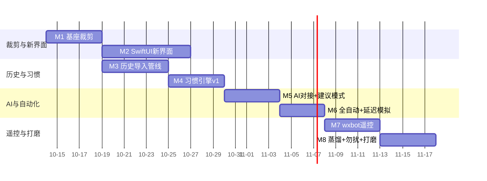

# 微信机器人自动回复 · 总体设计文档

（融合自 10 份独立文档 v0.3 基线 · 2026-10-13 · 全文 5377 行 · 共十篇）

> 本文档由 docs/ 下三份设计文档融合而成：按「需求 → AI 自动回复功能 → 总体架构与模块」顺序整合，保留全部实质内容，删除各源文档版本头与跨文档重复；文内指向独立文件的链接已改为篇内章节引用。04（长记忆与知识库）、05（AI 对话学习模块）等其余文档由第二部分融合。

## 目录

- **第一篇 · 需求**（源：01-需求文档.md）
  - §1 一句话定位与设计原则
  - §2 背景：从基座裁剪什么、保留什么（含 §2.1 Hook 面裁剪说明）
  - §3 用户与使用场景（用户 / 核心场景 / 非目标 / 场景流 / 自动回复工作流）
  - §4 功能需求：FR1 消息中心 · FR2 习惯学习引擎（含 FR2.5 历史会话导入）· FR3 AI 对接 · FR4 wxbot 遥控 · FR5 微信管理 · FR6 设置 · FR7 数据与存储 · FR10 长记忆 · FR11 AI 对话学习 · FR12 知识库与文档学习 · FR15 知识库备份与邮箱发送 · FR16 人工接入提醒 · FR13 首次启动与人工接管 · FR14 两种运行模式 · FR8 勿扰 · FR9 可靠性与降级
  - §5 体验需求（UX）
  - §6 非功能需求（NFR）
  - §7 里程碑（M1–M8）
  - §8 风险
  - §9 开放问题（待定）
- **第二篇 · AI 自动回复功能拆解**（源：03-AI自动回复功能设计.md）
  - §1 功能全景：一条消息进来要过七关
  - §2 A 触发层 — 什么消息才进 AI
  - §3 B 决策层 — jev 判断"该不该回"（输出契约 / 判断维度 / 决策路由 / fail-safe）
  - §4 C 生成层 — 生成"像我"的回复
  - §5 D 节奏层 — 怎么发才像人在打字
  - §6 E 审核与发送层 — 谁拍板
  - §7 F 反馈学习层 — 从结果里学
  - §8 G 护栏层 — 防失控
  - §9 H 可观测层 — 看得见 AI 在干什么
  - §10 会话状态机（自动回复视角）
  - §11 功能优先级（P0 / P1 / P2）
  - §12 待定问题
- **第三篇 · 总体架构与模块设计**（源：02-设计文档.md）
  - §1 系统总览（术语 / 进程模型 / 生命周期 / CLI / 依赖 / 并发 / 目录落盘与单库 / 密钥所有权 / 出网边界与两种运行模式）
  - §2 与基座的代码关系（裁剪策略 / 仓库结构 / crate 依赖 / 模块职责 / 两个消息通道的角色分离）
  - §3 自动回复编排器（模式分流 / 编排器要点 / jev 契约与解析 / 活动版本指针 / 待发送任务失效校验）
  - §4 习惯引擎（数据模型 / prompt 组装 / 学习信号 / 历史会话导入管线）
  - §5 AI 客户端（配置模型 / 内置预设 / 本地技能库）
  - §6 wxbot 通道（iLink Bot API）
  - §7 Rust 运行时 API（新增/变更部分）
  - §8 SwiftUI 桌面应用设计
  - §9 数据流与一致性
  - §10 测试与验收策略
  - §11 与需求文档的追踪关系
  - §12 v0.2 修订记录（架构评审）

## 文档版本一览

| 篇 | 源文档 | 版本 | 日期 |
|---|---|---|---|
| 第一篇 | 01-需求文档 | v0.1 | 2026-10-13 |
| 第二篇 | 03-AI自动回复功能设计 | v0.1 | 2026-10-13 |
| 第三篇 | 02-设计文档 | v0.2（架构评审统一 11 项） | 2026-10-13 |
| 第四篇 | 04-长记忆与知识库设计 | v0.3（备份/邮箱/固定话术/人工接入） | 2026-10-13 |
| 第五篇 | 05-AI对话学习模块需求 | V1.0（22 AC + 15 TC） | 2026-10-13 |
| 第六篇 | 06-学习与记忆数据流 | v0.2（评审八项 P0 落地） | 2026-10-13 |
| 第七篇 | 07-细节设计 | v0.2（全量 DDL + outbox + escalation） | 2026-10-13 |
| 第八篇 | 10-接口设计 | v0.1（全量契约 + WS 帧） | 2026-10-13 |
| 第九篇 | 19-前端设计 | v0.1（📋 暂缓，界面开发前启用） | 2026-10-13 |
| 第十篇 | 08-设计与进度 | 活文档（M0–M9 + V-01~V-10） | 持续更新 |

> 原独立文档保留在 docs/ 目录作为历史版本归档；**日常以本总文档为准**，修订直接改本文件对应篇章。

---

# 第一篇 · 需求

## 需求文档 — 个人微信自动回复助手（项目代号：微信机器人自动回复）

> 基座：`/Volumes/2t/it/微信机器人框架/` 现役 zmybot（Frida Hook + Rust 运行时），**裁剪复用**
> 界面：**SwiftUI 原生桌面应用**（macOS），视觉按 `西瓜狗2.0ui` 风格重设计
> 定位一句话：学习登录用户的回复习惯，模拟本人延迟思考后，以本人身份自动回复微信消息；界面看消息、勾选、手动回复；wxbot（iLink）做手机远程遥控通道。

---

### 1. 一句话定位与设计原则

**做一个「数字分身」**：程序挂上本机微信，学习"我平时怎么回消息"，然后在我不想自己回的时候，用我的口吻、我的节奏替我回。

设计原则：

1. **像本人，不像机器人** —— 回复以本人身份发出，带人类节奏：读条、正在输入、随机延迟。绝不能有机器腔。
2. **人对 AI 有最终控制权** —— AI 只建议，默认建议模式；全自动模式是显式开关，且可被一条手机指令随时叫停。
3. **最小能力面** —— 只保留收发消息 + 图片 + 文件。插件、MCP、webhook 上报、web 界面、授权系统等一切外部对接全部不要。
4. **本机数据不外泄** —— 对话数据、习惯数据全部存本机 SQLite；外发只有两类流量：调 AI 接口拿回复、wxbot 通道收发控制消息。
5. **Mac 单机应用** —— 一个 SwiftUI 界面壳拉起 Rust 运行时，无服务器、无独立后端，默认只监听 127.0.0.1。

---

### 2. 背景：从基座裁剪什么、保留什么

基座（`微信机器人框架/wechat_chatter`）现役能力处置：

| 基座能力 | 本项目 | 处置 |
|---|---|---|
| Frida Hook 收消息（文本/图片/语音/视频/文件） | 自动回复触发源 | ✅ 保留 |
| 文本发送（triggerX0/triggerX1Payload 链路） | 手动/AI 回复 | ✅ 保留 |
| 图片发送（CDN 上传链路） | 手动回复发图 | ✅ 保留 |
| 文件发送（sendfile 链路） | 手动回复发文件；收到的文件经 UI 保存/转发 | ✅ 保留 |
| 微信管理（枚举/attach/detach/多开） | 「微信管理」页 | ✅ 保留 |
| 事件库（SQLite）与 `/api/events/query` | 消息列表数据源 | ✅ 保留（并入唯一主库 `autoreply.db`） |
| HTTP `/api/*` + WS `/ws`（Bearer token，仅本机） | SwiftUI ↔ Rust 唯一通道 | ✅ 保留 |
| macOS 桌面壳 WeChatAgentDesktop（SwiftUI） | 壳与运行时托管 | ✅ 保留壳，**界面整体重设计** |
| 插件系统（cdylib/rules/清单） | — | ❌ 全部移除 |
| MCP（`/mcp`、mcp-stdio、MCP 对接卡） | — | ❌ 全部移除 |
| Web SPA（wechat_chatter/web） | — | ❌ 移除，SwiftUI 是唯一界面 |
| DB 密钥捕获 + SQLCipher 整库解密（`installDbKeyCapture` + `contact_db::decrypt_database`） | 历史会话学习的数据源 | ✅ **保留并强化**（见 FR2.5） |
| 转账确认 hook、下载 hook 等其余扩展 | — | ❌ 不带入 |
| 授权系统 | — | —（基座已整体删除） |

#### 2.1 Hook 面裁剪说明

基座 Hook 全集见框架 `wechat_chatter/docs/hook-features.md`。本项目按最小能力面裁剪：

| Hook | 用途 | 本项目 |
|---|---|---|
| `setReceiver` / buf2Resp | 收消息 | ✅ 保留 |
| `setupSendTextMessageDynamic` + AttachSendFunc + req2buf | 文本发送 | ✅ 保留 |
| 发图片/发文件（CDN 上传组） | 媒体发送 | ✅ 保留 |
| `installWeChatUpdateGuard` | 拦微信自动更新（防偏移漂移） | ✅ 保留（防更新 = 防失效） |
| `installQuitRelease` | 退出清理 | ✅ 保留 |
| `attachProfileReader` | 读取联系人资料 | ✅ 保留（联系人昵称展示 + 习惯学习） |
| `probeAccountInfoAfterLogin` | 登录账号信息 | ✅ 保留 |
| `installDbKeyCapture` | 抓 DB 密钥解密本地库 | ✅ **保留**（历史会话学习的唯一数据源） |
| 下载 hook | 收文件落盘 | ❌ 基座已删，不恢复 |

> **保留 `installDbKeyCapture` 是硬需求**：没有它就没有历史会话，习惯引擎只能从接入那天开始冷启动学，而"像本人"恰恰依赖长期历史。这是本项目与基座裁剪面唯一的反向决策。
>
> **密钥验真双轮原则**（参考 WeChatDataAnalysis macOS 捕获方案）：单次 `rounds=2` 命中可能只是单库派生密钥，**必须同时通过消息库与会话库两库首页 HMAC 校验的候选才可作为账号密钥**；密钥恢复时核对微信版本/build/CDHash，不把任意腾讯签名版本当作恢复成功。

裁剪后脚本仍走基座的 `hook-catalog` 偏移配置 + pattern 兜底扫描机制，微信小版本漂移仍可自愈；大版本漂移需要更新 `wechat_version/*.json`（沿用基座维护方式）。

---

### 3. 用户与使用场景

#### 3.1 用户

单用户：Mac 上挂着登录的微信，程序学习"我"的回复习惯并代回。

#### 3.2 核心场景

| # | 场景 | 描述 |
|---|---|---|
| S1 | 消息列表 | 按会话聚合的消息列表：头像、昵称、摘要、时间、未读点、复选框；点开看完整对话记录 |
| S2 | 手动回复 | 输入框直接回复，支持文本、图片、文件 |
| S3 | 勾选与批量 | 会话行带复选框；勾选后可批量操作（标记已读/静音/仅观察/暂停该会话自动回复） |
| S4 | 自动回复 | AI 按学到的习惯自动回复，模拟人类延迟（读条+正在输入+随机延迟），本人身份发出 |
| S5 | 手机遥控 | 手机微信里对 bot 发指令，查询/控制桌面端的自动回复（如「暂停」「回复 张三 …」），桌面端实时同步 |
| S6 | AI 对接选择 | 设置页选择 AI：自家中转站（OpenAI 兼容）或大厂接口（DeepSeek/Kimi/Qwen/OpenAI 兼容），各自填 base_url + api_key + model；jev 判断模型固定走自家中转站 |

#### 3.3 非目标（明确不做）

- 不做插件系统、MCP、webhook 上报、web 界面、授权/许可证系统。
- 不做群发、加好友、朋友圈、红包/转账等扩展能力（基座转账确认 hook 不带入本项目）。
- 不做多用户、云同步、远程 Web 控制台（wxbot 通道除外）。
- 不做 Windows、不做 iOS/Android 客户端。
- 收到的图片/文件**不主动落盘**（与基座一致），UI 展示与转发时按需拉取。

#### 3.4 场景流（首周真实使用）

1. 首次启动 → 法律门 → 引导注入微信（沿用基座注入流程）→ 进入主界面。
2. 日常：桌面端消息列表看新消息（含图片缩略、文件卡片），勾选会话，手动回复；AI 在后台持续学习习惯。
3. 顶部全局开关（大、显眼）：**观察模式（默认）→ 建议模式 → 全自动模式**，切换需二次确认。
   - 观察模式：只学不回。
   - 建议模式：AI 生成草稿，会话流里出现「建议回复」卡片，用户可改可发。
   - 全自动：AI 直接回复，带人类节奏。
4. 手机端随时发指令 `暂停` 拉闸：所有模式立刻冻结，桌面端弹横幅提示。

#### 3.5 自动回复工作流

```text
收到消息 → 会话粒度聚合/防抖（默认 45s 静默窗口）→
jev 判断：要不要回 / 风险 / 紧急度 →
  ├─ 不回 → 记录原因，静默
  ├─ 风险 → 转人工（建议卡 + 桌面通知）
  └─ 回 → 习惯引擎组装 prompt（人设卡、关系、历史、本人旧回复例句）
        → 用户选的模型生成回复 → 延迟计划（正在输入 5–20s + 随机静默 30–240s）
        → 建议模式: 生成建议卡，用户改/发
        → 全自动模式: 定时器到点发送（期间手机指令/手动介入可撤销）
```

---

### 4. 功能需求（FR）

#### FR1 消息中心（列表 / 回复 / 勾选）

**列表**

- FR1.1 会话列表：头像、备注/昵称、最后一条摘要（带类型标签）、时间、未读数、复选框、会话级「自动回复」开关（继承全局，可单聊覆盖）。
- FR1.2 对话视图：点会话进入（或右侧分栏）完整消息流，气泡式，文本/图片缩略/文件卡片。
- FR1.3 类型支持：文本、图片、文件（收到的文件可保存、经 UI 转发）；语音/视频/名片/小程序/红包/转账等显示占位卡（不处理内容）。收到的媒体按需拉取展示，不自动落盘。
- FR1.4 实时性：WS `/ws` 推送增量，列表去重按 `message_id`，断线重连 + 本地 SQLite 回填。
- FR1.5 搜索：按昵称/内容/wxid 搜索会话与消息。
- FR1.6 勾选：表头复选框全选；勾选后底部浮出批量栏：标记已读 / 静音 / 仅观察 / 暂停该会话自动回复。
- FR1.7 手动回复：文本；图片（文件选择器）；文件（文件选择器）。发送走基座发送闸门（限速），发送记录留痕。
- FR1.8 已读/未读为本地状态（微信无已读回执 hook，不触达微信）。

#### FR2 习惯学习引擎（数字分身）

**数据来源（两层）：**

- **历史层（P0，见 FR2.5）**：解密本机微信本地 SQLite，导入历史会话做画像基线 —— 这是"像本人"的地基。
- **增量层**：接入后实时收发的消息持续更新画像与例句。

两层数据都只存本机。

- FR2.1 习惯画像按（本人, 联系人）维度维护：
  - 语言风格：句长分布、标点习惯、emoji 使用、口头禅。
  - 回复策略：回复时段分布、典型延迟分布（从历史计算 P50/P90，冷启动默认 30–240s 随机）、话题回避项、常用回复模板。
  - 关系亲疏：按联系人分层（家人/朋友/同事/客户/陌生），影响语气与延迟（越陌生延迟越长）。
- FR2.2 学习方式：**双层** —
  - 统计层（本地，零成本）：对会话与联系人做本地统计，产出画像 JSON，作为 prompt 一部分。
  - 反馈层（AI 蒸馏，定时任务）：定期把「我手动发的回复」作为样本，让 jev 定期蒸馏出每联系人的「回复习惯摘要」落库，随 prompt 注入；建议卡被修改后发送的 diff 记为负样本。
  - 不做向量库、不做微调，全部通过 prompt 注入。
- FR2.3 人设卡：设置页编辑"我的口吻"卡片（自由文本 + 引导字段：称呼习惯/常用语气词/哪些话题只简短回/哪些联系人要更正式），作为 prompt 顶部注入。
- FR2.4 冷启动：**有历史导入 → 直接可用**；无历史（密钥未捕获）→ 人设卡 + 通用礼貌回复 + 更长延迟 + 默认仅建议模式，UI 明示「历史未导入，画像仍在积累」。

#### FR2.5 历史会话导入（本机微信本地库解密）✅ 明确要做

**数据源**：本机微信 macOS 本地 SQLite（SQLCipher 4 加密），路径
`~/Library/Containers/com.tencent.xinWeChat/Data/Documents/xwechat_files/<wxid>_*/db_storage/`，
密钥由 Frida 挂 `CCKeyDerivationPBKDF` 捕获（沿用基座 `installDbKeyCapture` + `contact_db::decrypt_database`，每库一把 32 字节 key，page-1 HMAC 校验）。

- FR2.5.1 **密钥捕获与持久化**：注入后捕获各 db 的 key → 写 `~/Library/Application Support/WeChatAutoReply/db-keys.json`（0600）；key 一旦 HMAC 校验通过即长期可用，重注入不清。
- FR2.5.2 **需要解密的库**（按优先级）：

  | 库 | 用途 | 优先级 |
  |---|---|---|
  | `message/message_*.db`（含分片 `message_N.db`） | 私聊/群聊历史消息（`Msg_<md5(username)>` 分表 + `Name2Id`） | P0 |
  | `session/session.db` | 会话列表、未读、摘要、草稿、最后消息时间 | P0 |
  | `contact/contact.db` | 好友/群/公众号、备注名、昵称、头像、群成员 | P0 |
  | `message/message_fts.db` | 全文检索（给 UI 搜索历史用） | P1 |

  朋友圈/表情包/红包转账/收藏等**不在范围**（与自动回复无关）。

- FR2.5.3 **导入管线**（后台任务，不阻塞 Hook 与 UI）：
  1. 解密到内存或临时明文库（临时文件 0600，`decrypted/` 临时目录，导入完即删；**不保留长期明文副本**）。
  2. 遍历 `Name2Id` 得会话 username → `Msg_<md5>` 表 → 逐会话按 `create_time` 升序读 `local_type=1`（文本）消息。
  3. 内容解压：`WCDB_CT_message_content == 4` 走 zstd 解压（基座能力文档已确认），解压后 XML 的只取文本节点。
  4. 发送者判定：`real_sender_id` → `Name2Id.rowid` → wxid，与本人 wxid 比对区分「我/对方」。
  5. 落 `events` 表（沿用基座事件模型）并置 `source='history_import'`，与实时消息区分。
- FR2.5.4 **规模与增量**：
  - 默认导入最近 12 个月；可配 6/12/24 个月/全部。
  - 首次全量，之后增量（记录每个会话已导入的最大 `create_time`，下次只拉增量）。
  - 大库分批（每会话 1000 条一批），可中断续跑，进度条展示在设置页/首页。
- FR2.5.5 **导入后的学习动作**：历史导入完成即触发一次全量画像重算 —— 从历史消息里算出每个联系人的句长分布、延迟分布（对方消息 → 我下一条回复的时间差）、时段分布、口头禅、常用模板。**这一步是"像本人"的地基**，必须在冷启动阶段就跑完，而不是等慢慢积累。
- FR2.5.6 **隐私红线（硬约束）**：
  - 明文 db 只存在于临时目录，导入完成立即删除；产物只有结构化画像 JSON + 例句，**不保留整库明文副本**。
  - 关键词脱敏：导入出的例句在入 prompt 前按 `data/dedup-rules.txt`（手机号/身份证/银行卡/地址/金额）脱敏。
  - 历史消息原文按模式处理：云端模式只发「画像摘要 + 脱敏例句」且受 FR3.9 隐私级别控制（严格模式下连例句都不发）；本地规则模式下完全不外发（第三篇 §1.7）。
  - 用户可一键「清除所有历史导入数据」（设置页 → 数据）。
- FR2.5.7 **失败降级**：密钥抓不到（如注入时机晚于微信开库）→ 提示用户重启微信后重新注入，导入任务挂起重试；此时产品退化为「从接入日起积累」，UI 明示「历史未导入，画像仍在积累」。

#### FR3 AI 对接（可切换）

- FR3.1 供应商配置：支持多条「AI 配置档案」，每条含：名称、类型（OpenAI 兼容）、base_url、api_key、model、温度、max_tokens、开关。内置预设：自家中转站、DeepSeek、Kimi(Moonshot)、Qwen(DashScope)、OpenAI、Ollama(本机)、LM Studio(本机)。
- FR3.1a 模型列表自动获取：填好 base_url+key 后从上游 `GET /v1/models` 拉取模型列表供选择（连接测试才产生推理调用，拉列表不产生）；上游不支持或失败时回退手动输入模型名。Ollama/LM Studio 默认地址见第三篇 §5.2。
- FR3.2 调用：OpenAI 兼容 `/v1/chat/completions`，非流式（回复短，非流式足够）。
- FR3.3 jev 判断模型：固定走自家中转站，独立配置（base_url + api_key + model，与生成模型互相独立），负责三件事：
  1. **要不要回**（发言权判断，输出 yes/no + 简短理由）；
  2. **风险判断**（借钱、交易、证件、隐私、情绪激动等应转人工的信号）→ 强制转建议模式；
  3. **延迟评估**（对方在等答复吗，影响延迟档位）。
  - 输出 JSON：`{should_reply, risk, urgency, intent, needs_human, reason}`（契约 v1.1，详见第二篇 §3.1）；解析失败 → 默认转建议模式（fail-safe）。
- FR3.4 提示词工程：模板文件外置（`data/prompts/*.md`），用户可改，改后热生效。
- FR3.5 失败策略：AI 超时/失败 → 转建议模式或静默，不重试轰炸；同一会话连续失败 3 次暂停 30 分钟。
- FR3.6 成本护栏：单日 token 上限（默认 200k），超出自动降观察模式，次日重置。
- FR3.7 上下文：最近 N 条（默认 20）历史 + 习惯画像 + 人设卡 + jev 输出。
- FR3.8 生成约束：回复长度贴近本人历史 P50 句长；负向约束禁用"作为AI"类措辞；每次生成 2 个候选（主/备），建议模式展示主候选，可一键换备选。
- FR3.9 隐私级别：严格=只发对话文本；默认=对话+人设卡；宽松=对话+人设卡+习惯摘要。发给大厂接口的内容仅限对话上下文与所选级别内容，不发通讯录。
- FR3.10 语音/视频等不支持的消息类型不触发自动回复（无法"看到"内容）。

#### FR4 wxbot（iLink Bot API）手机遥控

wxbot 通道：腾讯官方 iLink Bot API（`https://ilinkai.weixin.qq.com`），HTTP/JSON，Bearer bot_token，`getupdates` 长轮询收、`sendmessage` 发（回复必须带 `context_token`）。

- FR4.1 通道开关与配对：设置页「wxbot 通道」卡：开启后走 iLink 登录流程（get_bot_qrcode → 扫码 → bot_token 存 Keychain），状态展示（未连接/已连接/重连中）。
- FR4.2 长轮询守护：常驻长轮询（35s hold），游标 `get_updates_buf` 持久化，进程重启不丢消息。
- FR4.3 指令集（v1）：

  | 指令 | 行为 |
  |---|---|
  | `暂停` / `继续` | 全局暂停/恢复；桌面端弹横幅「手机端已暂停」 |
  | `状态` | 回复当前模式、今日收/发数、AI 调用数、勿扰状态 |
  | `张三 暂停` / `张三 继续` / `张三 状态` | 会话级控制与查询 |
  | `回复 张三 <文本>` | 桌面对指定联系人发送文本（v1 仅文本，不支持手机端发图/文件） |
  | `草稿` | 回复待发送建议卡摘要（建议模式） |
  | `通过 <id>` / `改 <id> <文本>` | 通过/修改建议卡并发送 |
  | `帮助` | 指令帮助 |
  | 非指令消息 | 默认仅转发到桌面端通知（可配置忽略），不自动回复 |

- FR4.4 安全：只有扫码配对的 bot 主人能下指令；指令完整留痕；`回复` 指令在桌面端显示为「来自手机指令」。
- FR4.5 状态同步：桌面端模式变化（勿扰/暂停/降级）主动经 wxbot 通知 bot 主人。
- FR4.6 降级：iLink 服务不可用/腾讯调整 → 通道断开只影响遥控，不影响核心自动回复。

#### FR5 微信管理（沿用基座）

- FR5.1 实例列表：枚举本机微信进程、attach/detach、多开实例管理、状态展示（在线/连接中/注入状态）。多开时按实例绑定自动回复配置。
- FR5.2 注入状态：bridge_alive、script_loaded、recv/text/media hook ready 展示（沿用基座 `/api/injection_status`）。
- FR5.3 更新守卫开关（拦微信自动更新）沿用基座。
- FR5.4 **发送通道原则（硬约束）**：所有消息发送一律走本项目 **Hook 通道（本人微信登录态）**。不采用 WeChatDataAnalysis 式"独立登录发送"——本产品的回复必须出自本人微信会话本体；若引入第二条发送通道，"这条消息到底是谁发的"将无法取信于人，也破坏 `outbound_origin` 学习信号的可信度。iLink 通道仅作遥控（见 FR4）。

#### FR6 设置

- FR6.1 常规：开机自启（**走系统登录项，即"登录时打开 App"；不做独立 LaunchAgent 后台服务**，见第三篇 §1.2.1）、语言（v1 仅简体中文）、深浅色跟随系统。
- FR6.2 AI 档案管理（FR3.1）+ jev 独立配置卡 + 「测试连接」按钮（发测试 prompt 验证连通）。
- FR6.3 习惯引擎：人设卡编辑、学习开关、蒸馏周期（默认每日）、重置联系人画像。
- FR6.4 自动回复：聚合窗口、延迟档位（快/正常/慢/随机参数）、单日自动回复上限（默认 80 条/日，超出转建议）、单日 token 上限、自动降级开关。
- FR6.5 wxbot 通道卡（FR4.1）。
- FR6.6 数据：打开数据目录、清空习惯数据、导出/导入配置（API Key 不导出）。
- FR6.7 隐私级别（FR3.9）。
- FR6.8 关于页：版本、基座版本、hook 能力清单版本、开源许可。

#### FR7 数据与存储

- FR7.1 存储：**唯一业务主库 `data/autoreply.db`**（WAL，仅本机）。`events` 是其中一张表，不再有独立的 `events.db`（基座 `event_store.rs` 的路径常量改为指向本库）。表：`events`（含 `source` 列区分实时/历史导入）、`conversations`、`contacts`、`habit_profiles`、`habit_summaries`、`sample_replies`、`suggestions`、`ai_logs`、`command_logs`、`settings`、`ai_config`、`dnd`、`import_state`、05-AI对话学习模块需求 §14 的 `learning_*` / `strategy_*` 表。**消息落库与游标推进必须同一事务**（第三篇 §1.6.0）。
- FR7.2 保留策略：实时消息默认保留 90 天滚动；**历史导入消息永久保留**（画像重算依赖它，用户可一键清除）；习惯数据永久（直到用户清空）；ai_logs 30 天。
- FR7.3 Keychain：AI api_key、jev api_key、iLink bot_token 全部进 macOS Keychain（基座桌面端未实现，本项目补齐）。微信 db 密钥存 `db-keys.json`（0600，与基座一致，因需按库路径索引）。
- FR7.4 备份/导出：习惯数据可导出 JSON；配置导出不含 Key 与 db 密钥。
- FR7.5 数据目录：`~/Library/Application Support/WeChatAutoReply/`，含 SQLite、prompts/、logs/、wxbot 游标文件、`db-keys.json`、**临时目录 `decrypted/`（导入完即删，不留明文库副本）**。消息媒体（图片/文件）不自动落盘，展示时按需拉取，缓存目录带 TTL 清理。
- FR7.6 隐私红线（按运行模式区分，见第三篇 §1.7）：
  - **两种模式共有**：整库原文、明文库、解密密钥、全部凭据**任何模式下都不上传**。
  - **云端 AI 模式**：只发生成所必需的上下文，经脱敏，且明确告知用户哪些内容会发往模型服务。
  - **本地规则模式**：聊天原文、记忆、推理上下文全不出本机。**不跑本地模型**，走本地规则库/技能库直答（第三篇 §1.7.2）。
  - 「整库不上传」与「任何原文都不上传」是**两条不同的承诺**，不得混用表述。

#### FR10 长记忆（学习目标 3：怎么处理具体的人）

- FR10.1 记忆条目：按 `contact | group | global` 作用域，分类为 `fact | commitment | preference | event | relationship`，带 `confidence`、证据片段 `evidence`、`source_ref` 溯源。
- FR10.2 四态生命周期：`candidate`（AI 提取未确认，**默认不进 prompt**）→ `confirmed`（用户确认，进 prompt）→ `superseded`（被新记忆取代，不物理删除）→ `expired`（到期/完成）。
- FR10.3 冲突不自动裁决：检测到矛盾 → 新条目保持 candidate 并标记 `conflict_with` → 在 AI 对话学习里提问人工裁决。
- FR10.4 过期：承诺类按提取到的时间点自动 expired；事件类 3 个月降权、6 个月归档；关系/偏好类不过期。
- FR10.5 检索：v1 用 SQLite FTS5（`trigram` tokenizer，适配中文）；`retrieval.rs` 统一封装，v2 可加向量检索。
- FR10.6 冷启动：新联系人明示「历史不足，AI 正在积累」，**绝不编造对方背景**。
- 详见 04-长记忆与知识库设计 §2。

#### FR11 AI 对话学习（学习目标 1：怎么回复）

- FR11.1 不是普通聊天窗：任务是把模糊偏好变成**有版本号、可回滚**的配置。
- FR11.2 流程：分析历史（区分我手动发的/AI 发的/我改过的）→ 生成初始画像 + 标记不确定项 → AI 基于**历史证据**逐步提问 → 用户自然语言回答 → AI 整理成候选策略 → 用户确认/修改/拒绝。
- FR11.3 提问必须带证据：用户可点开查看"你凭什么这么问"（`evidence` 指向具体消息）。
- FR11.4 四要素关联：已确认规则 ↔ 待确认假设 ↔ 历史证据 ↔ 反例，避免每次学习重建矛盾画像。
- FR11.5 人工修正产生**候选**不覆盖稳定规则；同一模式修正 ≥3 次才提高置信度并提问确认。
- FR11.6 策略版本化：`strategy_versions(version, parent_version, diff, active)`，可回滚。
- 详见 04-长记忆与知识库设计 §4 与 **05-AI对话学习模块需求**（完整模块需求：观察分类、问题生成、策略结构、状态机、数据模型、验收标准）。

#### FR12 知识库与文档学习（学习目标 2：回复什么）

- FR12.1 **Excel 标准回复表**：三列模板（序号/关键词/回复内容）；表头自动识别（列顺序可变）+ 手动映射兜底；多 sheet；关键词分隔符兼容中英文逗号、顿号、分号、换行。
- FR12.2 导入必须预览，检查关键词缺失/回复为空/重复关键词；逐行保存 `source_row_number` 可溯源。
- FR12.3 **序号 ≠ 优先级**：序号只用于追溯原始行和排序。
- FR12.4 **Word 文档**：保留标题层级与表格结构 + 来源定位，不拼成一大段。FAQ 生成**候选**规则待审核；回复案例**不自动提升**为强制规则。
- FR12.5 **在线文档**：腾讯文档 v1 走"粘贴链接 + 检查可访问性 + 手动导出导入"；金山/WPS v1 只支持本地导出文件。**不依赖绕过登录/权限的抓取**；连接器独立启停，不影响本地导入。
- FR12.6 Excel 规则（有匹配逻辑）与普通知识（辅助理解）**分开存储**。
- FR12.7 回复优先级：人工接管 > 会话强制规则 > 精确匹配标准回复 > 关键词+语义候选 > AI 自由生成。
- FR12.8 模糊匹配不可靠时 → 生成草稿或请求确认，**不强行使用答非所问的标准回复**；模板含变量时**锁定业务承诺**（价格/时间/条款），只填变量槽。
- FR12.9 格式支持：v1 保证 `.xlsx/.docx` 可靠；旧版 `.doc` 明确提示另存为 `.docx`。
- FR12.10 **固定话术语义（v0.3）**：Excel 每行 = 一条固定话术，命中关键词 → **原样返回回复内容**，不经模型改写/补写/润色；多关键词同命中按显式 `priority` 取最高，序号永不参与。
- FR12.11 **知识是引用不是复制品（v0.3）**：知识切片以"带来源引用的参考片段"进入 prompt（保留 document/version/chunk 引用链）；删除或替换文档版本时引用失效，不残留改写副本。
- FR12.12 **文档版本管线（v0.3）**：导入→staging→预览→审核→发布（原子切换 active_version）→回滚；重新导入先算内容 SHA-256，相同则提示"内容未变化"；导入失败不污染当前生效版本。
- 详见 04-长记忆与知识库设计 §7。

#### FR15 知识库备份与邮箱发送（v0.3）

- FR15.1 知识库是用户资产，**必须可备份**：含文档元数据/版本、规则（含启用/确认/优先级）、知识切片、本地技能配置。
- FR15.2 备份**不含**任何密钥（AI/jev/解密/SMTP 授权码）、聊天记录、记忆画像（结构上就查不到，不是靠过滤）。
- FR15.3 格式：版本化 JSON（或附带文档本体的 ZIP），带 format/version/app_version；导出经只读事务一致性读取。
- FR15.4 **邮箱发送**：填收件邮箱 → 生成备份 → 经用户配置的 SMTP 以附件发送；实现用 Rust `lettre`。
- FR15.5 SMTP 配置：服务器/端口/加密/账号/授权码；**授权码进 Keychain**（与 AI key 同级）；预设 QQ/163/126/Gmail/自定义；提供测试邮件。
- FR15.6 发送前 UI 明示"备份将发送至 <邮箱>，含全部规则与话术内容"；频率护栏默认单日 ≤5 封；同内容哈希 24h 重复发送提示。
- FR15.7 **恢复**走文档导入同款版本管线：校验 → 预览冲突（关键词/ID 冲突，**覆盖/合并/跳过**三选）→ 确认 → 发布；**恢复不自动删除现有规则**。
- 详见 04-长记忆与知识库设计 §7.5。

#### FR16 人工接入提醒（v0.3）

- FR16.1 **触发**（满足其一）：风险关键词；用户配置"必人工"关键词（优先级高于一切自动规则）；jev risk=high/needs_human（云端）；本地模式模糊命中/未命中且会话开启提醒；承诺事项 overdue；重要会话建议卡 30 分钟无人处理。
- FR16.2 **提醒三通道**同时触发（可按类开关）：**提示音**（系统音，同会话重复间隔默认 10 分钟可配）/ 桌面通知（点击跳会话，脱敏原因）/ 应用内红色横幅（不自动消失，带「去处理」）。
- FR16.3 「去处理」→ 定位会话并**自动进入人工接管态**（拦截所有 pending AI 回复）；处理完显式退出接管。
- FR16.4 **优先级**：人工接入词表高于一切自动规则（含精确话术）；接管态不发任何 AI 回复。
- FR16.5 不响铃：普通新消息（只亮未读）、建议卡常规生成（角标）——人工接入提醒是唯一"响铃"级。
- FR16.6 `escalation_events` 记录触发/通道/处理状态/耗时；**"AI 兜不住比例"是评估知识库覆盖度的核心指标**。
- 详见 04-长记忆与知识库设计 §8.5。

#### FR13 首次启动与人工接管（硬约束）

- FR13.1 首次启动八状态：`DISCOVERING / READING / INDEXING / PREPARING_MEMORY / READY / PARTIAL_READY / NEEDS_PERMISSION / ERROR`，**进度按数据源分条展示**（不是单个总百分比），由任务实时上报。
- FR13.2 **`READY`/`PARTIAL_READY` 之前强制观察模式**，不可切换自动回复（上下文不完整时 AI 不能回复）。
- FR13.3 增量：建立索引与同步游标，二次启动只增量更新；异常退出从上次位点恢复，**不重复执行危险操作**。
- FR13.4 macOS 权限：微信数据在 TCC 保护目录，被拒进 `NEEDS_PERMISSION` 并引导"系统设置 → 完全磁盘访问权限"；提供重新检查按钮，不要求重启。
- FR13.5 人工接管：待发送的 AI 回复被**硬拦截**，不继续擅自发送。
- 详见 04-长记忆与知识库设计 §3。

#### FR14 两种运行模式：云端 AI / 本地规则

- FR14.1 **云端 AI 模式**（默认）：决策走 jev（自家中转站），生成走用户选的模型。只发生成所必需的上下文，经脱敏，并明确告知用户哪些内容会发往模型服务。
- FR14.2 **本地规则模式**：聊天原文、记忆、画像**全不出本机**。**不运行任何本地推理模型**——回复能力来自 `knowledge` 的规则库与技能库，走确定性匹配直答。
- FR14.3 本地模式下：
  - 决策由**本地决策器**替代 jev（风险关键词库 + 屏蔽/必回词表 + 意图正则）；无法判定时**默认不回**。
  - **无生成能力**：只从规则库/技能库匹配已存在的回复，不生成新措辞。
  - 习惯画像**仍可本地统计**（句长/延迟/时段），但只影响节奏与非 LLM 决策，不影响措辞。
  - 节奏模拟、历史导入、画像统计、wxbot 遥控**均完全可用**（纯本地）。
  - **AI 对话学习不可用**（依赖模型）；策略只能手动配置或直接导入规则。
- FR14.4 **本地模式全自动边界（硬约束）**：仅"精确规则命中 + 该规则已人工确认"才可自动发送；模糊匹配/无命中**只走建议卡或静默**，绝不自动发送。
- FR14.5 **技能库**：本地模式的回复能力来源。类型含规则直答、知识检索、填槽模板、本地计算、系统动作。**默认全部不联网**；联网技能默认禁用，需单独授权并在卡片标注。
- FR14.6 模式切换：设置页显式二次确认；**切到本地时自动回复自动降级为建议模式**（防失去模型支撑出错），需用户重新确认；顶部常驻徽章明示当前模式。
- FR14.7 **本地模式规则编辑界面**：本地模式下 AI 对话学习不可用，策略配置路径不能断——提供**规则编辑界面**作为替代：手工增删改标准回复规则（关键词 + 回复内容 + 适用范围 + 启用开关）、编辑填槽模板、管理本地技能开关。与 Excel 导入产出同一张 `reply_rules` 表，编辑结果**视为已人工确认**（可进自动发送池）。
- 详见第三篇 §1.7.2、§3.0、§5.3。

#### FR8 勿扰（DND）

- FR8.1 全局勿扰时段（如 23:30–07:30）：暂停全自动与建议推送，消息照收、学习照常。
- FR8.2 会话级勿扰开关覆盖全局（例外名单）。

#### FR9 可靠性与降级

- FR9.1 崩溃/断电恢复：运行时与 App 分离（沿用基座进程托管）；重启后从 SQLite 回填，消息零丢失（游标/已处理位点）。
- FR9.2 AI 失败 → 转建议/静默（FR3.5）。
- FR9.3 Hook 失效（bridge_broken）→ 通知 + 停自动回复，不自动重试注入（沿用基座 watchdog 语义）。
- FR9.4 限速：沿用基座发送闸门 send_interval_ms，自动回复同样走闸门。
- FR9.5 时区：全部使用用户本机时间。

---

### 5. 体验需求（UX）

1. **人类节奏模拟**：正在输入/随机延迟必须可感知——这是本产品的灵魂。延迟参数可配，默认档从本人历史延迟分布采样。
2. **全局模式开关**：三档（观察/建议/全自动）+ 暂停态，顶部常驻，切换二次确认；手机叫停优先级最高。
3. **建议卡**：会话流内右侧展示 AI 候选回复 + 「发送/编辑/换一个/忽略」；编辑后发送的 diff 进负样本。
4. **通知策略**：macOS 通知中心只在高风险转人工、手机叫停、全自动降级时响；普通新消息只亮未读点。
5. **空状态**：未接入微信、无消息、AI 未配置、wxbot 未配对各有专门空状态引导。
6. **深浅色**：浅色为主 + 深色跟随系统，西瓜狗绿色 accent。

---

### 6. 非功能需求（NFR）

| 项 | 要求 |
|---|---|
| 平台 | macOS 14+（Apple Silicon 优先，Intel 兼容尽力） |
| 性能 | 消息入列 P95 < 300ms；列表滚动 60fps；AI 往返不阻塞 UI |
| 内存 | 运行时常驻 < 300MB；App < 250MB |
| 启动 | App 冷启动 < 2s；注入完成 < 30s（沿用基座） |
| 可靠性 | 7×24 挂机稳定；消息零丢失（WS 重连 + SQLite 回填） |
| 安全 | 仅监听 127.0.0.1 + Bearer token；Keychain 存密钥；日志脱敏 |
| 隐私 | 对话/习惯数据本机存储；外发流量仅 AI 调用与 iLink 通道 |
| 合规 | 使用 iLink 需同意《微信ClawBot功能使用条款》；首次启动法律门延续基座 |

---

### 7. 里程碑

| 阶段 | 内容 | 验收 |
|---|---|---|
| M1 | 基座裁剪：删插件/MCP/Web SPA；**保留 DB 密钥捕获**；收敛 API 面 | cargo test + swift test 通过；API 面与本文档一致 |
| M2 | SwiftUI 新界面：消息中心（列表/对话/回复/勾选/批量）+ 微信管理 + 设置 | 真机收发文本/图片/文件 |
| M3 | 历史导入管线：db 解密 + `Msg_*` 分表遍历 + zstd 解压 + 落库 | 真机导入 12 个月历史，进度可续跑 |
| M4 | 习惯引擎 v1：画像重算（句长/延迟/时段/口头禅）+ 人设卡 + 上下文组装 | 画像 JSON 产出并被 prompt 使用 |
| M5 | AI 对接：档案管理 + jev 判断 + 生成回复（建议模式） | 建议卡流程闭环 |
| M6 | 全自动模式：延迟计划 + 正在输入 + 发送闸门限速 | 真机全自动回复节奏自然 |
| M7 | wxbot 遥控：配对/长轮询/指令集/状态同步 | 手机指令控制桌面端实测通过 |
| M8 | 习惯蒸馏 + 勿扰 + 成本护栏 + 打磨 | 全功能验收 |



> M3 与 M2 并行：历史导入是运行时侧管线，不依赖新界面。M4 依赖 M3（画像重算需要历史数据）。

---

### 8. 风险

| 风险 | 影响 | 对策 |
|---|---|---|
| 微信大版本更新偏移漂移 | 收发失效 | 更新守卫拦自动更新；hook-catalog pattern 兜底；按基座流程维护版本 JSON |
| jev 输出不稳/超时 | 误回/不回 | fail-safe 转建议模式；超时默认不回 |
| 全自动回复露馅 | 体验/社交风险 | 人类节奏模拟 + 长度/口吻对齐 + 单日上限 + 勿扰 + 随时手机叫停 |
| 冒充风险（AI 以本人身份回复） | 信任 | 建议模式默认；全自动显式开启；手机叫停最高优先级 |
| AI 成本失控 | 费用 | token 上限自动降级观察模式 |
| iLink 腾讯侧调整 | 遥控失效 | 通道隔离，断开不影响核心链路；官方条款背书但腾讯保留终止权 |
| Hook 层账号风险 | 封号 | 承接基座现状；iLink 为官方合法通道但发送仍走 Hook（本人登录态） |
| 数据安全 | 隐私 | 本机存储 + 日志脱敏 + Keychain + 明文库用后即删 |
| db 密钥抓不到（注入晚于微信开库） | 历史无法导入，退化冷启动 | 提示重启微信后重新注入；导入任务挂起重试；产品仍可"从接入日起积累" |
| 大库导入耗时/占内存 | 首次体验差 | 每会话分批 1000 条、可中断续跑、后台任务不阻塞 Hook、进度条 |
| 解密产物明文外泄 | 隐私红线 | 临时目录 0600 + 用后即删 + 不保留整库明文副本 + 例句脱敏 |

---

### 9. 开放问题（待定）

1. 语音消息转文字（silk 解码 + ASR）是否纳入：v2 再议（语音二进制在 `message/media_0.db`，基座能力文档确认可读）。
2. 历史导入的**群聊**是否参与画像：v1 只导私聊历史，群聊历史仅落库供 UI 检索。
3. 群聊自动回复规则（@我 才回？跟聊？）：v1 只做私聊自动回复，群聊仅展示。
4. jev 输出 schema 版本化：v1.1 用 `should_reply/risk/urgency/intent/needs_human/reason` 六字段。
5. 图片消息的多模态看图能力：v1 不做，图片消息不触发自动回复。
6. wxbot `bot_type=3` 的实际含义与账号资格要求需实测确认。


# 第二篇 · AI 自动回复功能拆解

## 03 — AI 自动回复功能设计

> 范围：**只讲 AI 自动回复这个功能域**。界面、习惯引擎的数据源、wxbot 遥控等见第一篇与第三篇，本篇只在需要时引用。

---

### 1. 功能全景：一条消息进来要过七关

```text
收消息
  │
  ├─ A 触发层 ── 这条消息配不配让 AI 看？───────────── 不配 → 静默
  │
  ├─ B 决策层 ── jev：该不该回？有没有风险？急不急？── 不回 → 记原因
  │                                                  风险 → 转人工
  ├─ C 生成层 ── 用我的习惯生成回复（像我，不像 AI）
  │
  ├─ D 节奏层 ── 什么时候发、分几条、间隔多久（像人在打字）
  │
  ├─ E 审核层 ── 建议模式：我点头才发；全自动：到点自己发
  │
  ├─ F 反馈层 ── 我改了什么、拒了什么 → 回流到习惯引擎
  │
  └─ G 护栏层 ── 全程兜底：限额、轮次、冷却、降级、一键叫停
```

七层各自的功能清单如下。

---

### 2. A 触发层 — 什么消息才进 AI

不是所有消息都该打扰 AI。这一层是**纯本地规则，零 AI 成本**。

| # | 功能 | 说明 | 默认 |
|---|---|---|---|
| A1 | 会话类型过滤 | 私聊 / 群聊 / 公众号 / 系统号 分别开关 | 私聊开，群聊关，公众号关 |
| A2 | 消息类型过滤 | 仅文本触发；图片/语音/视频/文件/名片/红包等不触发（AI 看不到内容） | 仅文本 |
| A3 | 联系人黑白名单 | 白名单（只回这些人）/ 黑名单（永不回这些人） | 均空 |
| A4 | 关键词规则 | 命中「必回词」直接进；命中「禁回词」直接静默 | 空 |
| A5 | 自己发的过滤 | 本人发出的消息、`filehelper`、系统提示不触发 | 开 |
| A6 | 历史导入过滤 | `source='history_import'` 的消息只喂画像，不触发回复 | 开 |
| A7 | 消息去重 | 同一 `message_id` 只处理一次（防 WS 重放） | 开 |
| A8 | 会话防抖 | 同一会话静默 45s 才触发，避免对方连发 5 条我回 5 条 | 45s |
| A9 | 勿扰时段 | 时段内不触发（可配，如 23:30–07:30） | 关 |
| A10 | 会话级开关 | 单个会话可覆盖全局（inherit / 自动 / 仅建议 / 关闭） | inherit |

**设计要点**：A 层全部是本地判断，不花 token、不联网，先廉价地砍掉 90% 的噪音，再让 AI 看真正值得看的。

---

### 3. B 决策层 — jev 判断"该不该回"

jev（自家中转站上的判断模型）负责**发言权判断**，这是防"乱回话"的主闸门。

#### 3.1 jev 输出契约（v1.1）

```json
{
  "should_reply": true,
  "risk": "none | low | high",
  "urgency": "low | normal | high",
  "intent": "question | greeting | chat | request | closing | unknown",
  "needs_human": false,
  "reason": "对方在问地址，直接回即可"
}
```

> 相比第一篇 §3.5 工作流所依据的四字段契约，这里补了 `intent`（意图）和 `needs_human`（必须人工），需求侧需同步到 v1.1。

#### 3.2 判断维度

| # | 功能 | 判断什么 | 输出动作 |
|---|---|---|---|
| B1 | 发言权判断 | 这条需要"我"回应吗？还是对方自言自语/群聊跟我无关 | `should_reply` |
| B2 | 风险识别 | 借钱、转账、账号、证件、隐私、承诺、法律、医疗、情绪激动 | `risk=high` → 强制转人工 |
| B3 | 紧急度 | 对方在等答复吗（"在吗""急""快点"） | `urgency` → 影响延迟档 |
| B4 | 意图识别 | 提问 / 寒暄 / 闲聊 / 请求办事 / 结束语 | `intent` → 影响回复策略 |
| B5 | 收尾判断 | 对方说的是结束语吗（"好的""嗯嗯""谢谢"）→ 不回 | `should_reply=false` |
| B6 | 能力边界 | 问的是只有我本人才知道的事吗（"你妈手机号多少""明天几点到"） | `needs_human=true` → 转人工 |
| B7 | 群聊 @ 判断 | 群聊里被 @ 了才回（群聊功能开启时） | `should_reply` |
| B8 | 上下文感知 | 带上最近 N 条对话 + 会话关系亲疏一起判断 | 输入的一部分 |

#### 3.3 决策路由

```text
risk = high         → 转人工（建议卡 + 桌面通知 + 标记「建议人工处理」）
needs_human = true  → 转人工（同上，理由：只有你知道）
should_reply = false → 静默，记 reason 到回复日志
urgency = high      → 走快档延迟
其余                → 进生成层
```

#### 3.4 fail-safe

| 情况 | 处理 |
|---|---|
| jev 超时（8s） | 按 `risk=high` 处理 → 转人工，不自动回 |
| JSON 解析失败 | 同上 |
| 字段缺失 | 取保守默认（`should_reply=true, risk=high`） |
| 连续 3 次失败 | 该会话暂停 30 分钟并通知 |

**原则：宁可转人工，不可误回。** 判断不确定时一定往保守方向倒。

---

### 4. C 生成层 — 生成"像我"的回复

#### 4.1 功能清单

| # | 功能 | 说明 |
|---|---|---|
| C1 | 模型档案选择 | 用用户在设置里选中的 AI 档案（自家中转站 / DeepSeek / Kimi / Qwen / OpenAI） |
| C2 | 提示词组装 | 系统规则 + 人设卡 + 画像 + 蒸馏摘要 + 脱敏例句 + 最近 20 条对话（顺序见第三篇 §4.2） |
| C3 | 关系语气调节 | 家人 / 朋友 / 同事 / 客户 / 陌生人 用不同语气档 |
| C4 | 长度对齐 | 回复长度贴近本人对该联系人的历史 P50 句长，禁止 AI 式长篇大论 |
| C5 | 多候选 | 每次生成 2 个候选（主/备），建议模式可一键换 |
| C6 | 机器腔过滤 | 输出后处理：禁用「作为AI」「我是人工智能」「很高兴为您服务」「请问还有什么可以帮您」等，命中则重生成或丢弃 |
| C7 | 格式清洗 | 去掉多余引号、markdown 符号、首尾空行；微信里人不会发 `**加粗**` |
| C8 | 重复检测 | 与该会话最近 10 条本人回复比对，过高相似度（如连续"好的"）则换候选 |
| C9 | 敏感内容自检 | 生成结果再过一遍敏感词（身份证/银行卡/承诺性表述），命中转人工 |
| C10 | 隐私级别控制 | 严格/默认/宽松 决定发什么给模型（见第一篇 FR3.9） |
| C11 | 提示词可编辑 | `data/prompts/*.md` 外置，用户可改，热生效 |
| C12 | 分条生成 | 长回复按语义拆成 2–3 条（人不会一口气发一大段），见 D3 |

#### 4.2 生成约束（写进系统提示词的硬规则）

```text
1. 你是本人，不是 AI。禁止任何 AI 自称、禁止客套服务用语。
2. 只输出回复正文，不要解释、不要前缀、不要引号。
3. 长度对齐：参考例句的平均长度，宁短勿长。
4. 不使用 markdown、不使用Emoji堆砌（除非例句里本人常用）。
5. 不知道的事就说不知道/我去确认，不编造事实。
6. 不主动开新话题，只回应对方。
```

---

### 5. D 节奏层 — 怎么发才像人在打字

**这一层是本产品的灵魂**，也是"像人"和"像机器人"的分水岭。

> ⚠️ 诚实说明：Hook 通道**无法让对方看到真正的"正在输入"指示**（那需要协议层能力，iLink `sendtyping` 只对 bot 通道有效）。所以节奏模拟的实际效果是：**对方看到消息是延迟若干秒后、分若干条到达**，而不是看到"正在输入"气泡。设计目标定为"像人打完字发出去"。

| # | 功能 | 说明 | 默认 |
|---|---|---|---|
| D1 | 思考延迟 | 收到消息到开始"打字"的间隔，从本人历史延迟分布采样 | 30–240s（按关系/时段分档） |
| D2 | 打字时长模拟 | 按回复字数 / 本人打字速度估算，字多发得慢 | 40 字/分钟 |
| D3 | 分条发送 | 长回复拆多条，条间随机间隔 2–8s，像人边想边发 | 开 |
| D4 | 时段系数 | 深夜/凌晨整体放慢（或不发），白天正常 | 23:00 后 ×2 |
| D5 | 紧急度系数 | `urgency=high` 取 P25 快档，`low` 取 P90 慢档 | |
| D6 | 随机抖动 | 在采样值上 ±20% 抖动，避免机械规律 | ±20% |
| D7 | 撤销窗口 | 定时器未触发前可取消（手机叫停/我手动回了/改模式） | 开 |
| D8 | 抢答避免 | 对方仍在连发（防抖窗口内）不抢答 | 同 A8 |

**延迟档位参考**（可在设置里调）：

| 档 | 场景 | 首条延迟 |
|---|---|---|
| 快 | urgency=high、熟人、白天 | 5–30s |
| 正常 | 默认 | 30–120s |
| 慢 | 陌生人、深夜、低紧急 | 120–300s |
| 自定义 | 用户手调滑杆 | — |

---

### 6. E 审核与发送层 — 谁拍板

| # | 功能 | 说明 |
|---|---|---|
| E1 | 三档模式 | 观察（只学不回）/ 建议（生成卡等我发）/ 全自动（自己发） |
| E2 | 建议卡 | 会话流内卡片：候选文本 + 发送/编辑/换一个/忽略 + jev 判断理由小字 |
| E3 | 建议卡生命周期 | `pending → sent / discarded / expired(30min)` |
| E4 | 编辑后发送 | 改了再发 → diff 记为负样本回流学习 |
| E5 | 手动介入优先 | 我在 AI 待发送期间自己回了 → 自动取消 pending |
| E5b | **人工接管硬拦截** | 会话进入人工接管态后，所有 pending/scheduled 的 AI 回复立即拦截且不再生成新的；直到显式退出接管（见 04-长记忆与知识库设计 §6 优先级第 1 条） |
| E6 | 发送闸门 | 走基座 `send_interval_ms` 限速队列，防频率异常 |
| E7 | 发送幂等 | `idempotency_key` 防崩溃重启重复发送 |
| E8 | 来源标记 | **落库五维列**（`direction`+`author_role`+`outbound_origin`+`ingest_source`+`identity_confidence`），不只是 UI 显示——学习信号分级（§7 F 层）依赖 `outbound_origin` 区分手动/AI 草稿编辑/AI 自动，依赖 `identity_confidence` 排除不可靠来源 |
| E9 | 失败重试 | 发送失败（hook 失效）→ 转建议卡 + 通知，不无限重试 |
| E10 | **规则优先于生成** | 生成前先过规则匹配（人工接管 > 会话强制 > 精确标准回复 > 语义候选），命中规则不走 AI 生成；模糊匹配不可靠时转草稿/确认而非强行套用（见 04-长记忆与知识库设计 §6） |

---

### 7. F 反馈学习层 — 从结果里学

| # | 功能 | 说明 |
|---|---|---|
| F1 | 采纳信号 | 建议卡被直接发送 → 正样本，加深该场景策略 |
| F2 | 编辑 diff | 我改了再发 → 负样本（"用户把 X 改成了 Y"），喂给蒸馏 |
| F3 | 拒绝信号 | 建议卡被忽略 → 弱负样本，该场景少建议 |
| F4 | 手动回复回流 | 我手动回复的消息 → 正样本（ground truth），更新统计画像 |
| F5 | 延迟校准 | 我实际回复的延迟 vs AI 计划的延迟 → 校准延迟分布 |
| F6 | 每日蒸馏 | jev 定期把样本蒸馏成「回复习惯摘要」落库（第三篇 §4.2 反馈层） |
| F7 | 全自动不学习 | 全自动发出去的没有 ground truth，不产生学习信号 |

---

### 8. G 护栏层 — 防失控（关键）

这一层决定产品敢不敢开全自动。

| # | 功能 | 说明 | 默认 |
|---|---|---|---|
| G1 | 全局模式开关 | 观察/建议/全自动 + 暂停态，顶部常驻 | 建议 |
| G2 | **连续轮次上限** | 同一会话 AI 连续回复 N 轮后停止，转人工（防 AI 跟人聊个没完） | 3 轮 |
| G3 | 每日回复条数上限 | 超出转建议模式 | 80 条/日 |
| G4 | 每日 token 上限 | 超出自动降观察模式 | 200k |
| G5 | 单会话冷却 | 同一会话两次自动回复最小间隔，防刷屏 | 60s |
| G6 | 会话并发控制 | 每个会话同时只有 1 条 pending 回复 | 开 |
| G7 | 一键叫停 | 桌面端暂停 + 手机 wxbot「暂停」指令，优先级最高 | 开 |
| G8 | 自动降级 | hook 失效 / AI 连续失败 / 超限 → 自动往保守档降 + 通知 | 开 |
| G9 | 高风险硬拦截 | `risk=high` 永远不自动发，强制走人工 | 硬规则 |
| G10 | 内容安全兜底 | 生成结果含敏感承诺/金额/证件 → 拦下转人工 | 开 |

> **G2 连续轮次上限**是容易被忽略但极重要的功能：AI 不知疲倦，人聊天是有终点的。聊满 N 轮必须交给真人，否则迟早露馅。

---

### 9. H 可观测层 — 看得见 AI 在干什么

| # | 功能 | 说明 |
|---|---|---|
| H1 | 回复日志 | 每次 AI 决策全留痕：触发消息、jev 输出、生成候选、最终动作、延迟 |
| H2 | 可解释 | 建议卡上显示「为什么回这条」（jev 的 reason） |
| H3 | 每日统计 | 收到 / AI 代回 / 人工回 / 转人工数 / token 用量 |
| H4 | 降级通知 | 超限、失效、降级 → 桌面通知 + wxbot 推送 |
| H5 | 单条回溯 | 点任意一条已发回复，能看到它当时的完整决策链 |
| H6 | 联系人视角 | 看某个联系人的画像、历史采纳率、AI 代回占比 |

---

### 10. 会话状态机（自动回复视角）

每个会话在自动回复流程中有明确状态：

```text
                ┌─────────┐
                │  IDLE   │  空闲
                └────┬────┘
          触发层通过 │
                    ▼
                ┌─────────┐
                │ DEBOUNCE│  防抖窗口内（对方可能在连发）
                └────┬────┘
          静默 45s   │ 有新消息 → 回 DEBOUNCE
                    ▼
                ┌─────────┐
                │ JUDGING │  调 jev
                └────┬────┘
        ┌────────────┼────────────┬─────────────┐
        ▼            ▼            ▼             ▼
     SILENT    NEED_HUMAN    GENERATING      (jev失败)
   (不回,记原因)  (转人工)      (生成候选)         └→ NEED_HUMAN
                                  │
                    ┌────────────┴────────────┐
                    ▼                         ▼
                ┌─────────┐             ┌─────────┐
                │PENDING  │建议模式      │SCHEDULED│全自动
                │(等审核)  │             │(定时中)  │
                └────┬────┘             └────┬────┘
          发送/忽略  │              到点/撤销  │
                    ▼                         ▼
                ┌─────────────────────────────────┐
                │ SENT → COOLDOWN(60s) → IDLE     │
                │ 连续轮次 +1，达上限 → NEED_HUMAN │
                └─────────────────────────────────┘

任意状态: 暂停 / 叫停 / 手动介入 → 回 IDLE
```

---

### 11. 功能优先级

#### P0（MVP 必须有，先跑通闭环）

A1/A2/A5/A7/A8 · B1/B2/B5 · C1/C2/C4/C6/C7 · D1/D6/D7 · E1/E2/E3/E6/E7 · F4 · G1/G7/G9 · H1

| C13 | **长期记忆注入** | 生成前检索该联系人的 confirmed 记忆（约定/事实/关系）注入 prompt；candidate 记忆默认不注入（见 04-长记忆与知识库设计 §2） |

#### P1（让回复质量上一个台阶）

A3/A4/A9/A10 · B3/B4/B6 · C3/C5/C8/C9 · D2/D3/D4/D5 · E4/E5/E8 · F1/F2/F3 · G2/G3/G5/G6/G8 · H2/H3/H4

#### P2（打磨与高级玩法）

A6 · B7 · C10/C11/C12 · D8 · E9 · F5/F6/F7 · G4/G10 · H5/H6

> 建议 MVP 只做 P0：能收消息、能判断、能生成、能出建议卡、能暂停。跑通后再逐层加。

---

### 12. 待定问题

1. **群聊要不要自动回复**：默认关。开了的话规则复杂（@我才回？跟聊？被 @ 时群里其他人怎么看？），建议 v1 不碰。
2. **连续轮次上限取几轮**：默认 3，需要真机体感调。太少显得 AI 聊两句就跑，太多容易露馅。
3. **分条发送是否会显得刻意**：有人喜欢一口气发完，有人习惯分条。要不要做成按联系人学习（从历史里学本人是不是爱分条发）？
4. **jev 和生成能否合并成一次调用**：分开更稳（判断失败不影响生成策略），但多一次往返和成本。v1 分开。
5. **图片消息如何触发**：v1 不触发（AI 看不到）。是否接入多模态让 AI 看图回复？成本与延迟都会上升。
6. **语音消息**：微信语音转文字后可否触发？需要 silk 解码 + ASR，v2 再议。
7. **对方问"在吗"这类**：回还是不回？回太快显得随时在线，建议归到 urgency=high 但也有人说应该晾一会儿。

---

# 第三篇 · 总体架构与模块设计

## 设计文档 — 个人微信自动回复助手（项目代号：微信机器人自动回复）

> 本篇回答：系统怎么分层、每个模块怎么落地、界面长什么样、接口契约是什么、AI/wxbot 链路怎么走、数据怎么存。

---

### 1. 系统总览

#### 1.0 术语：不叫"前后端"

本项目**没有前端和后端**，只有同机两个进程：

| 常用误解 | 本项目实际 |
|---|---|
| 前端（浏览器/渲染层） | **界面壳** SwiftUI App —— 只渲染与提交意图，不持有业务状态 |
| 后端（服务器） | **运行时** Rust 常驻进程 —— 唯一真值来源，持有全部业务与数据 |

区别不是措辞，是三条硬约束：

1. **都在本机**：没有服务器、没有部署、没有远程调用；通道只有 `127.0.0.1` 上的 HTTP + WS。
2. **运行时不是"服务端"**：它不对外提供服务，只服务于本机这一个界面壳；界面壳退出，它也跟着退出（SIGTERM 跟随）。
3. **界面壳不是"客户端"**：它不做业务判断，也不直接读写 SQLite——业务写入只有运行时仓库层一条路径。

下文一律用 **界面壳 / 运行时**，不用前端 / 后端。

#### 1.1 进程模型

两个进程，一条本机通道，**没有独立后端服务**：

```text
┌──────────────────────────────────────────────────────────────────────┐
│  WeChatAutoReply.app（SwiftUI，macOS 14+）                            │
│  ├─ 视图：消息中心 / 微信管理 / 学习中心 / 设置 / 关于                 │
│  ├─ AppStore（@MainActor 状态机）+ EventStream（出站 WS 客户端）       │
│  ├─ Keychain（AI key / jev key / iLink bot_token）                    │
│  └─ Foundation.Process 托管运行时 ↓  SIGTERM → 2.5s 宽限 → SIGKILL     │
├──────────────────────────────────────────────────────────────────────┤
│  autoreply（Rust 常驻进程，裁剪自 zmybot）                             │
│  ├─ axum：HTTP /api/* + WS /ws（Bearer token，仅 127.0.0.1）          │
│  ├─ SQLite（WAL）：events / 画像 / 记忆 / 策略 / 知识 / 日志           │
│  ├─ 发送闸门（send_interval_ms 节流 + 幂等键）                         │
│  ├─ 编排器：防抖 → 规则匹配 → jev → 生成 → 节奏 → 发送                │
│  ├─ learning / knowledge / memory 三个学习目标模块                     │
│  ├─ ai-client（生成模型 + jev）+ wxbot-channel（iLink 长轮询）          │
│  └─ zmybot-frida → script.js 注入微信                                  │
└──────────────────────────────────────────────────────────────────────┘
        │ Frida attach                        │ HTTPS（仅这两类出网）
        ▼                                     ▼
   微信.app（macOS，本人登录态）        AI 中转站 / 大厂 API
   收发消息 hook                        ilinkai.weixin.qq.com
```

沿用基座的核心判断：**SwiftUI 只做界面与进程托管，不写业务；业务全在 Rust 运行时，且业务写入只有 Rust 仓库层一条路径（SwiftUI 不直接碰 SQLite）。**

#### 1.2 进程生命周期

##### 1.2.1 所有权模式（必须二选一，不可并存）

运行时**只能有一个所有者**。同时由界面壳和 launchd 管理同一实例会导致重复启动、应用退出误杀后台进程、重连连到错误实例。

| 模式 | 所有者 | 界面壳退出后 | V1 |
|---|---|---|---|
| **A · 界面壳托管**（默认） | SwiftUI `Foundation.Process` | 运行时跟随退出，自动回复停止 | ✅ V1 唯一实现 |
| B · 后台服务 | `SMAppService`（macOS 13+）管理的登录项 | 运行时常驻，自动回复继续 | 📋 V2，需要时再引入 |

**V1 只实现模式 A。** 模式 B 若要引入，必须先解决三个问题：单实例锁（防止两模式同时拉起）、所有权切换时的平滑接管、以及"界面壳不在时谁来审批策略/处理接管"的交互设计。

> 基座 `write_launch_agent` 生成的 plist 带 `KeepAlive=true`，与模式 A 直接冲突。
> **本项目移除 `--install-launch-agent` 参数**（见 §1.3）。开机自启在 V1 由「登录时打开 App」实现
> （系统设置 → 通用 → 登录项），走的是模式 A，运行时仍归界面壳所有。

##### 1.2.2 生命周期细节

| 环节 | 实现 | 来源 |
|---|---|---|
| 拉起 | 界面壳用 `Foundation.Process` 启动 `autoreply serve --http true --ws true` | 沿用 `OneBotRuntime.startProcess` |
| **端口** | **由 Rust 绑定 `127.0.0.1:0`，OS 分配空闲端口；真实端口经启动握手回传给界面壳** | 见 §1.2.3 |
| 鉴权 | 运行时首次启动生成 token 写 `data/api.token`（0600），界面壳读取后每次请求带 `Authorization: Bearer` | 沿用 `auth.rs` |
| 停止 | SIGTERM → 等 2.5s → 未退干净升级 SIGKILL（防孤儿进程） | 沿用 `signalGracefulStop` |
| 崩溃 | 运行时独立进程，崩溃不拖垮界面壳；重启后从 SQLite 位点恢复 | 沿用进程隔离 |
| 单实例 | 运行时启动时对数据目录加文件锁（`flock`），第二个实例启动即退出并报"已有实例运行" | 新增 |

##### 1.2.3 端口分配：由监听者决定（修复竞争窗口）

**不使用**"界面壳先探测空闲端口、再传给 Rust"的方案——探测与绑定分属两个进程，中间存在竞争窗口。

```text
界面壳启动 autoreply
  → Rust 直接 TcpListener::bind("127.0.0.1:0")   ← OS 分配空闲端口
  → Rust 拿到实际端口，向 stdout 打印一行握手：
      {"handshake":"ready","port":52341,"ws_port":52341,"token_file":".../api.token","pid":12345}
  → 界面壳读到该行后才建立连接
  → 超时（10s）未读到握手行 → 启动失败，展示运行时 stderr
```

要点：

- **分配权与监听权在同一进程**，不存在竞争窗口。
- WS 与 HTTP 共用一个监听（axum 同端口挂 `/api/*` 与 `/ws`），避免两端口各自竞争。
- 界面壳不再需要 `NWListener` 端口探测（**移除 `PortAllocator` 的探测职责**）。
- 握手行必须单行 JSON、前缀固定，便于从混杂的日志中识别。

#### 1.3 运行时 CLI 参数（裁剪后）

沿用基座 `Args` 结构（clap），本项目保留：

```text
autoreply serve
  --receive-host 127.0.0.1:0       HTTP 监听（0 = OS 分配，界面壳托管模式默认）
  --token <t>                      API token（留空写 data/api.token，0600）
  --http true --ws true            界面壳显式开启两个通道
  --hook-dir ../wechat_version     版本偏移目录
  --script ../autoreply/script.js  注入脚本
  --attach <bool>                  是否附加微信并注入
  --wechat-pid <pid>               目标微信进程
  --block-wechat-update <bool>     拦微信自动更新（默认 true）
  --data-dir <path>                运行数据目录
```

**本项目删除的参数**：

| 参数 | 删除原因 |
|---|---|
| `--install-launch-agent` | 与 §1.2.1 模式 A 冲突（基座 plist 带 `KeepAlive=true`）；V1 用登录项代替 |
| `--plugin-dir` | 插件系统整体移除 |
| `--ai-base` / `--ai-model` / `--ai-key` | **API Key 不得出现在命令行**（会出现在 `ps` 进程列表）；改走 Keychain + `/api/ai/*` |
| `--ws-receive-host` | V1 WS 与 HTTP 共用监听，减少一个端口竞争面 |

#### 1.4 核心依赖

| 层 | 选型 | 状态 |
|---|---|---|
| HTTP/WS | `axum` 0.8（`ws`+`json`）、`tower` 0.5 | 基座已有 |
| 异步 | `tokio` 1（rt-multi-thread / macros / net / time / sync / signal） | 基座已有 |
| HTTP 客户端 | `reqwest` 0.12（rustls-tls / json） | 基座已有 |
| 数据库 | `rusqlite` 0.31（bundled，已确认带 `-DSQLITE_ENABLE_FTS5`） | 基座已有 |
| SQLCipher 解密 | `aes` 0.8 + `hmac` 0.12 + `pbkdf2` 0.12 + `sha2` 0.10 | 基座已有（`contact_db.rs`） |
| 消息解压 | `zstd` 0.13 | 新增（本地缓存已有） |
| 表名计算 | `md5` 0.7 | 新增（本地缓存已有） |
| Excel | `calamine` 0.30（xlsx/xls/ods/csv，纯 Rust） | 新增（本地缓存已有） |
| Word | `zip` + `quick-xml` 自解析 docx | 新增（本地缓存已有） |
| **Keychain 读写** | `security-framework` 3.7（Rust 侧直读 Keychain） | **新增**（本地缓存已有），见 §1.6.1 |
| 单实例锁 | `fs2`（flock 封装） | 新增 |
| **语义检索（v2 预留）** | `sqlite-vec` 0.1.9 + `ort`（ONNX Runtime）+ BGE-small-zh-v1.5（95MB） | v2；选型与验收依据见 04-长记忆与知识库设计 §2.5，有 macOS CPU 实机验证参考 |

#### 1.5 并发模型

| 任务 | 并发策略 |
|---|---|
| HTTP 请求 | tokio 多线程 runtime，axum 每连接一任务 |
| WS 广播 | 单连接复用，事件帧广播（不每事件建连接） |
| Frida 收消息 | Frida 脚本线程 → 解析 → 事件队列 → 落库 → WS 广播 |
| 发送闸门 | **串行队列 + `send_interval_ms` 节流（默认 1000ms）**，全局唯一出口 |
| 历史导入 | 后台单线程，每会话 1000 条分批，批间让出 CPU；不阻塞 Hook |
| AI 调用 | 每会话并发上限 1（G6），全局并发上限 4 |
| 学习批量分析 | **走独立限速通道**：与实时回复的 AI 调用共享全局并发上限，但**额外限速 ≤2 req/s**；历史分析 5 万条消息按 500 条/批组织 prompt，**全程可暂停**，不与实时回复抢配额（实时优先） |
| jev 调用 | 8s 超时，与生成调用分离，失败不阻塞 |
| wxbot 长轮询 | 独立常驻任务，35s hold，指数退避重连 |

#### 1.6 目录落盘

```text
~/Library/Application Support/WeChatAutoReply/
├── data/
│   ├── autoreply.db            唯一业务主库（WAL），见 §1.6.0
│   ├── api.token               API token（0600）
│   ├── db-keys.json            微信 db 解密密钥（0600）
│   ├── wxbot_cursor.txt        iLink 长轮询游标
│   ├── dedup-rules.txt         脱敏规则
│   └── prompts/*.md            提示词模板（用户可改）
├── decrypted/                  **临时**明文库，导入完即删（0600）
├── media-cache/                图片/文件按需拉取缓存（TTL 清理）
└── logs/                       结构化日志（脱敏）
```

##### 1.6.0 单一业务主库（修复"两个库"的归属冲突）

**只有一个业务库：`data/autoreply.db`。** 不再有独立的 `events.db`。

| 项 | 决定 |
|---|---|
| 库文件 | `data/autoreply.db`（WAL 模式），`events` 是其中一张表 |
| 与基座的关系 | 基座 `event_store.rs` 以 `data_dir/events.db` 打开；本项目改其路径常量指向 `autoreply.db` 中的 `events` 表，**不保留第二个库文件** |
| 跨库事务 | 单库单事务，天然具备崩溃级原子性；**不依赖跨文件事务**（SQLite 对跨文件事务的原子性有明确限制） |
| 附加库 | 历史导入时解密出的明文库放 `decrypted/`，**用完即删**，不参与业务事务 |

**为什么必须单库**：消息落库与学习游标更新必须在一个事务里完成，
否则会出现"消息已入库但游标未更新"→ 重放丢消息，或"游标已更新但消息未入库"→ 消息永久丢失。
跨文件事务无法保证这一点。

```sql
-- 单事务保证：消息入库 + 学习游标推进 原子完成
BEGIN IMMEDIATE;
  INSERT INTO events (...) VALUES (...);          -- 消息落库
  UPDATE import_state SET cursor_json = ...;  -- 复合游标推进（见 §4.4.7）
COMMIT;
```

##### 1.6.1 密钥所有权：Rust 运行时持有并直读（修复归属不清）

真正发起模型请求的是 Rust 常驻进程，**密钥必须由运行时自己能读到**。
`keychain_ref` 只是引用标识，不能作为运行时取得凭据的机制。

**方案**：Rust 运行时通过 `security-framework` 3.7 直接读写 macOS Keychain，是密钥的**唯一持有者与读取者**。

```text
界面壳（SwiftUI）                      运行时（Rust）
  │ 用户在设置页填 api_key                │
  │ → 经 /api/ai/profiles 提交 ─────────▶│ 写入 Keychain（kSecClassGenericPassword）
  │                                      │ 配置里只存 keychain_ref（不含明文）
  │                                      │
  │                                      │ 调用模型时自己读 Keychain → 内存 → 请求
  │                                      │ 进程退出即释放，不落盘、不进日志
```

| 凭据 | 存储 | 归属 | 轮换 |
|---|---|---|---|
| AI api_key（生成模型） | Keychain | 运行时直读 | 设置页可改，改即生效 |
| jev api_key | Keychain | 运行时直读 | 同上，独立于生成模型 |
| iLink bot_token | Keychain | 运行时直读（`wxbot-channel`） | 重新扫码即轮换 |
| `api.token`（本机 API 鉴权） | 文件 `data/api.token`（0600） | 运行时生成并持有 | 删文件即重新生成 |
| 微信 db 解密密钥 | 文件 `data/db-keys.json`（0600） | 运行时持有（`wechat-db`） | 随微信重新登录更新 |

**硬约束**（适用于全部五类凭据）：

1. **不得**写入命令行参数（会出现在 `ps` 输出）。
2. **不得**写入普通配置文件、SQLite、日志文件。
3. **不得**进入学习提示词或任何发往模型的内容。
4. 日志中只出现 `keychain_ref` 或脱敏标识（如 `key_ref=ai.relay`）。

> 界面壳侧的 Keychain 封装（`KeychainStore.swift`）**只负责"把用户输入的 key 交给运行时"这一次提交**，
> 不保存副本、不参与后续读取。

#### 1.7 出网边界（隐私红线）

##### 1.7.1 两种运行模式（修复"永不外发"的表述冲突）

原表述"历史聊天原文永不外发"与"把最近 20 条聊天发给模型"直接矛盾，必须改成按模式区分承诺：

| **能力模式**（是否用模型） | 出网内容 | 推理方式 | 承诺 |
|---|---|---|---|
| **模型增强模式**（默认；端点=远程 API **或本机** Ollama/LM Studio） | 生成所必需的上下文（近期对话片段、脱敏例句、画像摘要），经脱敏后发送至**所配端点** | 远程或本机模型 | **明确告知哪些内容发给模型服务**；本机端点不出外网但仍调模型 |
| **纯本地规则模式** | **无**。聊天原文、记忆、画像不发给任何模型 | **不跑任何模型**（含本机端点），走规则/技能库直答 | 真正的"聊天内容零外发" |

> **两个正交维度（06 评审五）**：①是否用模型（能力模式，本表）；②模型在哪跑（端点类型，属 AI 配置）。
> 旧称"云端 AI/本地规则"退役——"本地"曾同时表达"本机端点"和"不用模型"两个含义，已拆分。

> **重要更正**：本地模式**不运行任何本地推理模型**（不需要本机跑 LLM）。
> 它的回复能力来自 `knowledge` 的**规则库与技能库**（Excel 标准回复、Word 知识、内置技能），
> 走确定性匹配直答。**没有模型，只有规则。**

**两条承诺不是同一件事，文档中不得混用**：

- 「**整库原文不上传**」——两种模式都成立。db 解密产物、明文库、整份聊天记录**任何模式下都不上传**。
- 「**任何聊天原文都不上传**」——**仅本地规则模式成立**。云端模式下必然有对话片段出网，否则无法生成回复。

##### 1.7.2 两种模式的能力对照（本地模式能做什么、不能做什么）

这是最容易误解的地方：**本地模式不是"把 AI 搬到本地跑"，而是换成一套完全不同的回复机制。**

| 环节 | 云端 AI 模式 | 本地规则模式 |
|---|---|---|
| **触发**（A 层） | 本地规则 | 本地规则（**完全相同**） |
| **决策**（jev） | 远程 jev 模型 | ❌ **无 jev**。改用本地确定性判断 + 风险关键词库（见下） |
| **生成** | 远程生成模型（习惯画像 + 上下文） | ❌ **无生成**。只从规则库/技能库**匹配**已存在的回复 |
| **习惯画像** | 用于组装 prompt，影响生成结果 | ⚠️ **仍可本地统计**（句长/延迟/时段），但**只影响节奏与非 LLM 决策**（如延迟采样、该不该回），不影响措辞 |
| **节奏模拟** | 可用 | ✅ **完全可用**（纯本地计时，无任何依赖） |
| **记忆检索** | 本地 FTS5 检索后注入 prompt | ✅ 本地检索，但**只能作为填槽来源**，不能被模型重新表述 |
| **学习 / AI 对话学习** | ✅ 完整可用 | ❌ **不可用**（依赖模型）。策略只能通过手动配置或直接导入规则 |
| **历史导入与画像统计** | ✅ | ✅ **完全可用**（纯本地） |
| **wxbot 遥控** | ✅ | ✅ 可用（通道本身出网，但**只传指令与控制状态**，不传聊天内容） |
| **自动回复能否开启** | 三档模式全可用 | ⚠️ **默认仅建议模式**；全自动**仅对命中精确规则的消息生效**（见下） |

**本地模式下的决策替代方案**（替代 jev）：

```text
1. 风险关键词库（本地）：借钱/转账/账号/证件/承诺/承诺性表述 → 强制转人工
2. 屏蔽/必回词表（本地）                                    → 决定回不回
3. 意图粗分类（本地关键词/正则）：提问 / 寒暄 / 结束语 / 结束语不回
4. 规则命中判定（knowledge 规则库）                          → 有精确命中才可能自动发
```

**本地模式下全自动模式的适用边界（硬约束）**：

```text
命中精确规则且 confidence=exact  → 可自动发送（仍走节奏模拟 + 闸门）
模糊匹配 / 无命中                → 只生成建议卡或直接不回，绝不自动发
任何规则都需人工确认过           → 才允许进入自动发送池
```

> **填槽变量来源必须落表定义**（本地模式的关键依赖，不能靠现编）：
> 变量取值按优先级查：① `memories`（该作用域 confirmed，如「{事项}」来自 commitment 类记忆）
> ② `contacts`（昵称/备注） ③ 本地计算（时间/日期） ④ 查不到 → **整条模板不执行**，转建议卡。
> 不允许填"未知"占位符发出去——那等于把空话发给联系人。
> 没有模型兜底时，"没匹配到"就是真的不知道该说什么，自动发送只会发出答非所问的内容。

##### 1.7.2.1 云端模式下的最小化与告知

| 措施 | 说明 |
|---|---|
| 最小必要 | 只发当前回复所需的上下文；不发通讯录、不发全量历史、不发其他联系人的内容 |
| 脱敏 | 入 prompt 前过 `data/dedup-rules.txt`（手机号/身份证/银行卡/金额/地址） |
| 分级 | 严格=只发对话文本；默认=+人设卡；宽松=+画像摘要（需求 FR3.9） |
| 明示 | 设置页常驻说明"使用云端模型时，以下类别内容会发送给模型服务" |
| 留痕 | `ai_logs` 记录每次调用的**内容类别与脱敏后长度**，不记录明文 |

##### 1.7.3 出网清单

允许出网的只有两类：

1. **AI 调用**：`POST {base_url}/v1/chat/completions`（生成 + jev）—— **本地规则模式下无此项**
2. **wxbot 通道**：`ilinkai.weixin.qq.com`（长轮询收 + sendmessage 发）—— 两种模式都有，
   但**只传指令与控制状态**，会话内容不出网

**任何模式下都不出网**：整库原文、明文库、解密密钥、全部凭据、其他联系人的私人内容、
聊天记录、习惯画像、人设卡、记忆。

##### 1.7.4 模式切换

| 项 | 规则 |
|---|---|
| 切换入口 | 设置页「隐私模式」卡，明确二次确认 |
| 切到本地 | 自动回复**自动降级为建议模式**（防止此前配置的全自动失去模型支撑而出错），需用户重新确认 |
| 切到云端 | 提示"以下内容将发送给模型服务"，用户勾选确认后生效 |
| **学习债务** | 本地模式期间落库的消息**没有**观察/记忆提取（无模型）。**切回云端后提示"有 N 条消息尚未分析"，由用户触发补分析**——走增量管线（从 `learning_sessions.analysis_cursor` 位点续），不自动重跑，防一次性打爆配额 |
| 持久化 | 存 `settings`，重启保持 |
| 界面标识 | 顶部常驻徽章明示当前模式（绿色=云端 / 蓝色=本地规则），不让用户记不清自己在哪种模式 |

### 2. 与基座的代码关系

| 策略 | 对象 |
|---|---|
| **直接裁剪保留**（同仓 fork） | `zmybot-rs` 全部 crate（删 plugin 相关）、`zmybot-frida`、`zmybot-msg`、`zmybot-media`、`zmybot-core`、`hook-catalog`、`wechat-hook`、发送闸门（`deliver.rs`）、事件库、HTTP/WS 骨架、`auth.rs` |
| **保留结构，重写内容** | SwiftUI 桌面壳（保留 AppStore/EventStream/FrameworkRuntime/LegalAgreementGate 骨架，视图层全部重写；**`PortAllocator` 移除探测职责**，见 §1.2.3） |
| **删除** | 插件系统（plugin-api-probe/plugin-echo/插件路由/插件队列）、MCP（mcp.rs/mcp_stdio.rs/MCPIntegration.swift）、Web SPA、插件事件队列、i18n（v1 仅中文）、`--plugin-dir`、DB 密钥之外的解密衍生能力 |
| **保留并强化** | `installDbKeyCapture` + `contact_db::decrypt_database`（SQLCipher 4 整库解密）——历史会话学习的唯一数据源，见 §4.4 |
| **新增** | `autoreply-core`（编排器 + 节奏）、`wechat-db`（解密 + 导入管线 + zstd）、`learning` / `knowledge` / `memory`（三个学习目标）、`ai-client`、`wxbot-channel`、Keychain 桥、新 SwiftUI 视图 |

#### 2.1 仓库结构

```text
微信机器人自动回复/
├── docs/                     01 需求 · 02 设计 · 03 AI自动回复 · 04 长记忆 · 05 学习模块
├── runtime/                  Rust workspace（从 zmybot-rs 裁剪而来）
│   └── crates/
│       ├── autoreply/        入口：HTTP/WS 路由、发送闸门、启动编排、权限检测
│       │   ├── startup.rs        首次启动八状态机
│       │   ├── permissions.rs    macOS TCC / FDA 检测与引导
│       │   └── api.rs            axum Router 汇总（各 crate 注册自己的路由）
│       ├── domain/           领域模型与 trait（零 IO，可 mock 单测）
│       ├── storage/          SQLite 仓库层（唯一业务写入口 + 迁移）
│       ├── autoreply-core/   编排器、规则匹配、节奏/延迟计划
│       ├── wechat-db/        本地库解密 + 历史导入管线 + zstd 解压
│       ├── learning/         【学习目标1】怎么回复：观察/提问/策略版本
│       ├── knowledge/        【学习目标2】回复什么：Excel 规则 + Word 知识 + 导入
│       ├── memory/           【学习目标3】怎么处理具体的人：记忆/检索/冲突/过期
│       ├── ai-client/        OpenAI 兼容客户端 + 档案 + jev
│       ├── wxbot-channel/    iLink 长轮询、指令解析、状态同步
│       ├── zmybot-frida/     沿用基座
│       ├── zmybot-msg/       沿用基座
│       ├── zmybot-media/     沿用基座
│       ├── zmybot-core/      沿用基座
│       └── hook-catalog/     沿用基座
├── app/                      SwiftUI 桌面壳（从 WeChatAgentDesktop 裁剪重写）
│   └── WeChatAutoReply/
│       ├── AppStore.swift          全局状态（@MainActor）
│       ├── EventStream.swift       出站 WS 客户端
│       ├── RuntimeHost.swift       进程托管（SIGTERM→宽限→SIGKILL）
│       ├── KeychainStore.swift     Keychain 桥（基座未实现，新增）
│       └── Views/                  消息中心 / 微信管理 / 学习中心 / 设置 / 关于
├── wechat_version/           版本偏移 JSON（沿用基座）
└── script.js                 注入脚本（裁剪 hook 面，见第一篇 §2.1）
```

#### 2.2 crate 依赖关系（补充 `domain` / `storage` 层）

此前依赖图里的"存储层"没有对应 crate，且方向不清。补两个基础层：

```text
                          autoreply（入口：组装 + 路由注册）
                          ╱        │         │         ╲
              autoreply-core        │         │          learning
                  │                 │         │             │
                  │            wechat-db      │             │
                  │                 │         │             │
                  └────────┬────────┴─────────┼─────────────┤
                           │                  │             │
                     knowledge            memory            │
                           │                  │             │
                           └────────┬─────────┘             │
                                    │                       │
                           ai-client（生成 + jev）           │
                                    │                       │
                           wxbot-channel                    │
                                    │                       │
                                    ▼                       ▼
                    ┌──────────────────────────────────────────┐
                    │  domain        领域模型与 trait（无 IO）   │
                    │  storage       SQLite 仓库层（唯一写入口） │
                    └──────────────────────────────────────────┘
                                   │
                                   ▼
        zmybot-frida / zmybot-msg / zmybot-media / zmybot-core / hook-catalog（基座）
```

**分层规则（严格单向，无环）**：

| 层 | crate | 允许依赖 | 禁止 |
|---|---|---|---|
| 入口 | `autoreply` | 全部 | — |
| 业务 | `autoreply-core` `learning` `knowledge` `memory` `wechat-db` | `domain` `storage` `ai-client` | 彼此之间（除下表显式允许） |
| 能力 | `ai-client` `wxbot-channel` | `domain` `storage` | 业务层 |
| 基础 | `domain` | 无（纯模型/trait） | 任何 IO |
| 基础 | `storage` | `domain` | 业务层、能力层 |
| 基座 | `zmybot-*` | — | 本项目 crate（被依赖，不反向） |

**显式允许的横向依赖**（除此之外业务层互不依赖）：

- `autoreply-core` → `knowledge`（规则匹配优先于生成，04 §6）
- `autoreply-core` → `memory`（记忆检索注入 prompt）
- `learning` → 无横向依赖（只写 `storage` 与调 `ai-client`）

**两个基础层的职责**：

| crate | 职责 | 内容 |
|---|---|---|
| `domain` | 领域模型与 trait，**零 IO** | `Event` `Conversation` `Memory` `Strategy` `Scope{type,id}`、`Repository` trait、错误类型 |
| `storage` | SQLite 仓库层，**唯一业务写入口** | 连接池、迁移（版本化）、`*Repo` 实现、事务封装、FTS5 虚表管理 |

> `domain` 保证业务层可以脱离数据库做单测（trait 可 mock）；
> `storage` 保证"业务写入只有一条路径"（§1.0 硬约束 1）在代码层面成立——业务 crate 拿不到裸 `Connection`。

#### 2.3 模块职责表

| crate | 职责 | 关键文件 |
|---|---|---|
| `autoreply` | HTTP/WS 服务、事件库、发送闸门、启动编排、权限检测 | `startup.rs` `permissions.rs` `api.rs` `deliver.rs` |
| `autoreply-core` | 防抖、规则匹配、jev 编排、节奏计划、限额降级 | `orchestrator.rs` `rhythm.rs` `send_guard.rs` |
| `wechat-db` | db 解密、`Msg_*` 遍历、zstd 解压、增量导入 | `import.rs` `decrypt.rs` `schema.rs` |
| `learning` | 观察提取、提问、回答解析、策略生成/校验/发布/版本 | 见 05-AI对话学习模块需求 §15 |
| `knowledge` | Excel 规则导入与匹配、Word 知识切片与检索、**本地技能库执行**（本地规则模式的回复能力来源） | `rule_matcher.rs` `skill_engine.rs` `excel_importer.rs` `docx_importer.rs` |
| `memory` | 记忆增删查、FTS5 检索、冲突检测、过期归档 | `memory_manager.rs` `retrieval.rs` `conflict_resolution.rs` |
| `ai-client` | OpenAI 兼容调用、档案管理、jev 调用、用量统计 | `provider.rs` `structured_output.rs` `prompt_templates.rs` |
| `wxbot-channel` | iLink 登录、长轮询、指令解析、状态同步（**仅遥控，不收发用户消息**） | `ilink.rs` `commands.rs` |
| `domain` | 领域模型 + trait（零 IO） | `event.rs` `memory.rs` `strategy.rs` `scope.rs` `repository.rs` |
| `storage` | SQLite 仓库层 + 迁移（唯一写入口） | `pool.rs` `migrations/` `*_repo.rs` |

#### 2.4 两个消息通道的角色分离（必须区分）

微信个人会话接入与 iLink 远程控制**不是同一种东西**，架构上必须分开，
否则会在联系人数据层混成同一个会话身份（用 bot 的 `from_user_id` 去查联系人画像，必然查不到或查错）。

| 维度 | 微信接入（Frida Hook） | wxbot / iLink |
|---|---|---|
| **角色** | 本人微信账号的**实际会话通道** | **遥控通道**（控制面），不是会话通道 |
| 身份 | 本人 wxid（登录态） | bot 主人（`xxx@im.bot` / `xxx@im.wechat`） |
| 数据面 | ✅ 收发真实消息、图片、文件 | ❌ **不收发用户消息** |
| 控制面 | ❌ | ✅ 指令、状态查询、建议卡审批 |
| 事件类型 | `message.*`（进 `events` 表、参与学习） | `wxbot.command`（**只进 `command_logs`，不进 `events`**） |
| 授权范围 | 无需额外授权（本机登录态） | 扫码配对白名单（仅 bot 主人可下指令） |
| 会话身份 | 参与 `conversations` 与画像 | **不建立会话身份**，不参与画像 |
| 表归属 | `events` / `conversations` / `habit_profiles` | `command_logs` 独立表 |

**实现约束**：

1. wxbot 收到的消息**只走指令解析器**，解析失败即为"非指令消息"→ 默认仅通知（可配忽略），**不进入编排器**。
2. 建议卡经 wxbot 审批后，**由微信通道发出**，不是由 iLink 回发。
3. `wxbot_cursor` 与消息游标分离，互不干扰。
4. `wxbot.command` 事件**不得写入 `events` 表**（否则会污染历史学习与画像）。


### 3. 自动回复编排器（核心业务流）

#### 3.0 两条路径：按运行模式分流

编排器在「决策」与「生成」两处按 §1.7 的运行模式分流。**这不是可选项，是两条不同的链路**。

```text
   WS 事件(收消息)
        │
        ▼
  ┌───────────────────────────────────────────┐
  │ 会话聚合器（两种模式完全相同，纯本地）        │
  │ · 按会话分桶 · 防抖 45s · 勿扰/暂停/模式检查  │
  └───────────────────┬───────────────────────┘
                      ▼
  ┌───────────────────────────────────────────┐
  │ 规则匹配层（knowledge.rule_matcher）        │
  │ **两种模式都先过这一层，优先级最高**          │
  │ 人工接管 > 会话强制 > 精确标准回复 > 语义候选 │
  └───────┬───────────────────────────┬───────┘
          │命中精确规则                │未命中
          ▼                           ▼
   【直接答复内容确定】        ┌──────────────────┐
          │                   │ 分流：运行模式？   │
          │                   └───┬──────────┬───┘
          │              云端 AI  │          │ 本地规则
          │                       ▼          ▼
          │              ┌────────────┐  ┌──────────────┐
          │              │ jev 判断    │  │ 本地决策器    │
          │              │ （远程模型） │  │ 风险词库+屏蔽 │
          │              └─────┬──────┘  │ 词+意图正则   │
          │                    ▼         └──────┬───────┘
          │              ┌────────────┐         │
          │              │ 生成模型    │         │无生成能力
          │              │ 2 候选      │         │
          │              └─────┬──────┘         │
          │                    │                ▼
          │                    │        ┌──────────────┐
          │                    │        │ 未命中精确规则 │
          │                    │        │ → 不自动发送  │
          │                    │        │ → 仅建议/静默 │
          │                    │        └──────┬───────┘
          └────────┬───────────┴────────────────┘
                   ▼
        ┌──────────────────────────────┐
        │ 延迟计划器（两种模式相同，纯本地）│
        │ · 随机静默 30–240s（延迟采样）  │
        │ · 分条发送 2–8s                │
        │ · 期间可撤销                   │
        └───────────────┬──────────────┘
                        ▼
         建议模式: 建议卡 → 用户发
         全自动:   定时器到点 → §3.2 四项校验 → 发送闸门 → 发送
```

**关键点：规则匹配层在两种模式下都优先于 AI/本地决策。** 本地规则模式并没有让位移回退，
只是把"jev + 生成模型"这一对远程依赖，替换成"本地决策器 + 规则直答"。

#### 3.0.1 编排器要点

| 机制 | 设计 |
|---|---|
| 防抖窗口 | 每会话收到新消息重置 45s 定时器（可配），静默后才触发判断，避免对方连发时逐条回复 |
| 规则优先 | 任意模式下先过 `rule_matcher`；精确命中直接用规则内容，不走模型 |
| jev fail-safe（云端） | 超时 8s / JSON 解析失败 → 视为 `{should_reply:true, risk:high}` → 转建议模式 |
| 本地决策 fail-safe | 无法判定（既非风险词也无规则命中）→ **默认不回**，不是默认转建议 |
| **全自动边界（本地）** | 仅"精确规则命中 + 该规则已人工确认"才可能自动发送；模糊/未命中只走建议或静默 |
| 延迟采样 | 从 `habit_profiles` 的延迟分布 P50–P90 区间采样；冷启动用默认档。**本地模式同样可用**（纯本地统计） |
| 正在输入 | Hook 通道无"正在输入"API，只有 iLink 有 `sendtyping`；微信通道用**延迟静默 + 分条发送**替代，文档不假装能显示指示器 |
| 撤销窗口 | 全自动发送前任意时刻：手机 `暂停`、桌面手动回复该会话、用户改模式 → 取消 pending 定时器 |
| 每日限额 | 自动回复条数 + token 双限额（本地模式只看条数），超限自动降级并通知 |
| 幂等 | suggestion/发送带 `message_id` 幂等键，防 WS 重连重复触发 |

#### 3.1 jev 输出契约（v1）

```json
{
  "should_reply": true,
  "risk": "none | low | high",
  "urgency": "low | normal | high",
  "reason": "对方在问地址，直接回即可"
}
```

解析规则：缺字段取保守默认（`should_reply=true, risk=high`）；`risk=high` 强制转建议卡；`urgency=high` 缩短延迟（P25 档）。

#### 3.1b 活动版本指针（评审四）

```sql
CREATE TABLE strategy_heads (
  strategy_key TEXT NOT NULL, scope_type TEXT NOT NULL, scope_id TEXT NOT NULL DEFAULT '',
  active_version INTEGER, updated_at_ms INTEGER NOT NULL,
  PRIMARY KEY (strategy_key, scope_type, scope_id)
);
```

`strategy_versions` 存不可覆盖的版本历史；`strategy_heads` 指向当前生效版本。**回滚 = 创建指向旧内容的新版本**（记录回滚来源），不改写旧版本伪装历史未发生。UI 与学习接口都不得绕过发布服务直接改 `active_version`。

#### 3.2 待发送任务的失效校验（补充：旧草稿与新消息的协调）

防抖 45s + 延迟 30–240s 期间，情况会变：我可能已手动回复，对方可能又补充了消息。
**最终发送闸门不能只检查时间**，必须在真正下发前重新校验任务是否仍然有效。

每个待发送任务绑定：

```text
pending_send {
  task_id              TEXT
  conversation_id      TEXT
  session_version      INTEGER   -- 会话版本号：模式变更/手动回复/接管 → +1
  last_inbound_msg_id  TEXT      -- 生成时所见的最后一条入站消息 ID
  created_at           INTEGER
  expire_at            INTEGER
  idempotency_key      TEXT
}
```

**发送前（闸门出口处）的四项强制校验**：

| 校验 | 不通过的处理 |
|---|---|
| ① 会话版本是否匹配 | 版本已变 → **丢弃任务**（说明我手动回过、改过模式或已接管） |
| ② 最后一条入站消息是否仍是 `last_inbound_msg_id` | 有新消息 → **丢弃并重新走编排**（旧回复已答非所问） |
| ③ 全局模式是否仍允许自动发送 | 已降级/暂停/勿扰 → **丢弃** |
| ④ 任务是否过期（`expire_at`） | 过期 → **丢弃** |

> 任一校验不通过，任务直接丢弃而非重试——**宁可不回，不可回错**。
> 丢弃事件写 `ai_logs`，界面壳显示"该回复已因新消息/手动介入取消"。

**会话版本 `session_version` 递增时机**（任一发生即 +1）：
用户手动回复该会话 · 用户修改该会话模式 · 进入/退出人工接管 · 手机指令暂停该会话 · 全局模式切换。

### 4. 习惯引擎

#### 4.1 数据模型（修复：画像必须支持四种作用域）

原 `habit_profiles(contact_id PRIMARY KEY)` 只能表达联系人级，无法表示全局风格、群聊、业务场景。
改为 **`scope_type + scope_id` 复合作用域**：

```sql
-- 画像：本地统计层
habit_profiles (
  scope_type TEXT NOT NULL,         -- global | contact | group | business
  scope_id   TEXT NOT NULL,         -- '' | wxid | chatroom_id | business_id
  profile_version INTEGER NOT NULL, -- 每次重算递增，便于回溯
  style_json TEXT,                  -- 句长P50/P90、emoji率、口头禅 topN、标点习惯
  timing_json TEXT,                 -- 回复时段直方图、延迟分布 P25/P50/P90
  relationship TEXT,                -- family|friend|colleague|client|stranger（contact 级有效）
  -- v0.2 评审 P0-4：不再存 confirmed_preferences_json —— 已确认偏好唯一权威在 strategy_versions(+strategy_heads)
  sample_count INTEGER,             -- 支撑该画像的证据条数
  updated_at INTEGER,
  PRIMARY KEY (scope_type, scope_id)
);

-- 蒸馏摘要：反馈层，jev 每日蒸馏一次
habit_summaries (
  scope_type TEXT NOT NULL,
  scope_id   TEXT NOT NULL,
  summary TEXT,                     -- 「回他通常很短，爱用「行」「好」，晚上回得慢」
  sample_count INTEGER,
  generated_at INTEGER,
  PRIMARY KEY (scope_type, scope_id, generated_at)
);

-- 例句：必须记录来源与确认状态
sample_replies (
  id INTEGER PRIMARY KEY,
  scope_type TEXT NOT NULL,         -- 例句归属的作用域
  scope_id   TEXT NOT NULL,
  content TEXT NOT NULL,            -- 脱敏后的例句正文
  source_message_id TEXT,           -- 溯源到具体消息
  source_type TEXT,                 -- history_import | manual_send | ai_edited
  confirmed INTEGER DEFAULT 0,      -- 0=观察到的 1=用户确认可作为范例
  created_at INTEGER
);
```

**作用域解析顺序**（生成回复时）：`contact`（该联系人）→ `group`（所在群）→ `business`（业务场景）→ `global`（兜底）。
越具体的层覆盖越通用的层。

**硬约束：例句不得跨作用域推广。** 对联系人 A 使用的称呼、语气、私人背景，
**不得**因为"同属 global"就自动出现在对 B 的 prompt 里。
`scope_type='global'` 的例句只能是跨会话确实通用的表达（如"好的""收到"这类），
且需 `confirmed=1` 才可入 prompt。

#### 4.2 组装 prompt 的顺序

```text
[系统] 数字分身规则（禁 AI 腔、长度对齐、不主动要新话题）
[人设卡] 用户编辑的"我的口吻"
[画像] 按作用域解析：contact → group → business → global（style/timing/confirmed_preferences）
[蒸馏摘要] habit_summaries 最新一条（隐私级别允许时）
[例句] sample_replies 中该作用域 confirmed=1 的，随机抽 5–10 条
[记忆] 该联系人的 confirmed 记忆（memory 模块检索，见 04 §2）
[对话] 最近 20 条（区分 我/对方）
[任务] 以"我"的身份写一条回复，只输出回复正文
```

#### 4.3 学习信号（修复：不能都当正/负样本）

人工手动回复可能只是一次性表达；忽略建议可能只是当时没空。
**必须按强度分级，且只有强信号能直接触发策略变更**：

| 信号 | 强度 | 处理 |
|---|---|---|
| 用户**明确**表达偏好或纠正（"以后短一点""别这样回"） | **强** | 可创建高优先级候选策略，进 AI 对话学习确认 |
| 用户**编辑 AI 草稿后**发出 | **中** | 有价值信号：记 diff，先按场景分析，**不自动当作全局偏好** |
| 用户**直接发送**自己的回复（未用草稿） | **弱观察** | 只记一个实际案例，更新统计画像，**不得假定在纠正 AI** |
| 建议卡**被忽略** | **不作为负反馈** | 仅记录；不得据此降低建议频率或认定质量差 |
| AI **自动发送** | **无** | 无 ground truth，不产生学习信号 |
| 同一模式**重复**出现（≥3 次） | 由弱转中 | 提高置信度，主动提问确认 |

**规则**：持续学习看的是**重复规律与反例**，不是消息条数。
任何信号都不能仅凭数量自动改变画像——达到阈值只触发"提问确认"，不直接改规则。

### 4.4 历史会话导入管线（`wechat-db` crate）

#### 4.4.1 链路

```text
Frida installDbKeyCapture (CCKeyDerivationPBKDF, passLen=32, rounds=256000|2)
  → 32 字节 key × 每库，page-1 HMAC 校验匹配 db 相对路径
  → db-keys.json（0600，长期可用）
  ↓
导入任务（后台，不阻塞 Hook/UI）
  → decrypt_database(message_0.db → decrypted/ 临时明文, 0600)
  → rusqlite 打开明文库
  → Name2Id 枚举会话 username → 表名 Msg_<md5(username)>
  → 逐会话按 create_time 升序读行（默认近 12 个月）
  → 解压: WCDB_CT_message_content==4 → zstd → 取文本节点
  → 发送者: real_sender_id → Name2Id.rowid → wxid，与本人比对分「我/对方」
  → 落 events 表（source='history_import'）+ import_state 记增量位点
  → 删除 decrypted/ 临时明文库
  → 触发画像全量重算（§4.2 统计层）
```

#### 4.4.2 涉及的表与字段

| 库 | 表 | 关键字段 |
|---|---|---|
| `message/message_*.db` | `Msg_<md5(username)>`, `Name2Id` | `local_id`, `server_id`, `local_type`, `create_time`, `real_sender_id`, `message_content`, `WCDB_CT_message_content` |
| `session/session.db` | `SessionTable` | `username`, `unread_count`, `summary`, `last_timestamp`, `sort_timestamp`, `last_msg_sender` |
| `contact/contact.db` | `contact`, `chat_room` | `username`, `remark`, `nick_name`, `local_type`, `big_head_url` |

消息类型 `local_type`：`1`=文本（**v1 只导这类**）、`3` 图片、`34` 语音、`49` appmsg（文件/链接/小程序）、`10000` 系统提示。非文本只落库占位，不参与画像。

#### 4.4.3 依赖

| 依赖 | 用途 |
|---|---|
| `rusqlite`（bundled） | 读明文库（基座已有） |
| `aes` + `hmac` + `pbkdf2` + `sha2` | SQLCipher 4 解密（基座 `contact_db.rs` 已有实现，直接复用） |
| `zstd` | 解压 `WCDB_CT_message_content == 4` 的消息正文（**新增**） |
| `md5` | 计算 `Msg_<md5(username)>` 表名（新增，轻量） |

#### 4.4.4 规模控制

| 机制 | 参数 |
|---|---|
| 默认范围 | 最近 12 个月（可配 6/12/24/全部） |
| 分批 | 每会话 1000 条一批，批间让出 CPU |
| 续跑 | 复合游标 `cursor_json`（见 §4.4.7），中断后从位点继续，不重头 |
| 增量 | 后续导入只拉新于位点的数据，**允许安全重叠** |
| 并发 | 单线程串行，避免与微信自身写库冲突（微信在运行中会写 db） |
| 锁规避 | 解密的是**文件快照**（先复制到临时目录再解密），不直接开微信正在写的原文件 |

#### 4.4.5 隐私与红线（实现层约束）

1. 明文库只在临时目录，任务结束 `fs::remove_file`，异常路径也要清理（`Drop` 兜底）。
2. **不保留任何整库明文副本** —— 产物只有结构化 `events` 行 + 画像 JSON + 脱敏例句。
3. 例句入 prompt 前过脱敏器：`data/dedup-rules.txt`（手机号/身份证/银行卡/金额/地址），正则替换。
4. 云端模式下**只有脱敏后的上下文片段出网**；真正的"原文零外发"仅本地规则模式成立（见 §1.7.1）。
5. 设置页「数据」提供一键清除：删 `events` 中 `source='history_import'` 的行 + 重算画像（或退回人设卡）。

#### 4.4.6 失败与降级

| 情况 | 处理 |
|---|---|
| 密钥未捕获（注入晚于开库） | 提示「重启微信后重新注入以导入历史」；导入任务挂起，密钥到位自动触发 |
| HMAC 校验失败（key 不匹配该库） | 跳过该库，记日志；其余库继续 |
| zstd 解压失败 | 该条记 `content_parse_failed`，跳过，不影响整体 |
| 微信群聊 | 见 §4.4.8 群聊范围（V1 明确定义） |

#### 4.4.7 增量游标：复合游标 + 幂等（修复时间戳碰撞）

**只记最大 `create_time` 不够**——同一秒内可有多条消息，且微信可能在游标之后补写历史记录，
只按时间戳过滤会**遗漏相同时间戳但后入库的记录**。

采用**复合游标 + 消息幂等键**：

```json
{
  "conversation": "wxid_xxx",
  "last_create_time": 1739376000,
  "last_sort_seq": 88123,
  "last_local_id": 48213,
  "last_server_id": 9988776,
  "scanned_rows": 48213
}
```

| 机制 | 说明 |
|---|---|
| 复合游标 | **`(create_time, sort_seq, local_id)` 三元组锚点**（同秒消息靠 `sort_seq`、再靠 `local_id` 区分；锚点法参考 WeChatDataAnalysis `chat_realtime_reader.py` 已验证实现），续跑时锚点前/后两个窗口分别查询 |
| 幂等键 | `events` 表对 `(conversation_id, server_id)`（缺失时退化为 `local_id`）建唯一索引，重复导入自动去重 |
| **安全重叠** | 续跑时从 `last_create_time - 60s` 开始读（回退窗口），靠幂等键去重，**不追求精确切分** |
| 事务 | 消息落库与游标推进在**同一事务**（§1.6.0），保证"不丢消息、不重复生成学习结果" |

> 宁可重叠读取 60 秒靠幂等去重，也不要为了精确切分而冒险丢消息。

#### 4.4.8 群聊范围（V1 明确定义，消除文档冲突）

此前一处说"V1 只导私聊"，另一处又支持群聊场景策略，存在冲突。V1 定义如下：

| 能力 | V1 | 说明 |
|---|---|---|
| 群聊**实时**消息 | ✅ 接收并展示 | 走 Frida hook，与私聊同一链路 |
| 群聊**自动回复** | ❌ 默认关闭 | 群聊规则复杂（@我才回？跟聊？），V1 不做，第一篇 §9 待定 |
| 群聊**历史导入** | ⚠️ 仅落库 | 导入 `events` 供 UI 检索，**不参与画像重算** |
| 群聊**场景策略** | ✅ 结构预留 | `scope_type='group'` 已建模（§4.1），但 V1 无数据填充，等群聊自动回复开启后启用 |
| 群**成员**独立画像 | ❌ 不做 | 只对本人与会话建模，不对群成员逐个建模 |

> 结论：**V1 群聊只进不出**——能收能看，不自动回；历史只存不学；场景策略结构预留但不启用。

### 5. AI 客户端

> **本地规则模式下本 crate 整体不工作**（不发任何请求）。
> 编排改走本地决策器，生成改走规则直答，详见 §1.7.2 与 §3.0。
> 唯一例外：`knowledge` 的本地技能执行仍可用（那不是本 crate 的职责）。

#### 5.1 配置模型

```json
{
  "profiles": [
    {
      "id": "relay",
      "name": "自家中转站",
      "base_url": "https://your-relay.example.com/v1",
      "model": "deepseek-v4",
      "temperature": 0.8,
      "max_tokens": 500,
      "enabled": true
    }
  ],
  "active_profile_id": "relay",
  "jev": {
    "base_url": "https://your-relay.example.com/v1",
    "model": "jev-judge",
    "timeout_ms": 8000
  }
}
```

- 生成模型：取 `active_profile_id` 指向的档案；`/v1/chat/completions` 非流式。
- jev：独立 base_url/model/key，固定走自家中转站。
- api_key 全部进 Keychain，配置文件里只存 `keychain_ref`。

#### 5.2 内置预设

| 预设 | base_url | 说明 |
|---|---|---|
| 自家中转站 | 用户填 | 默认档案，生成与 jev 都可指向它 |
| DeepSeek | `https://api.deepseek.com/v1` | |
| Kimi | `https://api.moonshot.cn/v1` | |
| Qwen | `https://dashscope.aliyuncs.com/compatible-mode/v1` | |
| OpenAI | `https://api.openai.com/v1` | |
| Ollama（本地） | `http://127.0.0.1:11434/v1` | 本地模式可配合使用，未启用鉴权时 key 可空 |
| LM Studio（本地） | `http://127.0.0.1:1234/v1` | 同上 |

> 本地模型端点（Ollama/LM Studio）与「本地规则模式」是两回事：前者是**云端 AI 模式下把推理放本机**（仍走本篇 §5 全流程），后者是**完全不跑模型**（§5.3 规则直答）。设置页要分开呈现，不得混淆。

#### 5.3 本地技能库（`knowledge/skill_engine.rs`）—— 本地规则模式的回复能力来源

本地规则模式**不跑模型**，它的"回复能力"完全来自技能库。这是本地模式的核心依赖，需要单独设计。

##### 5.3.1 技能类型

| 类型 | 说明 | 出网 | 示例 |
|---|---|---|---|
| **规则直答** | Excel 标准回复表的精确/模糊匹配 | ❌ | 关键词"营业时间" → 固定答复 |
| **知识检索** | Word 知识库 FTS5 检索，返回原文片段 | ❌ | FAQ 命中 → 返回文档中的答案段落 |
| **填槽模板** | 模板 + 变量槽，变量来自本地数据 | ❌ | "你好 {昵称}，{事项}" |
| **本地计算** | 纯本地逻辑（时间、日期、简单换算） | ❌ | "今天周几" |
| **系统动作** | 查本机状态（电量、机型、磁盘） | ❌ | 复用本机命令结果 |
| ⚠️ 联网技能 | 需要外部 API 的技能 | ✅ | **默认禁用**，需单独授权，且明确告知（见下） |

> **默认所有技能都不出网。** 联网技能是例外而非常态：需单独开关、单独授权、
> 并在技能卡片上标注"此技能会联网"。用户不开就是纯本地。

##### 5.3.2 技能执行结果

```json
{
  "skill_id": "business_hours",
  "matched_by": "exact_keyword",
  "confidence": "exact",
  "reply_text": "我们的营业时间是 9:00–18:00",
  "source": {"type": "excel_rule", "row": 2, "doc": "标准回复表.xlsx"},
  "needs_review": false
}
```

| 字段 | 说明 |
|---|---|
| `confidence` | `exact`（精确关键词命中）/ `fuzzy`（模糊/语义）/ `none` |
| `needs_review` | 模糊命中时置 `true` → **只走建议卡，不自动发送** |

##### 5.3.4 规则编辑界面（本地模式的策略配置入口）

本地模式下 AI 对话学习不可用（05 文档整个模块依赖模型），**策略配置路径不能断**，
否则用户切到本地后就只能"用 Excel 导入时已经配好的规则"，没法调整。

- 入口：设置页「知识库」Tab（或学习中心降级态）。
- 能力：手工增删改 `reply_rules`（关键词 / 回复内容 / 适用范围 / 优先级 / 启用开关）、
  编辑填槽模板、管理本地技能开关。
- **手工编辑的规则视为 `confirmed=1`**（人工确认过，可进自动发送池）——
  与 Excel 导入后需审核不同，因为编辑这个动作本身就是确认。
- API：`GET/POST/DELETE /api/knowledge/rules`、`PUT /api/knowledge/rules/{id}`。

##### 5.3.3 与自动发送的边界（硬约束）

```text
confidence = exact 且 规则 enabled 且 已人工确认过  → 可自动发送
confidence = fuzzy 或 未确认过                     → 仅建议卡，绝不自动发送
confidence = none（无命中）                        → 静默不回
```

没有模型兜底时，"没匹配到"就是真的不知道该说什么，自动发送只会发出答非所问的内容。

### 6. wxbot 通道（iLink Bot API）

#### 6.1 登录与运行

```text
开启通道 → GET get_bot_qrcode?bot_type=3 → 弹二维码窗
        → 轮询 GET get_qrcode_status?qrcode=xxx
        → confirmed → bot_token 存 Keychain，启动长轮询
长轮询: POST /ilink/bot/getupdates {get_updates_buf}
        · 35s hold，游标落盘 data/wxbot_cursor.txt
        · 收到消息 → 指令解析器
发送:   POST /ilink/bot/sendmessage（必须带 context_token，取自最近一条 inbound）
```

请求头（每次请求生成）：

```text
Content-Type: application/json
AuthorizationType: ilink_bot_token
X-WECHAT-UIN: base64(random_uint32 的十进制字符串)
Authorization: Bearer <bot_token>
```

#### 6.2 指令解析

```text
精确匹配优先: 暂停/继续/状态/草稿/帮助
"通过 <id>" / "改 <id> <文本>" → 建议卡操作
"回复 <联系人> <文本>" → 联系人模糊匹配（备注>昵称>wxid），命中多条回列表
"<联系人> 暂停|继续|状态" → 会话级控制
其余 → 转桌面端通知（可配置忽略）
```

指令执行结果经 `sendmessage` 回发（带对应 `context_token`）。

#### 6.3 安全与降级

- 只响应扫码配对账号（`from_user_id` 白名单 = 扫码人）。
- 指令全量落 `command_logs`。
- 通道崩溃自动重连（指数退避 1s→60s）；腾讯侧不可用只降遥控能力。
- 合规：开启通道时展示《微信ClawBot功能使用条款》要点并要求确认。

### 7. Rust 运行时 API（新增/变更部分）

基座已有接口（`/api/get_login_info`、`/api/wechat/*`、`/api/events/query`、`/api/injection_status`、`/send_private_msg`、`/send_group_msg`、WS `/ws`）全部沿用，不重复列。新增：

#### 7.1 自动回复控制

```http
GET  /api/autoreply/state          → {mode: observe|suggest|auto, paused, dnd_active, daily_counters}
POST /api/autoreply/mode           {"mode":"auto"}        （切模式）
POST /api/autoreply/pause          {"paused":true,"source":"wxbot|ui"}
GET  /api/autoreply/suggestions?status=pending
POST /api/autoreply/suggestions/{id}/send    {"text?": "可选修改后文本"}
POST /api/autoreply/suggestions/{id}/discard
POST /api/autoreply/suggestions/{id}/regenerate
```

#### 7.2 会话级控制

```http
GET  /api/conversations                       （含 autoreply_override/unread/muted）
POST /api/conversations/{wxid}/autoreply     {"override":"inherit|on|off|observe"}
POST /api/conversations/{wxid}/read          （标记已读）
POST /api/conversations/batch                {"ids":[...], "op":"read|mute|observe|pause"}
```

#### 7.3 AI 配置

```http
GET  /api/ai/profiles
POST /api/ai/profiles                        （增改档案，key 进 Keychain）
POST /api/ai/active                          {"profile_id":"relay"}
POST /api/ai/jev                             （jev 配置）
POST /api/ai/test                            {"profile_id":"relay"}  测试连接
GET  /api/ai/usage                           {"today_tokens":..., "daily_limit":...}
```

#### 7.4 习惯引擎

```http
GET  /api/habit/profile/{wxid}
POST /api/habit/persona                      （人设卡）
POST /api/habit/reset/{wxid}
POST /api/habit/distill                      （手动触发蒸馏）
```

#### 7.4.2 AI 对话学习（`learning` crate，详见 05-AI对话学习模块需求 §15.1）

```http
GET  /api/learning/overview
POST /api/learning/session/start             {"scope_type":"global|contact|group|business","scope_id":null}
POST /api/learning/session/{id}/resume|pause|cancel
GET  /api/learning/session/{id}/next-question
POST /api/learning/question/{id}/answer      {"text":"自然语言回答"}
POST /api/learning/question/{id}/skip
GET  /api/learning/strategies?status=draft|pending|approved|rejected
GET  /api/learning/strategies/{id}/diff
POST /api/learning/strategies/{id}/approve
POST /api/learning/strategies/{id}/reject
POST /api/learning/strategies/{key}/rollback
GET  /api/learning/history
```

WS 进度事件（长任务不阻塞请求）：

```json
{"event_type":"learning.progress","session_id":"...","status":"ANALYZING_HISTORY","done":1200,"total":52000}
```

#### 7.4.1 历史导入

```http
GET  /api/import/state                       {phase, progress, imported_msgs, db_keys_ready}
POST /api/import/start                       {"months": 12, "scope": "private"}   启动/续跑
POST /api/import/pause
GET  /api/import/dbkeys                      {ready: true, dbs: ["message/message_0.db", ...]}
POST /api/import/clear                       （清除历史导入数据）
```

WS 进度事件：`{"event_type":"import.progress", "phase":"decrypting|reading|computing", "done":1200, "total":50000}`

#### 7.5 wxbot 通道

```http
GET  /api/wxbot/state                        {status, paired, cursor_ok}
POST /api/wxbot/start                        → 返回二维码数据
GET  /api/wxbot/qrcode/status
POST /api/wxbot/stop
```

#### 7.6 WS 事件扩展

沿用 OneBot 风格事件帧，新增事件类型：

```json
{"event_type":"autoreply.suggestion_created", "suggestion":{...}}
{"event_type":"autoreply.sent", ...}
{"event_type":"autoreply.mode_changed", ...}
{"event_type":"wxbot.command", ...}
{"event_type":"autoreply.degraded", "reason":"token_limit|ai_failure"}
{"event_type":"import.progress", "phase":"decrypting|reading|computing", "done":1200, "total":50000}
{"event_type":"import.done", "imported_msgs": 48213, "contacts": 260}
```

### 8. SwiftUI 桌面应用设计

> 本章是**界面壳**（§1.0）的设计。它只渲染与提交意图，不持有业务真值。

#### 8.1 信息架构

```text
侧边栏（西瓜狗风格）
├── 首页（仪表盘）
├── 消息              ← 核心页
├── 学习中心          ← AI 对话学习（见 05）
├── 微信管理
├── 设置
└── 关于
顶部常驻: 全局模式开关（观察/建议/全自动）+ 暂停态横幅
```

**界面壳的三条硬约束**：

1. 不做业务判断（是否该回复、是否高风险、能否发送，全部由运行时裁决）。
2. 不直接读写 SQLite（所有读写走 `/api/*`）。
3. 不做乐观更新（写操作等运行时返回成功再更新 UI，见 §9.1）。

#### 8.2 视觉规范（沿用西瓜狗 2.0 风格）

设计令牌直接沿用基座 `wechat_chatter/web/src/tokens.css` 的取值体系（其本身与基座 StitchDesignSystem.swift 对齐），落到 `DesignTokens.swift`：

| 令牌 | 值 | 用途 |
|---|---|---|
| 页面底 | `#f5f5f7` / 深 `#0d0e12` | 窗口背景 |
| 卡片 | `#ffffff` / 深 `#1f1f24`，圆角 8–12px，无边框阴影 | 所有容器 |
| 主色 | `#008651`（accent）、`#00c781`（glow/live dot） | 选中态、开关、强调 |
| 文字 | `#1d1d1f` / 次 `#6e6e73` / 弱 `#86868b` | |
| 语义色 | 危险 `#ba1a1a`、警告 `#ffbd5d`、信息 `#0066cc` | 风险卡、降级提示 |
| 字体 | 系统苹方；数字/时间/参数用 JetBrains Mono 等宽 | 时间戳、计数 |
| 布局 | 侧边栏 256px + 内容区；卡片间距 12px；控件高 32px | |

#### 8.3 页面设计

**首页（仪表盘）** —— 西瓜狗 `_01` 风格：
- 问候卡（头像 + 模式状态一句话）+「重新连接微信」主按钮。
- 三统计卡：今日收到 / 今日回复（AI 代回占比）/ AI 用量（token/上限进度条）。
- **历史学习卡**（显著位置）：显示「已学习 4.8 万条历史消息 / 260 个联系人 / 覆盖 12 个月」或导入进度条；未导入时显示引导按钮「导入历史会话（让 AI 更像你）」。
- 双卡片行：左「运行状态」（微信在线、hook ready、db 密钥就绪、wxbot 状态、勿扰状态）；右「实时消息」迷你曲线（收/发 msg/s，绿色实线+灰色对比线，复刻 _01 右下卡）。

**消息页（核心）** —— 西瓜狗 `_03` 的表格基因 + 微信对话感：

```text
┌────────────────────────────────────────────────────────────┐
│ 消息  [全部|未读|待建议]  [搜索框]          [模式开关]        │
├──────────────┬─────────────────────────────────────────────┤
│ 会话列表      │  对话流（气泡：我=绿色右，对方=白左）          │
│ ☐ 头像 昵称   │  …                                          │
│    摘要  时间 │  ┌─────────────────────────────┐            │
│ ● 未读点      │  │ 建议卡(AI): 候选回复文本       │            │
│ ☐ …          │  │ [发送][编辑][换一个][忽略]     │            │
│              │  └─────────────────────────────┘            │
│              ├─────────────────────────────────────────────┤
│              │ [输入框] [📷图片][📎文件] [发送]               │
└──────────────┴─────────────────────────────────────────────┘
```

- 会话行：复选框、头像、昵称、摘要、时间、未读绿点、会话自动回复开关（右键或悬浮按钮）。
- 勾选 ≥1 时底部浮出批量栏：标记已读 / 静音 / 仅观察 / 暂停自动回复。
- 建议卡：绿色描边卡片，来自 jev 的 reason 显示为小字「为什么回这条」。

**微信管理页** —— 西瓜狗 `_04` 风格：账号卡（头像+wxid+在线徽章+今日收/发+运行时长）+「重新启动/退出此号」+ 虚线「添加微信」卡（attach 新实例）+ 顶部注入状态条（进程并发、bridge 状态）。

**设置页** —— 西瓜狗 `_09` 风格的分卡布局，Tab：常规 / 自动回复 / AI 对接 / 习惯引擎 / **历史学习** / wxbot 通道 / 数据：

- **历史学习卡**：导入范围（6/12/24 个月/全部）、「开始/继续导入」按钮 + 进度条 + 状态（等待密钥/解密中/读取中/计算画像/已完成）、已导入统计、「清除历史数据」按钮（二次确认）、隐私说明小字（明文库用后即删、原文不外发）。
- AI 对接卡：档案列表（增删改）、base_url/model/key 字段（key 写入 Keychain 后掩码显示）、测试连接按钮 + 结果徽章。
- 自动回复卡：模式默认值、防抖窗口、延迟档位滑杆、每日限额。
- wxbot 卡：开关 + 状态点 + 配对二维码弹窗 + 指令帮助链接。

#### 8.4 状态机（全局模式）

```text
             ┌─────────┐  手机"暂停"/手动   ┌─────────┐
             │ 观察(默认)│◀──────────────▶│  暂停    │
             └────┬────┘   恢复            └─────────┘
            确认切换│ ▲                        ▲ 任何模式下手机叫停
                  ▼ │确认切换                  │
             ┌─────────┐ ──────确认切换────▶ ┌─────────┐
             │ 建议     │                    │ 全自动   │
             └─────────┘ ◀─────确认切换───── └─────────┘
任何状态下: token 超限 / AI 连续失败 / hook 失效 → 自动降级(向左) + 桌面通知
```

### 9. 数据流与一致性

| 链路 | 机制 |
|---|---|
| 收消息落库 | Frida 事件 → zmybot-msg → core 事件模型 → `autoreply.db` 的 `events` 表（单库，§1.6.0）→ WS 广播 |
| 消息幂等 | `message_id` 唯一索引，WS 重连后按游标回放之后的事件 |
| 建议生命周期 | `pending → sent | discarded | expired(30min)`，状态机落 `suggestions` 表；**全自动任务的 `expire_at` = 延迟计划到期时刻（≤5min），远短于建议卡的 30min**——两个超时不是同一个东西：建议卡等"人来看"，全自动任务等"定时器触发"，后者过期即作废 |
| 发送幂等 | 发送闸门队列条目带 `idempotency_key`（suggestion_id 或 手机指令 id），崩溃恢复时去重 |
| 游标 | wxbot `get_updates_buf` 每次更新原子落盘；启动时读回 |
| 时钟 | 全部本地时间 + epoch 毫秒存储 |

#### 9.1 进程间一致性（SwiftUI ↔ Rust）

| 场景 | 机制 |
|---|---|
| UI 与运行时状态不同步 | **Rust 是唯一真值来源**；SwiftUI 不发号施令，只发意图（如"切到全自动"），由 Rust 校验后广播新状态 |
| WS 断线 | SwiftUI 指数退避重连；重连后拉 `GET /api/autoreply/state` 全量对账，不增量猜 |
| 运行时未启动 / 端口漂移 | SwiftUI 探测端口后重连；连续失败则提示并检查权限 |
| App 退出而运行时仍在 | 运行时被 SIGTERM 跟随退出；残留孤儿由宽限期后 SIGKILL 兜底 |
| 写操作"假成功" | 所有写接口以 SQLite 事务提交结果为准，失败即回错误，**UI 不得先乐观更新** |
| 配置热加载 | 策略/AI 配置变更后 Rust 广播 `config.reloaded`，SwiftUI 与编排器同时刷新 |

### 10. 测试与验收策略

| 层 | 方式 |
|---|---|
| Rust 单元 | `cargo test --workspace`：编排器状态机、延迟采样分布、指令解析、幂等、md5 表名计算、zstd 解压、脱敏器 |
| Rust 集成 | mock AI server（本地 axum）测 jev fail-safe、降级、限额；构造 fixture db 测导入管线（加密样本库 → 解密 → 落库 → 画像） |
| Swift | `swift test`：AppStore 状态、视图模型、模式状态机、导入进度 UI |
| 真机 | M3 历史导入（真机 12 个月）、M6 全自动节奏、M7 手机遥控 |
| UI QA | 按西瓜狗截图对照浅/深色模式走查 |

> 导入管线的 fixture 测试很关键：需要一个已知密钥的加密样本 db（可用基座 `decrypt_database` 反向构造），覆盖 zstd 压缩与非压缩两种正文、私聊与群聊两种表。

### 11. 与需求文档的追踪关系

（本表中需求编号见第一篇 §4；设计落点章节号见本篇对应小节。）

| 需求 | 设计落点 |
|---|---|
| FR1 消息中心 | §8.3 消息页 + §7.2 会话 API |
| FR2 习惯引擎 | §4（画像/蒸馏）+ §7.4 |
| FR2.5 历史导入 | §4.4（管线）+ §7.4.1（API）+ §4.4.5（隐私红线） |
| FR3 AI 对接 | §5 + §7.3 |
| FR4 wxbot | §6 + §7.5 |
| FR5 微信管理 | §8.3 微信管理页（基座能力沿用） |
| FR6 设置 | §8.3 设置页 |
| FR7 数据 | §4.1 + §4.4.5 + §1.6.0（单库）+ §9 |
| FR8 勿扰 | §3 编排器检查项 + 设置页 |
| FR9 可靠性 | §3 撤销/幂等 + §3.2（任务失效校验）+ §4.4.6 + §9 + §10 |
| FR10 长记忆 | 04-长记忆与知识库设计 §2；`memory` crate（§2.3） |
| FR11 AI 对话学习 | `learning` crate（§2.3）+ 05-AI对话学习模块需求 |
| FR12 知识库 | `knowledge` crate（§2.3）+ 04-长记忆与知识库设计 §5 |
| FR13 首次启动/接管 | §2.1 `startup.rs` + 04-长记忆与知识库设计 §3 + §3.2 |
| FR14 两种运行模式 | §1.7（模式定义）+ §3.0（编排分流）+ §5.3（本地技能库） |

---

### 12. v0.2 修订记录（架构评审）

> 2026-10-13 架构评审后统一，共 11 项。标记 🔴 的是会导致逻辑冲突、必须先修的。
> （本节为设计文档自身的修订历史，其中与第一篇需求重复的条目仅保留要点；具体内容以本篇各修订落点小节为准。）

#### 12.1 七个优先修正项

| # | 问题 | 修订 | 落点 |
|---|---|---|---|
| 01 🔴 | 隐私策略冲突："原文永不外发" vs "发 20 条上下文给模型" | 拆成**云端 AI 模式**（最小化+脱敏+明示）与**本地规则模式**（零外发，**不跑本地模型**，走规则/技能库直答）；区分"整库不上传"与"原文不上传"两条不同承诺 | §1.7 |
| 02 🔴 | 进程所有权冲突：SwiftUI 托管 vs `KeepAlive` LaunchAgent | V1 **只保留界面壳托管**；移除 `--install-launch-agent`；开机自启走系统登录项；加单实例 flock | §1.2.1 §1.3 |
| 03 🔴 | Keychain 归属不清：界面壳存但运行时要用 | **Rust 运行时经 `security-framework` 直读**，是唯一持有者与读取者；五类凭据的归属/轮换/四项硬约束 | §1.6.1 |
| 04 🔴 | 两个数据库：`autoreply.db` vs `events.db` | **唯一业务主库 `autoreply.db`**；消息落库与游标推进同事务；不依赖跨文件事务 | §1.6.0 |
| 05 🔴 | 画像只支持联系人级 | 改为 `scope_type + scope_id` 复合主键（global/contact/group/business）；例句带来源与确认态，**不得跨作用域推广** | §4.1 |
| 06 🔴 | 学习信号都当正/负样本 | 五级强度：**明确表达=强** / **编辑草稿=中** / **直接发送=弱观察** / **忽略≠负反馈** / **自动发送=无**；只看重复规律不看条数 | §4.3 |
| 07 🔴 | 端口探测竞争窗口 | Rust 绑 `127.0.0.1:0`，OS 分配，经**启动握手**回传真实端口；移除 `PortAllocator` 探测职责 | §1.2.3 |

#### 12.2 四项补充明确

| # | 补充 | 落点 |
|---|---|---|
| 08 | 新增 `domain`（零 IO 领域模型）+ `storage`（唯一写入口）两个基础层；重画无环依赖图与分层规则 | §2.2 §2.3 |
| 09 | 待发送任务绑定 `session_version` + `last_inbound_msg_id`；发送前四项强制校验（版本/新消息/模式/过期），任一不过即**丢弃** | §3.2 |
| 10 | 导入游标改**复合游标** `(create_time, local_id)` + 幂等键；续跑允许 60s 安全重叠，靠幂等去重 | §4.4.7 |
| 11 | 明确 V1 群聊范围（只进不出：能收能看、不自动回、历史只存不学）；微信接入与 iLink 的**角色分离**（数据面 vs 控制面，`wxbot.command` 不进 `events`） | §4.4.8 §2.4 |

#### 12.3 核心业务原则（长期贯彻）

1. **Rust 是唯一业务真值来源** —— 界面壳展示状态、发出意图，不判断策略是否已发布，不直接改 SQLite。
2. **学习 / 记忆 / 知识库是三个独立目标** —— 可共享 `storage` 与检索，但**不混用确认规则**（`learning` 横向零依赖）。
3. **正式策略必须经过确认** —— 观察 → 候选 → 用户确认 → 版本提交 → 引擎热加载；模型不得直接覆盖。
4. **人工接管是强制控制机制** —— 人工暂停/改模式/亲自回复后，待发送任务必须重新校验（§3.2）；已生成也不能跳过。
5. **尽可能像本人，但不假设 AI 已完全了解你** —— 画像/例句/联系人差异/人工修正持续更新；不确定的保留为候选，不当成固定偏好。

#### 12.4 开发顺序

| 阶段 | 内容 |
|---|---|
| 1 · 运行时与数据基础 | 单库归属（§1.6.0）、端口握手（§1.2.3）、生命周期与单实例（§1.2）、Keychain（§1.6.1）、`domain`/`storage` 仓库层、启动状态机 |
| 2 · 消息链路与人工控制 | 事件落库、WS 同步、会话模式、发送闸门、幂等、人工撤销（§3.2） |
| 3 · 历史学习与个性化回复 | 四种作用域画像（§4.1）、历史证据、AI 对话学习、策略确认与版本回滚 |
| 4 · 长期记忆与文档知识库 | 过期与冲突（04 §2.3/§2.4）、Word/Excel 导入（04 §5）、持续学习任务 |

---

（第一部分完，接第二部分）
---

# 第二部分 · 记忆、知识与学习

本部分由三份设计文档融合而成，涵盖**长记忆与知识库**、**AI 对话学习模块需求**与**学习/记忆数据流契约**。

- **第四篇 · 长记忆与知识库**（源文档 04，完整收录）：三个学习目标分工、记忆数据模型与状态拆分、检索规则、知识库版本/固定话术/备份、人工接入提醒——相关主题的**权威版本**。
- **第五篇 · AI 对话学习模块需求**（源文档 05，完整收录）：学习中心流程、基于历史的证据式提问、策略生成/发布/回滚、数据模型与验收。
- **第六篇 · 学习与记忆数据流契约**（源文档 06，按「流转契约视角」收录）：按实际数据流转顺序串起全链路；与第四篇重复的学习目标矩阵、记忆状态拆分、检索规则、outbox 段落压缩为「见第四篇 §N」，保留第六篇独有增量——数据流五阶段图、事件五维标注、转正分域审批表、七条件准入 SQL、token 预算 prompt 序列、五级信号表与验收。

篇内章节编号沿用各源文档原编号（第四篇原文即无 §15，照录）；对未并入本部分的其他设计文档（01/02/03/07/10 等）一律使用文字编号引用，不含文件链接。

---

# 第四篇 · 长记忆与知识库

> 本文回答：三个学习目标怎么分工、记忆/知识的数据模型与检索、知识库的版本与备份、人工接入的提醒机制。

### 0. 不可违反的约束（v0.2 继承 + v0.3 新增）

1. **三个学习目标分开**：Learning 学"我怎么回复"；Knowledge 学"业务上回复什么"；Memory 记"我与某个人发生了什么"。可共享来源 ID，**不可共享确认状态**，不得互相自动覆盖。
2. **Rust 运行时是唯一业务真值来源**；业务写入只经 `storage`；界面壳不碰 SQLite、不做业务裁决。
3. **唯一业务主库 `data/autoreply.db`**；禁止第二个业务库。
4. **索引是可重建的派生数据**：FTS5 在主库内维护；v2 向量索引可为独立文件，但不是业务真值，不假装跨文件事务。
5. **模型输出默认是候选**：未确认记忆不进 prompt；未审核规则不参与强制回复；AI 不能发布/覆盖正式策略。
6. **所有自动发送经过统一发送闸门**（02 §3.2）：无论回复来自 Excel、Word、Memory、AI 还是本地技能，都不能绕过人工接管、风险策略、会话版本、新消息、模式和过期检查。**匹配结果 ≠ 发送许可**（v0.3 重申）。
7. **本地规则模式不运行任何推理模型**（含 jev 与 v2 向量嵌入）；只用确定性规则 + FTS/LIKE + 已审核本地技能。
8. **不承诺超出真实能力的隐私边界**：两种模式均不上传整库明文；只有本地规则模式承诺不向模型服务发送聊天内容；iLink 遥控与用户主动发送的正文单独披露出网边界（§9）。
9. **消息数据面与控制面隔离**：微信 Hook 是会话数据面；wxbot/iLink 是控制面；`wxbot.command` 不进 `events`。
10. **（v0.3）知识库是用户资产，必须可备份**：支持导出备份（本地文件 + 邮箱发送）；备份含规则/文档/技能配置，**不含**任何密钥与聊天内容。
11. **（v0.3）知识库中的"知识"是引用不是复制品**：Excel 规则命中走**固定话术直答**（关键词→固定回复文本，原样发出），Word 知识只作带来源引用的检索参考；两者都只是候选内容来源，最终发送由闸门裁决。
12. **（v0.3）人工接入是一等能力**：风险/指定关键词/未命中等触发**人工接管**时，必须有**提示音 + 桌面通知 + 应用内横幅**三通道提醒；人工接管优先级高于一切自动行为。

---

### 1. 三个学习目标与数据边界

#### 1.1 目标矩阵

| 维度 | Learning 怎么回复 | Knowledge 回复什么 | Memory 具体的人与事 |
|---|---|---|---|
| 核心问题 | 我通常如何表达？哪些偏好已确认？ | 什么业务答案/文档依据适用？ | 我与某人之间有什么已确认事实与约定？ |
| 主要来源 | 历史消息、草稿 diff、明确反馈、AI 对话学习 | Excel 标准回复、Word 文档、手工规则与技能 | 当前/历史事件、人工添加或修正 |
| 产物 | `habit_profiles` `habit_summaries` `sample_replies` `strategy_versions` | `knowledge_documents(_versions)` `reply_rules` `knowledge_chunks` `skill_*` | `memories` `memory_evidence` `memory_relations` |
| 更新 | 观察慢更新；策略需确认+版本发布 | 导入/编辑→预览→审核→发布版本 | 持续提出候选；确认后生效 |
| 失效 | 长期有效；新偏好走新版本 | 文件变更/业务变更/停用/版本替换 | 事项完成/被替代/归档/用户确认失效 |
| 进 prompt | 当前作用域已确认策略+允许的统计摘要 | 已发布且适用的知识片段；**固定话术命中结果** | 仅当前作用域 confirmed+active+相关 |
| 未确认 | 假设候选，非正式约束 | 草稿/待审核，不参与强制匹配 | `candidate`，不进 prompt、不触发自动发送 |

#### 1.2 可以共享 / 不能共享

共享：事件 `event_id`/`message_id` 与时间、说话方、会话归属；`scope_type + scope_id` 作用域；`storage` 的事务/迁移/检索/审计；统一脱敏与删除重算机制。

不共享：**确认状态**（确认"张三周五交合同"≠确认"对张三要简短"）；**生效版本**（知识发新版不改变口吻策略）；**自动覆盖权限**（模型不得因一条消息对多模块有用就一次改三个模块的正式结果）。

#### 1.3 作用域统一

| scope_type | scope_id | 说明 |
|---|---|---|
| `global` | `''` | 跨联系人通用 |
| `contact` | wxid | 个人约定、称呼、往来偏好 |
| `group` | chatroom_id | 群聊；v1 仅接收展示 |
| `business` | 业务场景 ID | 客服/售前/售后，用户显式创建 |

解析：更具体优先 `contact → group → business → global`；但**可用作用域由业务场景决定**——联系人私密记忆不得注入群聊，群成员私事不得提升为 global。

---

### 2. 模块边界（与 02 v0.2 完全对齐）

#### 2.1 统一处理链路

```text
微信 Hook / 历史导入 / 人工编辑 / 文档导入
        │
        ▼
   domain 领域事件与契约
        │
        ▼
 storage：autoreply.db 事务提交
   ├─ events / import_state
   ├─ learning / strategy
   ├─ memories / evidence / relations
   ├─ knowledge documents / rules / chunks / backups
   └─ outbox_jobs（事务性待处理任务）
        │
   ┌────┼────┐
   ▼    ▼    ▼
learning memory knowledge
   └────┼────┘
        ▼
 autoreply-core 读已生效结果 → 统一安全判断 → 发送闸门
```

#### 2.2 事务性 outbox（v0.2 新增，吸收）

实时 Hook 的收消息热路径**不同步跑**模型/记忆抽取/向量编码。消息入库事务同时写异步任务：

```sql
BEGIN IMMEDIATE;
  INSERT INTO events (...) ON CONFLICT(message_id) DO NOTHING;
  INSERT INTO outbox_jobs (job_id, job_type, aggregate_id, idempotency_key,
                           status, attempts, created_at)
    VALUES (...) ON CONFLICT(idempotency_key) DO NOTHING;
  UPDATE import_state SET cursor_json = ... WHERE ...;  -- 导入批次时
COMMIT;
```

约束：①同事务只写主库；②每种任务有稳定幂等键，重复消费不重复建候选/推游标；③**实时自动回复优先级 > 历史批处理 > 语义索引**；④用户可暂停学习/重建任务，不阻塞收消息与人工发送。

#### 2.3 依赖方向（冻结）

- `domain`：零 IO，不依赖本项目其他 crate。
- `storage`：只依赖 `domain`；业务层拿不到裸 `Connection`。
- `learning`/`memory`/`knowledge`：依赖 `domain`+`storage`；`learning` 可调 `ai-client`；**三者互不依赖**。
- `autoreply-core`：可依赖 `domain`+`storage`+`ai-client`+`knowledge`+`memory`，读取已生效结果做编排；**不得复制规则/记忆状态**。
- `wechat-db`：快照、读取、解析、导入；持久化经 `storage`。
- `autoreply`：唯一入口（路由、生命周期、调度、注入）。
- `wxbot-channel`：只做控制面；不写 `events`，不调记忆提取。

**禁止重复实现**：不加 `sources/local_chat.rs`（归 `wechat-db`）；不加第二个 `send_guard`/`response_planner`（归 `autoreply-core`）。

---

### 3. 长记忆数据模型（状态拆分 + 证据/关系独立）

#### 3.1 设计原则

记忆不是聊天摘要集合，而是**带作用域、证据和生命周期的可追溯条目**。v1 不建知识图谱。

- `confidence` 只用于排序与复核优先级，**不是统计概率**。
- **事实与证据分离**：正文不重复保存整段聊天。
- 已确认 ≠ 永久正确：新证据提出冲突候选，不自动覆盖。
- **到期 ≠ 完成**：承诺逾期标 `overdue` 并提示核实，不自动失效。
- 删除源数据必须清理派生证据、FTS 项、向量项。

#### 3.2 核心表

```sql
CREATE TABLE memories (
  memory_id   TEXT PRIMARY KEY,
  scope_type  TEXT NOT NULL CHECK (scope_type IN ('global','contact','group','business')),
  scope_id    TEXT NOT NULL DEFAULT '',
  category    TEXT NOT NULL CHECK (category IN ('fact','commitment','preference','event','relationship')),
  memory_key  TEXT,                    -- 同一事项规范化标识（可空），用于冲突检测
  content     TEXT NOT NULL,
  structured_data_json TEXT,           -- 日期/金额/事项状态等结构化字段
  confidence  REAL CHECK (confidence IS NULL OR (confidence>=0.0 AND confidence<=1.0)),
  review_status    TEXT NOT NULL DEFAULT 'candidate'
                   CHECK (review_status IN ('candidate','confirmed','rejected')),
  lifecycle_status TEXT NOT NULL DEFAULT 'active'
                   CHECK (lifecycle_status IN ('active','superseded','archived')),
  valid_from INTEGER, valid_until INTEGER,
  created_at INTEGER NOT NULL, updated_at INTEGER NOT NULL,
  confirmed_at INTEGER, archived_at INTEGER
);
CREATE INDEX idx_mem_scope ON memories(scope_type, scope_id, review_status, lifecycle_status);
CREATE INDEX idx_mem_key   ON memories(scope_type, scope_id, memory_key);

CREATE TABLE memory_evidence (
  evidence_id TEXT PRIMARY KEY,
  memory_id   TEXT NOT NULL REFERENCES memories(memory_id),
  event_id    TEXT,                    -- 可空：人工输入/文档来源未必是消息事件
  source_type TEXT NOT NULL,
  source_ref  TEXT,
  speaker_role TEXT,                   -- me|other|system|manual|document
  excerpt_redacted TEXT,               -- 可选、脱敏短摘录；原文以源事件为准
  locator_json TEXT,                   -- 文档段落/表格单元格位置
  created_at  INTEGER NOT NULL
);
CREATE INDEX idx_evi_memory ON memory_evidence(memory_id);
CREATE INDEX idx_evi_event  ON memory_evidence(event_id);

CREATE TABLE memory_relations (
  memory_id         TEXT NOT NULL REFERENCES memories(memory_id),
  related_memory_id TEXT NOT NULL REFERENCES memories(memory_id),
  relation_type     TEXT NOT NULL CHECK (relation_type IN ('supports','contradicts','supersedes','related_to')),
  created_at INTEGER NOT NULL,
  PRIMARY KEY (memory_id, related_memory_id, relation_type),
  CHECK (memory_id <> related_memory_id)
);
```

> 相比 v0.1 的三处结构升级：①`review_status` 与 `lifecycle_status` **拆分**（审核与时间线是两件事，v0.1 用 `expired` 混着表达）；②**证据独立建表**（原文以事件为准，不复制进记忆行）；③**关系表**替代单字段 `conflict_with`（支持/矛盾/替代/相关，多对多）。外键在每个连接上启用；删除走 `storage` 显式事务，不用级联删除替代隐私删除流程。

#### 3.3 状态维度

| 维度 | 值 | 含义 |
|---|---|---|
| 审核 | `candidate` | 系统/模型提出，未确认；**默认不进 prompt** |
| 审核 | `confirmed` | 用户确认或手工创建；满足有效期与作用域后可参与检索 |
| 审核 | `rejected` | 用户拒绝；保留记录，避免短期重复提问 |
| 生命周期 | `active` | 当前时间线上 |
| 生命周期 | `superseded` | 被确认的新记录取代；保留供审计回溯，不参与普通检索 |
| 生命周期 | `archived` | 归档；不参与普通检索，按保留政策处理 |

**进 prompt 的充要条件**：`confirmed` + `active` + 作用域正确 + 未过期 + 与意图相关 + 通过隐私筛选。

#### 3.4 事项状态（承诺类）

`structured_data_json` 可含：

```json
{"subject":"合同交付","due_at":1792108800000,"task_status":"open","last_checked_at":null}
```

`task_status`：`open | overdue | completed | cancelled | needs_confirmation`。

- 到达 `due_at` 只标 `overdue`，**不自动认定完成/失效**。
- 完成/取消要有证据或用户确认；状态变化写审计。
- `valid_until` 是信息本身的有效期，不替代事项状态。
- 事件类记忆降权/归档前保留来源引用；**不按固定月份无条件删除仍影响当前关系的重要事实**。

#### 3.5 提取与确认流程

```text
原始事件 → 事务写入 events + outbox job
  → 脱敏 + 候选提取（云端模式才可调远程模型）
  → 结构校验（作用域/类别/来源/时间/字段）
  → 与已确认记忆做 key/结构字段/语义冲突检查
  → candidate + evidence + relations
  → UI 查看证据 → 确认/修改/拒绝
  → confirmed/active
```

规则：模型提出的永远是候选，分数不能自行改 `review_status`；无可靠来源的推测不写；`source_ref` 必须可追溯；摘录只留最短脱敏片段；**全局记忆必须有明确跨会话适用理由**——联系人 A 的称呼/财务/家庭/承诺不得自动提升 global。

#### 3.6 冲突检测与人工裁决

检测按可靠性排序：①同作用域同 `memory_key` 的结构化字段冲突 → ②同来源事项明确否定/更正 → ③关键词/实体匹配 → ④语义相似（只作候选召回，**不单独决定矛盾成立**）。

流程：新候选 + `contradicts` 关系；旧 confirmed 不动 → UI 并排展示两记录证据与时间 → 用户裁决：
- 接受新值：新 confirmed/active，旧 superseded + `supersedes` 关系；
- 两者本不同事项：保留两者，修 `memory_key`/作用域；
- 拒绝候选：`rejected`，可记拒绝原因（不变成全局规则）。

无裁决时，回复生成**不得把冲突内容当确定事实**；关键日期/金钱/承诺 → 转建议卡或确认。

#### 3.7 删除与来源撤回

删除历史数据**不是只删 `events` 某类行**，必须覆盖：绑定的 `memory_evidence` 与学习证据引用；失去全部来源的 AI 候选；`sample_replies`/画像/摘要重算；FTS 与 v2 向量对应派生项；仍引用该来源的知识候选、提问证据、待处理 outbox 任务。

已手工确认且有其他独立证据的记忆可保留，但重算来源关联；**用户手工创建的记录不因某条历史消息删除而被静默删除**——UI 告知来源变化。

---

### 4. 记忆检索

#### 4.1 v1：FTS5 trigram + 短词 LIKE（已实测）

- ≥3 Unicode 字符走 FTS5 MATCH（字面短语转义，防用户内容变运算符）；≤2 字符走参数化 `LIKE '%'||?||'%'`。SQLite 官方文档明确 trigram 对 <3 字符 MATCH 无法命中。
- **FTS5 虚表由 `storage` 在同一事务内同步维护**（增/改/状态变/删都同步），提供校验与重建命令——不允许建了表不定义同步方式。
- 命中后**必须**再用 SQL 限定 scope + `confirmed` + `active` + 有效期；不能只靠 FTS 命中。
- 敏感类别、已归档、superseded、candidate、rejected 不做普通召回。
- 空查询/纯停用词**不做全表宽泛召回**，退回无记忆结果。

#### 4.2 排序（透明规则，不用不可解释的 AI 分）

①精确作用域优先于宽作用域 → ②active+confirmed 优先 → ③关键词覆盖度/标题匹配 → ④多独立证据适度加权（**不因此提高审核状态**）→ ⑤近期更新作信号（不得仅凭"最新"覆盖冲突）→ ⑥限量返回并保留来源引用。

#### 4.3 v2：关键词+语义混合（可选，验收后启用）

- 模型：`bge-small-zh-v1.5` ONNX，固定 commit + SHA-256 + 许可。
- 向量扩展：`sqlite-vec` **固定版本**（官方仍标 pre-v1，可能有不兼容变更；隔离适配层 + 升级验收）。
- 混合：关键词与向量各召回有限候选 → 按来源去重 → RRF（常数 60）；参数以自建测试集调优。
- 分块：会话+时间相邻片段，目标 384 token、重叠 64（用所选模型 tokenizer 计，不用字符数冒充）；保留逐消息来源映射。
- generation 隔离：新模型建新索引，旧索引保留；验收通过后原子切换 `active_generation` 指针。
- 索引文件是派生缓存，**不是消息或导入游标的唯一来源**。
- **异步化（v0.2 修订）**：向量任务走 outbox，可重建，**不参与业务原子事务**。
- **隐私模式限制**：严格本地规则模式**不启用** ONNX 嵌入；未来要加，须作为单独明示能力重新评估模式定义与授权。云端模式可选本机嵌入做召回，再按隐私策略发送最小必要上下文。

#### 4.4 v2 验收指标

人工标注测试集（覆盖短中文/口语/错别字/别名/跨时间事项/作用域隔离），至少报告 Recall@10/20、MRR 或 nDCG、P50/P95 延迟、峰值 RSS、索引大小、增量与重建耗时、**错误作用域命中率**。小样本基准只作观测值，不写成通用质量保证；"错误召回私人信息"是独立安全失败指标，不只看召回率。

---

### 5. 首次启动、数据读取与恢复

#### 5.1 三套状态分开

①**核心数据就绪**（决定消息处理能力）；②**每数据源读取/索引状态**；③**历史分析与个性化学习任务**（可排队/暂停/恢复/失败，不阻塞实时与人工）。

核心枚举：`DISCOVERING`/`READING`/`INDEXING`/`READY`/`PARTIAL_READY`/`NEEDS_PERMISSION`/`ERROR`；`PREPARING_MEMORY` 是后台学习 phase，**不代表核心管线必须等它**。

#### 5.2 按数据源上报（禁止单一总百分比）

```json
{"core_state":"READING",
 "sources":[
  {"id":"contact_db","name":"通讯录","status":"done","records":1263},
  {"id":"message_0","name":"聊天消息 1","status":"reading","done":18400,"total":52000},
  {"id":"memory_fts","name":"记忆搜索索引","status":"pending"}],
 "learning_job":{"status":"queued","done":0,"total":0}}
```

源状态：`pending|discovering|reading|indexing|done|partial|needs_permission|failed|paused`；`total` 未知时为 `null`，不估算冒充确定值。

#### 5.3 自动回复准入（分状态开放）

| 状态 | 允许能力 |
|---|---|
| DISCOVERING/READING/INDEXING | 只观察；发送锁定 |
| NEEDS_PERMISSION/ERROR | 无全自动；说明原因与重试路径 |
| PARTIAL_READY | 观察/建议可用；全自动仅限"精确+已审核+作用域明确"规则；生成式只给建议 |
| READY | 可申请建议/全自动；仍过权限/Hook/风险/隐私告知/闸门 |
| 任意状态但健康检查失败 | 立即暂停自动发送；**不因 UI 显示在线而继续** |

默认观察；首次开云端模式须告知数据类别并确认；冷启动联系人走保护（建议模式+保守 prompt，不编造背景）；**全自动下仍允许联系人级覆盖为 observe**。

#### 5.4 快照与微信库一致性（关键）

**不能复制单个 `.db` 就宣称一致快照**——微信运行中有 WAL/分片/持续写入。

- `wechat-db` 定义 `SnapshotProvider` 抽象，按实际格式实现并**真机测试**。
- 快照覆盖实际用到的 WAL/相关文件，或用经验证的数据库级快照（SQLite Backup API 是否适用加密库，以实际访问方式验证为准）。
- 解密前校验数据源身份、密钥↔库路径、页/HMAC；解密后做完整性检查与 schema 版本检测。
- **拿不到被验证的一致快照 → 任务明确失败/需用户操作；不得把不完整数据标 `done`。**
- 明文产物只进受限临时目录；成功/失败/取消/崩溃恢复都有清理方案；清理失败必须告警。
- 不同微信版本/分片/WAL 状态做真实环境回归；单一 fixture 不是兼容性保证。

#### 5.5 增量游标与幂等

沿用 02 §4.4.7：`(create_time, sort_seq, local_id)` 复合锚点（`server_id` 做幂等但**不能替代排序锚点**）；60s 安全重叠（可配）；落库+游标+outbox 同事务；中断可重放但不重复生成记忆/发布策略/发送消息；导入与批处理走低优先级队列。

#### 5.6 macOS 权限与本地数据保护

- 先检测权限与路径能力；不可用时给系统设置指引或用户选路径的降级，**不盲目重试**。
- FDA 由用户授予；**正式签名 App 的实际可访问范围必须真机验证**，不能拿开发机权限推断终端用户。
- `data/`、临时目录、日志、缓存最小文件权限；日志不含聊天正文/密钥/解密内容。
- **SQLite ≠ 静态加密**：未实现 SQLCipher/应用级加密前，设置页不得显示"数据库已加密"；说明依赖 macOS 账户权限与 FileVault，应用级加密单独立项评估。
- 临时文件清理覆盖"进程被强杀后的下次启动扫描"。

---

### 6. Learning：风格画像与 AI 对话学习

职责、持久化对象（`habit_profiles`/`habit_summaries`/`sample_replies`/`strategy_versions`/`learning_*`）、五级信号、证据式提问、版本发布流程——**全部与 02 §4、第五篇一致，不重复展开**。补充两条 v0.2 约束：

- **不建第二套画像表**：禁止 `style_profiles` 与 `habit_profiles` 并行——同一事实只存一份。
- **阈值"≥3 次"是产品参数**：允许用户在设置中调整或关闭主动提问，不是统计显著性保证。

---

### 7. Knowledge：知识库、固定话术与备份（v0.3 重点扩展）

#### 7.1 统一文档版本管线

```text
选择文件 → 类型/大小校验 → 解析到 staging 版本 → 预览与错误报告
  → 用户审核/手工修正 → 发布版本 → 原子切换 active_version → 更新规则与索引
```

- 导入未完成/失败**不能污染当前 active 版本**。
- 重新导入先算内容 SHA-256；哈希相同且配置未变 → 提示"内容未变化"，不重复插同一套规则。

#### 7.2 核心表（版本化）

```sql
CREATE TABLE knowledge_documents (
  document_id TEXT PRIMARY KEY,
  source_type TEXT NOT NULL,           -- excel|word|manual
  display_name TEXT NOT NULL,
  active_version_id TEXT,              -- 当前生效版本（可空=尚未发布）
  created_at INTEGER NOT NULL, updated_at INTEGER NOT NULL
);

CREATE TABLE knowledge_document_versions (
  version_id TEXT PRIMARY KEY,
  document_id TEXT NOT NULL REFERENCES knowledge_documents(document_id),
  version INTEGER NOT NULL,
  content_sha256 TEXT NOT NULL,
  import_status TEXT NOT NULL,         -- staging|preview|published|failed|rolled_back
  parser_version TEXT NOT NULL,
  original_filename TEXT,
  published_by TEXT, published_at INTEGER,
  error_summary TEXT,
  UNIQUE (document_id, version)
);

CREATE TABLE knowledge_import_jobs (
  job_id TEXT PRIMARY KEY,
  document_id TEXT,
  status TEXT NOT NULL,                -- queued|parsing|preview|failed|done|paused
  idempotency_key TEXT UNIQUE,
  progress_json TEXT, error TEXT,
  created_at INTEGER NOT NULL, updated_at INTEGER NOT NULL
);
```

发布在 `autoreply.db` 单事务完成：新版本 `published`、active 指针切换、规则/知识状态更新、索引 outbox 任务写入。大规模重建可随后完成，但**未完成前标注索引状态，不宣称已完整更新**。

`reply_rules` / `knowledge_chunks` 在 07 DDL 基础上加 `source_version_id` 引用（替代裸 `source_document_id`），规则版本与文档版本绑定。

#### 7.3 Excel 固定话术（关键词→固定回复）

模板与导入要求沿用（表头别名/多 sheet/分隔符/序号≠优先级/默认待审核），v0.3 明确**话术语义**：

- Excel 每行 = 一条**固定话术**：命中关键词（精确/配置的模糊档）→ **原样返回 `reply_content`**——不经模型改写、不补写、不润色。
- 模板变量（`{{business.hours}}`）见 §7.7——变量解析失败整条不执行，但**变量之外的文本一字不改**。
- 命中后仍走 §8 统一决策序与发送闸门（精确+已审核+变量齐才可能自动发送）。
- 多关键词同命中：按 `priority` 字段取最高（显式配置），同优先级按行序；**序号永不参与**。

#### 7.4 Word 知识是引用（不是复制品）

- v1 支持 `.docx`（zip+quick-xml）；`.doc` 明确提示另存。
- 定位不依赖 Word 页码（分页随字体/系统变），保存稳定标识：段落序号+标题路径、表格序号+行列坐标、来源版本+解析器版本。
- 分用途处理：业务说明→知识切片（只作参考）；FAQ→**规则候选**（审核后生效）；回复案例→参考材料（**不自动升级为规则或例句**）；人工回复规范→确认后才成候选；**文档中夹带的指令/prompt 一律按不可信数据处理**，不得覆盖系统提示或触发工具。
- **"引用"的确切含义**：知识切片只以"带来源的参考片段"身份进入 prompt（或本地模式下的查找结果），保留 `document_id/version/chunk_id` 引用链；**原文始终以源文档版本为准**——删除/替换文档版本时引用失效，不残留改写副本。

#### 7.5 知识库备份（v0.3 新增）

**定位**：知识库是用户积累的业务资产（规则/话术/文档/技能配置），必须可备份、可迁移、可恢复。

##### 7.5.1 备份内容

| 包含 | 不包含 |
|---|---|
| `knowledge_documents` + 全部版本元数据 | API 密钥 / jev 密钥 |
| `reply_rules`（含启用/确认/优先级状态） | 解密密钥 / bot_token / SMTP 授权码 |
| `knowledge_chunks` | 聊天记录 / `events` |
| 本地技能配置（开关与参数） | 记忆 / 画像 / 策略（属 Learning/Memory 域，另行导出） |
| 文档版本的内容哈希与来源元数据 | 原始 xlsx/docx 文件本体（可选附带） |

##### 7.5.2 备份格式与导出

```json
{
  "format": "wechat-autoreply-knowledge-backup",
  "version": 1,
  "exported_at": 1760329200000,
  "app_version": "0.1.0",
  "documents": [...], "rules": [...], "chunks": [...], "skills": [...]
}
```

- 载体：`.json`；或附带文档本体的 `.zip`（`manifest.json` + `files/`）。
- 导出经 `storage` 只读事务一致性读取；写临时文件 0600 后由用户选择保存位置。
- **导出不含任何密钥与聊天内容**（结构上就查不到，不是靠过滤）。

##### 7.5.3 邮箱发送备份

设置页「知识库 → 备份」卡提供"导出到本地"与"发送到邮箱"两个动作：

```text
点击「发送到邮箱」→ 填收件邮箱（记忆上次，可改）→ 生成备份文件
  → 经用户配置的 SMTP 发送（备份作为附件）
```

- **SMTP 配置**：服务器/端口/加密（None/STARTTLS/SSL）/账号/授权码——授权码进 **Keychain**（与 AI key 同级保护），配置只存 `keychain_ref`。预设 QQ 邮箱/163/126/Gmail/自定义。
- **实现**：Rust `lettre`（纯 Rust SMTP 客户端）；附件 MIME 编码；失败明确报错（认证/网络/附件超限），**不假成功**。
- **安全边界**：备份含业务话术（可能含价格/条款），发送前 UI 明示"备份将发送至 <邮箱>，含全部规则与话术内容"；留痕（动作/邮箱/大小，不含内容）。
- **频率护栏**：默认单日 ≤5 封（可配）；同一内容哈希 24h 内重复发送提示。
- **恢复**：走文档导入同款版本管线——校验 format/version → 预览冲突（关键词重复/规则 ID 冲突，**覆盖/合并/跳过**三选）→ 确认 → 发布版本；**恢复不自动删除现有规则**。

##### 7.5.4 API

```http
POST /api/knowledge/backup/export      → 生成备份
POST /api/knowledge/backup/email       {"to":"a@b.com","attach_documents":true}
GET/POST /api/knowledge/backup/smtp    （授权码进 Keychain，GET 只回 keychain_ref）
POST /api/knowledge/backup/smtp/test   → 发测试邮件
POST /api/knowledge/backup/restore     # 上传备份 → 预览/冲突/确认
```

WS：`knowledge.backup.sent` / `knowledge.backup.restore_progress`。

#### 7.6 在线文档来源

v1 仅支持用户主动导出后导入（腾讯文档粘贴链接仅提示导出流程；金山/WPS 本地文件）。不绕过登录/验证码/访问控制；连接器失败不影响本地导入。

#### 7.7 模板变量与业务硬内容

```text
我们的营业时间是 {{business.hours}}，地址是 {{business.address}}。
```

变量取值优先级：①当前作用域 confirmed+active 的 Memory/业务字段 → ②已授权确认的联系人备注/昵称 → ③明确的本地日期/时间计算 → ④**缺失则整条模板不执行，转建议卡**。

**模型不得擅自更改价格、日期、退款条件、服务范围、法律承诺等锁定字段**；本地规则模式下只有"精确命中+规则启用+人工确认+变量全部可解析"的模板才具备自动发送资格。

---

### 8. 回复编排与安全边界

#### 8.1 检索结果 ≠ 发送许可

规则、知识、记忆只提供**候选内容与依据**；是否回复、能否自动发送、以何种模式回复，由 `autoreply-core` 统一编排并由发送闸门复核。**任何数据层都不得直接调用微信发送接口。**

#### 8.2 统一决策顺序（v0.3 细化）

```text
0. 会话/全局硬拦截
   全局暂停 · 勿扰 · 人工接管 · 会话关闭 · Hook/存储/权限/发送通道健康检查
   任一禁止 → 不发送
1. 风险与禁止发送策略
   本地风险关键词（v0.3：必含「触发人工接入」清单，§8.5）；
   云端模式 jev 辅助但不能替代硬规则
   高风险（转账/凭证/隐私/重要承诺）→ 转人工 + 三通道提醒
2. 会话强制规则 / 会话 override
3. 精确匹配 + 已启用 + 已人工确认的 Excel 固定话术
4. 模糊规则 / Word 知识检索 —— 仅候选；生成草稿或请求确认，不因相似度高而自动发送
5. 按运行模式分流
   云端：在已授权最小上下文上调 jev/生成
   本地：只跑确定性规则与已审核技能；无精确命中不自动发
6. 统一待发送任务与发送闸门
   session_version · last_inbound_msg_id · 模式/暂停/接管 · expire_at · 风险 · 限额 · 幂等 · 发送间隔
7. 发送或丢弃；记录可审计原因码
```

#### 8.3 两种模式能力边界

| 能力 | 云端 AI | 本地规则 |
|---|---|---|
| 本地消息/记忆读取、FTS5/LIKE | ✅ | ✅ |
| Excel 精确固定话术 | ✅ | ✅ |
| Word 知识 | 作为模型上下文 | 本地查找/建议，不由模型改写 |
| jev/生成模型 | 授权后使用 | ❌ 不调用 |
| AI 学习/记忆抽取 | 可用（明确触发或排队） | ❌ 不得后台调模型 |
| 全自动 | 受统一闸门 | 仅精确+已审核+作用域对+填槽成功 |
| 未命中/模糊 | jev/生成流程决定；风险不明转建议 | 不自动发；按设置静默或建议 |
| 聊天内容发往模型服务 | 最小必要脱敏 | ❌ |

#### 8.4 人工接管优先

接管/手动发送/会话模式切换/手机暂停/全局切换 → `session_version` 递增 + 取消 pending；发送前重检，任一失败即丢弃不重试。沿用 02 §3.2，不在 memory/knowledge 重复实现。

#### 8.5 人工接入提醒（v0.3 新增，一等能力）

**触发条件**（满足其一即进入"需人工"路径）：

| # | 触发 | 来源 |
|---|---|---|
| T1 | 风险关键词命中（转账/借钱/证件/承诺/投诉/退款等，词表可编辑） | §8.2 步骤 1 |
| T2 | **指定关键词触发人工**（用户配置的"必人工"词表，优先级高于一切规则） | `escalation_rules` |
| T3 | jev 判定 `risk=high` 或 `needs_human=true`（云端模式） | jev 输出 |
| T4 | 本地模式模糊命中/未命中且会话开启"未命中提醒" | 编排器 |
| T5 | 承诺类事项 `overdue`（对方问起的承诺到期未完成） | memory 事项状态 |
| T6 | 建议卡 30 分钟无人处理且会话标记"重要" | 建议卡生命周期 |

**提醒三通道（同时触发，可按类开关）**：

| 通道 | 行为 |
|---|---|
| **提示音** | 系统提示音（默认"玻璃"声，可选自定义音频）；同会话重复提醒间隔可配（默认 10 分钟内不重复） |
| 桌面通知 | macOS 通知中心，点击跳转对应会话；显示触发原因摘要（脱敏） |
| 应用内横幅 | 顶栏下红色横幅「⚠️ 张三 的消息需要人工处理：<原因>」+「去处理」按钮；不自动消失 |

**人工接入动作**：点「去处理」→ 消息中心定位该会话并自动进入**人工接管态**（拦截所有 pending AI 回复，03 E5b）；处理完显式退出接管。

**不响铃的**：普通新消息（只亮未读点）、建议卡常规生成（侧边栏角标）——维持 03 §2.7 打扰策略，人工接入提醒是唯一"响铃"级别。

**数据**：

```sql
CREATE TABLE escalation_rules (
  rule_id TEXT PRIMARY KEY,
  keywords_json TEXT NOT NULL,         -- 触发人工的词表
  scope_type TEXT, scope_id TEXT,      -- 可限定作用域
  enabled INTEGER NOT NULL DEFAULT 1,
  priority INTEGER NOT NULL DEFAULT 0, -- 高于一切自动规则
  created_at INTEGER NOT NULL
);

CREATE TABLE escalation_events (
  event_id TEXT PRIMARY KEY,
  conversation_id TEXT NOT NULL,
  trigger_type TEXT NOT NULL,          -- risk_keyword|manual_rule|jev|unmatched|overdue|suggestion_timeout
  trigger_detail TEXT,                 -- 命中词/规则ID/jev reason（脱敏）
  notified_json TEXT,                  -- {"sound":true,"notification":true,"banner":true}
  status TEXT NOT NULL DEFAULT 'pending',  -- pending|handled|expired
  handled_at INTEGER, handled_by TEXT, -- ui|wxbot
  created_at INTEGER NOT NULL
);
```

`escalation_events` 的统计价值：**"AI 兜不住的比例"是评估知识库覆盖度的核心指标**——转人工多 = 规则/知识没覆盖住，正好指导用户补 Excel。

---

### 9. 隐私、出网与日志

#### 9.1 出网边界（v0.3 补邮箱）

| 内容/动作 | 云端 AI | 本地规则 |
|---|---|---|
| 整库/整份明文 | ❌ | ❌ |
| 生成所需近期对话片段 | 告知+授权+最小化+脱敏后可发 | ❌ |
| 画像/人设卡/记忆 | 默认不整体上传；被明确选取的最小摘要按策略可发 | ❌ |
| 密钥（AI/bot/解密/**SMTP 授权码**） | ❌ 绝不进 prompt/日志 | ❌ |
| iLink 控制指令 | 按启用出网 | 同 |
| 经 iLink 发送的回复正文 | 随遥控通道出网，须告知 | 同；**零内容承诺不覆盖用户主动发送** |
| **知识库备份（邮箱）** | **按用户指令发往指定邮箱，发送前明示** | 同 |
| 本地向量嵌入 | v2 单独授权 | ❌ 不运行 |

**准确承诺**：两种模式均不上传整库原文；只有本地规则模式不向模型服务发送聊天内容。不得扩写为"任何数据都不出本机"——iLink 遥控、用户主动发送、邮箱备份都可能联网。

#### 9.2 脱敏与最小必要

- 脱敏器在 prompt 组装**之前**；覆盖手机号/身份证/银行卡/地址/配置的金额订单凭证字段。
- 脱敏不是授权替代品；云端模式仍须显示数据类别、服务方与确认状态。
- `ai_logs` 只记：调用类别/档案 ID/作用域类别/脱敏后长度/耗时/token/状态码/错误类别/降级原因——**不写聊天正文、prompt、响应正文、密钥**。
- 记忆 UI 的 evidence 片段同样受脱敏策略约束。
- **外部文档文字一律按不可信资料处理**，不得改变系统规则或触发工具调用。

#### 9.3 本地数据保护

- 文件/目录权限最小化；临时解密文件受限访问，成功/失败/取消/重启恢复都清理。
- 明确记录主库、WAL、FTS、日志、media-cache、向量索引的位置与清理规则。
- **未启用应用级加密前，UI 不得显示"数据库已加密"**；说明依赖 macOS 账户权限与 FileVault，应用级静态加密单独立项评估。
- 删除历史导入数据后重算画像与索引并处理依赖证据；**不能只删临时明文库就声称彻底删除**。

---

### 10. 接口契约（补充域；其余沿用 02/07/10）

#### 10.1 Memory API

```http
GET    /api/memory?scope_type=&scope_id=&status=
GET    /api/memory/{memory_id}
POST   /api/memory/candidates/{id}/confirm | /reject
POST   /api/memory/{id}/update | /archive
POST   /api/memory/{id}/resolve-conflict     {"decision":"keep_existing|accept_candidate|treat_as_distinct"}
GET    /api/memory/{id}/evidence
POST   /api/memory/rebuild-index             # 可暂停后台任务
```

- `confirm/reject/resolve-conflict` 事务校验当前状态与版本；重复提交幂等。
- `resolve-conflict` 的 decision 是**结构化枚举**，不接受前端传模糊自然语言批量覆盖。
- `evidence` 返回脱敏摘要 + 可跳转事件引用。

#### 10.2 Knowledge API（v0.3 扩展备份）

```http
POST /api/knowledge/documents/import | {id}/publish | {id}/rollback
GET  /api/knowledge/documents/{id}/versions | /imports/{job_id} (+pause/resume/preview)
GET/POST/PUT/DELETE /api/knowledge/rules(…)
GET  /api/knowledge/search?q=&scope_type=
-- 备份域（v0.3）
POST /api/knowledge/backup/export | /email | /restore
GET/POST /api/knowledge/backup/smtp   +  POST /api/knowledge/backup/smtp/test
```

导入只创建任务返回 job ID；长任务进度走 WS，不长时间阻塞 HTTP。

#### 10.3 人工接入 API（v0.3 新增）

```http
GET  /api/escalation/events?status=pending
POST /api/escalation/events/{id}/handle        # 标记已处理（ui|wxbot）
GET  /api/escalation/rules | PUT /api/escalation/rules
POST /api/escalation/{conversation_id}/takeover    # 进入人工接管
POST /api/escalation/{conversation_id}/release     # 退出接管
```

#### 10.4 WS 事件（补充）

```json
{"event_type":"memory.candidate_created","memory_id":"…","scope_type":"contact","scope_id":"…"}
{"event_type":"memory.conflict_detected","memory_id":"…","conflicts_with":["…"]}
{"event_type":"memory.status_changed","memory_id":"…","review_status":"confirmed","lifecycle_status":"active"}
{"event_type":"knowledge.import.progress","job_id":"…","phase":"parsing","done":120,"total":500}
{"event_type":"knowledge.version.published","document_id":"…","version_id":"…"}
{"event_type":"knowledge.backup.sent","to":"a@b.com","size_bytes":45231}
{"event_type":"knowledge.backup.restore_progress","done":12,"total":40}
{"event_type":"escalation.triggered","conversation_id":"…","trigger_type":"risk_keyword","notified":{"sound":true,"notification":true,"banner":true}}
{"event_type":"escalation.resolved","event_id":"…","handled_by":"ui"}
```

WS 只表示运行时已提交的真实状态；**不得先在界面壳乐观修改再反当事实**。

---

### 11. 数据恢复、迁移与一致性

| 数据 | 真值/派生 | 恢复策略 |
|---|---|---|
| events/import_state/记忆证据/策略版本/规则文档版本 | 真值 | SQLite 事务；按备份策略恢复 |
| outbox_jobs | 事务性待处理 | 重启扫描 pending/retry，按幂等键继续 |
| FTS5 | 可重建派生 | 校验失败按主表重建 |
| v2 向量索引 | 外部派生缓存 | 按 generation 重建；不反向写真值 |
| UI 进度 | 派生 | 由 API/WS 重读，不单独保存 |
| 临时解密文件 | 临时 | 启动扫描清理残留并记录 |

迁移：全部 schema 变更进 `storage/migrations/`（连续版本号+升级测试）；**升级前一致性备份**（路径/大小/状态可确认；不在活动写入时裸复制 `.db` 冒充备份）；迁移失败保留原库进可恢复错误态，**不得用半迁移 schema 继续自动发送**。候选策略/文档发布/冲突解决写审计事件。

#### 11.1 崩溃恢复必须覆盖

①消息插入前后崩溃；②消息已提交但 outbox 未消费；③任务消费中崩溃重复执行；④FTS 更新失败/索引损坏；⑤文档解析中途失败；⑥向量 generation 完成但切换前崩溃；⑦pending 回复等待时用户手动发送/暂停/切模式；⑧删除历史数据时清理中断。恢复可重复执行且有进度；**恢复失败不默认放行全自动**。

---

### 12. 测试与验收

#### 12.1 单元

- Memory：状态转换、作用域解析、有效期、同事项 key、冲突关系、拒绝去重。
- Learning：五级信号、候选生成、反例、版本发布回滚、单作用域唯一 active。
- Knowledge：表头别名/列映射/多 sheet/分隔符/空值重复冲突检查/**模板变量锁定**；DOCX 定位溯源；**备份结构（不含密钥断言）/恢复冲突三选/SMTP 配置**。
- Retrieval：1/2/3+ 字符中文、FTS 转义、LIKE 兜底、作用域状态过滤、隐私边界。
- Storage：事务/外键/唯一键/FTS 同步/迁移/重建。
- Reply core：**规则命中仍过风险检查**；接管/新消息/session_version 变化后 pending 必丢；**人工接入三通道触发**。

#### 12.2 集成

- fixture（压缩与非压缩/多会话/同秒消息/WAL 差异）→ 快照/解密/读取/落库/游标/去重。
- 注入崩溃点证明同事务；outbox 重放不重复建候选或发消息。
- mock AI：超时/错 JSON/限流/取消/脱敏/模式切换。
- 文档版本 A 发布→B 导入失败：A 仍有效；B 预览过并发布才切换。
- 删除一批 history_import → 事件/证据/画像/样本/FTS/向量按策略重算清理。
- **备份往返**：导出→清库→恢复→规则话术一致；SMTP mock 测认证失败/网络失败路径。

#### 12.3 安全与隐私验收

- 发送出口验证所有来源共享唯一闸门；**精确规则不可绕过人工接管与风险策略**。
- 抓包验证本地规则模式无 AI/jev 请求；云端只发披露范围内脱敏内容。
- 日志/命令行/配置文件/SQLite 无 API key、bot_token、解密密钥、**SMTP 授权码**。
- 文档 prompt injection 不改变系统指令或触发工具。
- 联系人 A 的记忆不出现在 B 或群聊 prompt。
- 无 FDA 时进可理解错误态，不误报成功。
- 临时明文在取消/错误/重启后清理；清理失败 UI 明确警告。

#### 12.4 发布门槛（全自动对新装用户开放前）

核心链路+单库+发送幂等集成通过；发送前校验（含风险/接管二次校验）自动化通过；模式隔离出网测试通过；快照方案在至少一台**正式签名发布环境** Apple Silicon Mac 验证；用户能查看/确认/拒绝/修改/删除记忆规则策略；崩溃恢复与清理可审计；**人工接入提醒三通道实测**。

---

### 13. 开发路线

**阶段 A · 数据可靠性**：crate 职责对齐；迁移/作用域/复合游标/outbox/幂等/事务测试；微信库一致性快照与真实解密；Memory 候选/确认/冲突/有效期、FTS5/LIKE、来源删除闭环。

**阶段 B · 用户可控的知识与学习**：Excel 导入预览审核、文档版本发布回滚、**备份导出/邮箱/恢复**；DOCX 结构解析、切片、来源跳转、注入防护；AI 对话学习证据式提问→确认→版本回滚；三模块边界与跨作用域泄漏测试。

**阶段 C · 受控自动回复与检索增强**：统一规则匹配、风险策略、pending 复核、会话版本失效；**人工接入词表+三通道提醒**；观察/建议积累验收数据后逐步启用精确规则自动发送；v2 检索标注集与基准，验收后接入混合语义。

---

### 14. 文档对接清单

| 文档 | 需同步 |
|---|---|
| 01 需求 | 知识库版本发布/备份邮箱；记忆确认与冲突裁决；隐私边界；**人工接入提醒 FR**；删除恢复验收 |
| 02 设计 | crate 划分；唯一主库；`domain`/`storage` 边界；outbox；统一发送闸门；作用域与状态约定 |
| 03 功能 | **规则命中 ≠ 发送许可**；知识/记忆只提供候选；人工接管与风险在最终闸门再校验；**提示音通道** |
| 第五篇（AI 对话学习模块需求） | 标准对象/强中弱信号/证据式提问/候选确认回滚；Learning 不依赖 Memory/Knowledge |

统一用语：界面壳/运行时；`autoreply.db` 唯一主库；记忆状态 `review_status`+`lifecycle_status`（事项进度单独表达）；正式策略与发布知识必须确认/发布；`wxbot.command` 是控制事件；本地规则模式不调模型；云端上下文出网必须披露；所有自动发送经 02 §3.2 统一闸门。

---

### 16. 修订记录

| 项 | 修订 | 目的 |
|---|---|---|
| 01 | 三学习目标责任边界与确认状态独立 | 防风格/业务知识/个人事实互相污染 |
| 02 | 对齐 02 的 crate、唯一主库、storage 写入口 | 消除重复模块与写入路径 |
| 03 | 记忆拆 `review_status`+`lifecycle_status`；事项状态独立 | 防"到期=完成"语义错误 |
| 04 | 证据独立建表；关系表多对多 | 溯源/删除/人工裁决 |
| 05 | FTS5 事务内同步且可重建 | 防主表与索引不一致 |
| 06 | 首次启动拆核心就绪/数据源/后台学习 | 历史分析不阻塞消息处理 |
| 07 | 微信库经验证快照抽象 `SnapshotProvider` | 防复制活动库漏 WAL/不一致 |
| 08 | 文档导入版本/哈希/预览/发布/回滚 | 防部分导入污染生效规则 |
| 09 | 发送决策统一过风险与闸门 | 精确匹配 ≠ 自动发送许可 |
| 10 | 向量索引异步可重建（outbox） | 不依赖跨库事务 |
| 11 | 本地规则模式不启用本地嵌入 | 与 02 隐私模式定义一致 |
| 12 | 来源删除/崩溃恢复/隐私安全验收补齐 | 可测试、可运维、可审计 |
| **13** | **（v0.3）知识库备份 + 邮箱发送（§7.5，SMTP 授权码进 Keychain，lettre）** | 用户要求：知识库资产可备份可迁移 |
| **14** | **（v0.3）知识=引用 + 固定话术语义（§7.3/§7.4）** | 用户要求：按关键词固定话术回复 |
| **15** | **（v0.3）人工接入一等能力：词表 + 提示音/通知/横幅三通道 + `escalation_*` 表（§8.5）** | 用户要求：触发人工有提示音 |

> **核心原则：证据可以共享，结论必须分权；索引可以重建，业务真值不能猜；AI 可以提议，只有确认/发布流程能改变稳定状态；任何内容都不能绕过统一发送闸门；知识库是用户资产必须可备份；该转人工的必须响铃。**

---

# 第五篇 · AI 对话学习模块需求

> 模块名：AI 对话学习中心（AI Learning Center）；状态：需求设计稿（可直接交付开发）。
> **架构**：SwiftUI 原生壳 + Rust 常驻运行时（HTTP `/api/*` + WS `/ws`）。
> 本模块代码落在 `runtime/crates/learning/`，对外暴露 `/api/learning/*` 路由与 `learning.progress` WS 事件。**核心状态判断与策略发布一律在 Rust 侧**，SwiftUI 只渲染与提交操作。

### 1. 背景与目标

#### 1.1 要解决的问题

只把最近几条聊天丢给模型会出这些问题：

1. AI 不清楚用户长期表达习惯，需要反复纠正。
2. 历史可能不完整，首次收到某人消息时完全没有历史。
3. 不同联系人/群聊交流方式不同，不能一套规则处理所有对话。
4. 用户随时会人工介入，AI 需要从人工修正中发现可复用经验。
5. AI 提取的长期记忆会重复、冲突、过时或错误。
6. 导入的业务文档/标准回复表需要与聊天学习结果协同。
7. AI 生成的建议不能未经确认就变成永久规则。

#### 1.2 产品目标

```text
读取已有聊天 → 发现回复规律 → AI 主动提问 → 用户补充想法
  → AI 生成回复策略 → 用户确认 → 策略进入自动回复系统 → 根据人工修正持续优化
```

循序渐进，不要求用户第一次就配完所有规则。

#### 1.3 设计原则

| # | 原则 | 落地约束 |
|---|---|---|
| 1 | 历史是证据，不是绝对事实 | 区分「用户明确说的规则 / 观察到的行为规律 / AI 推测 / 未确认候选」四类 |
| 2 | AI 提建议，用户定规则 | AI 无权自行批准正式策略 |
| 3 | 不同会话严格隔离 | 联系人 A 的历史不得推断联系人 B；群聊信息不得转入私人会话 |
| 4 | 学习结果必须持久化 | 确认的策略写 SQLite，重启后有效，不能只活在模型上下文里 |
| 5 | 允许纠正、撤销、回滚 | 每次正式更新有版本记录，可看差异、可回滚、可撤销 |
| 6 | 学习不影响人工接管 | 接管优先级高于一切；学习在跑也不能重新启用自动发送 |

---

### 2. 模块边界

#### 2.1 本模块负责

1. 读取已加载的聊天历史及元数据
2. 分析表达方式与回复决策
3. 发现历史中的疑问、冲突、反例、信息缺口
4. 向用户提出有价值的澄清问题
5. 把用户回答整理为候选回复策略
6. 展示策略来源、适用范围、潜在影响、修改内容
7. 管理待确认策略与正式策略
8. 根据后续人工修正产生学习建议
9. 管理策略版本、回滚、审计
10. 把已确认策略提供给自动回复引擎

#### 2.2 不负责（由其他模块提供）

聊天数据接入与增量同步（`wechat-db`）、Word/Excel/在线文档解析（`knowledge`）、
实际发送与平台连接（`reply/send_guard`）、模型 API 网络通信（`ai-client`）、
原始聊天存储（`events` 表）、自动回复调度（`autoreply-core`）、账号与联系人身份管理。

本模块通过统一接口调用，**不重复实现**。

#### 2.3 依赖的接口

| 提供方 | 用途 |
|---|---|
| `wechat-db` 本地数据加载器 | 判断历史是否足够完整 |
| `conversation/session_store` | 限定学习范围（联系人/群聊/会话 ID） |
| 历史检索服务 | 提供可追溯的学习证据 |
| `ai-client` | 分析、提问、生成策略（结构化输出） |
| `autoreply-core` 回复引擎 | 把确认的策略应用于自动回复 |
| `conversation/human_takeover` | 分析人工修正，保护人工控制权 |
| `knowledge` 文档知识库 | 避免重复制定已有规则 |
| 本地存储（SQLite） | 保存学习状态与策略版本 |

---

### 3. 功能范围

#### 3.1 V1.0 必须实现

学习中心首页 · 初次学习与持续学习 · 历史案例提取 · 基于真实历史提问 · 用户自由输入回答 ·
跳过/暂缓/拒绝 · 策略草稿生成 · 策略预览/编辑/确认/拒绝 · 作用范围管理 ·
学习进度与任务恢复 · 策略版本管理与回滚 · 人工修正产生学习建议 · 本地持久化 · 错误提示与来源追溯。

#### 3.2 V1.0 明确不做

- 自动修改模型参数或微调。
- 未经确认自动改写所有正式策略。
- 推断用户深层人格、心理状态、私人动机。
- 自动合并身份不明确的联系人。
- 把所有群聊信息转为用户级长期记忆。
- 由模型自行决定人工接管是否有效。
- 通过非官方方式绕过在线文档访问权限。

V1.0 采用**可解释的策略配置 + 记忆检索**，不需要先做模型训练。

---

### 4. 角色与权限

| 角色 | 权限 |
|---|---|
| 用户（本机所有者） | 查看分析、回答、编辑、确认、拒绝、回滚、删除学习数据 |
| AI 学习助手 | 读授权数据、提问、生成候选、分析修正、建议优化；**不能批准正式策略** |
| 自动回复引擎 | 只读已生效且适用的策略；**不能直接使用未确认草稿** |
| 系统任务 | 历史分析、进度恢复、差异计算；只能在明确权限内改数据 |

---

### 5. 交互设计

#### 5.1 学习中心入口

首页展示：当前学习状态 · 已加载聊天来源 · 已确认策略数 · 待确认建议数 ·
最近学习时间 · 最近一个待确认问题 · 「开始学习/继续学习/查看策略」。

用户随时知道：AI 已掌握什么、还有哪些不确定、哪些规则已生效。

#### 5.2 进入时的状态判断

| 条件 | 显示 |
|---|---|
| 本地数据未加载完 | 等待加载页 |
| 没有历史聊天 | 冷启动学习引导 |
| 有历史未分析 | 历史分析引导 |
| 有分析结果和待回答问题 | 继续学习 |
| 存在未审核策略 | 待确认策略入口 |
| 有中断的学习会话 | 恢复学习入口 |
| 全部完成 | 学习概览 + 持续学习入口 |

> **加载失败 ≠ 没有历史**。加载失败必须显示失败原因与重试，不得解释为「你没有聊天历史」。

#### 5.3 页面四区

- **A 学习概览**：进度、数据范围、最近更新、待办
- **B AI 学习对话**：基于证据逐步提问，用户自然语言回答
- **C 回复策略**：正式策略 / 待确认 / 已拒绝 / 历史版本
- **D 学习记录**：问题、回答、分析、策略变更、操作时间，可追溯

---

### 6. 核心流程

#### 6.1 首次学习

```text
打开学习中心 → 检查数据加载状态
  → 未加载完: 提示等待 / 处理授权问题
  → 已加载:  显示可学习的联系人、群聊、历史消息、人工回复记录
  → 用户选范围（全局风格 / 指定联系人 / 指定群聊 / 特定业务场景）
  → 检查历史是否足够支撑该分析
  → AI 分析真实历史，提取观察、冲突、信息缺口
  → 生成问题队列 → 一次展示一个问题 + 解释提问原因
  → 用户回答 / 修改 / 跳过 / 暂缓
  → 生成候选策略 → 展示内容、来源、范围、示例
  → 用户编辑 / 确认 / 拒绝 / 暂缓
  → 确认后进入正式版本 → 更新进度 → 决定是否继续提问
```

#### 6.2 持续学习

触发：新增聊天同步完成 / 用户主动进入 / 用户完成人工回复或修正 AI 草稿。

**不每次全量重分析**，先查增量：

```text
获取新增数据与变更事件 → 检查来源/发送者/会话范围
  → 提取有学习价值的案例 → 与已有观察、策略比较
  → 无实质变化: 只更新证据索引
  → 有新规律/冲突/策略失效: 生成学习建议 → 通知用户 → 保持待审核
```

**不得**因连续出现相同形式的消息就不断生成重复问题。

#### 6.3 冷启动

没有历史时学习中心仍可用，明确说明：

> 当前没有可用于分析的历史聊天。可以通过回答几个基础问题建立初始回复策略，也可以稍后导入历史数据。

冷启动问题：整体表达风格 / 不确定时先追问还是给草稿 / 哪些消息不允许自动回复 /
哪些承诺必须本人确认 / 是否有优先遵守的固定回复规则。

**这些是用户明确确认的初始配置，不得伪装成"从历史中发现"的规律。**

---

### 7. 基于历史提问（核心差异化能力）

#### 7.1 历史分析输入

最近消息与时间 · 发送者身份 · 所属联系人或群聊 · **消息方向（收到/人工发出/AI 发出）** ·
AI 草稿 · 人工修改后的最终回复 · 已确认策略 · 已导入的标准回复规则 · 用户过去的学习回答。

> **若无法可靠识别是人工还是 AI 发送，不得视为人工偏好证据。**

#### 7.2 观察分类（先观察，不直接出规则）

| 类别 | 说明 | 示例 |
|---|---|---|
| 表达风格 | 句长、语气、正式度 | 经常使用简短直接的表达 |
| 回复结构 | 答案顺序与说明方式 | 先给结论再补原因 |
| 场景偏好 | 不同场景处理方式 | 商务询问先核实关键条件 |
| 关系差异 | 特定联系人习惯 | 某个群聊偏向简短互动 |
| 不确定性处理 | 信息不足时的反应 | 承诺前先确认条件 |
| 回复边界 | 不能自动处理的情况 | 涉及金钱承诺需本人确认 |
| 业务规律 | 重复出现的具体处理 | 常见问题有固定答复 |
| 待确认冲突 | 历史行为与现有策略不同 | 以前长回复，最近多次改短 |

每条观察必须记录：**证据来源、适用范围、时间、不确定性**。

#### 7.3 问题结构

每个问题包含：问题 ID · 文本 · 类别 · 提问原因 · 证据引用 · 证据覆盖范围与时间 ·
当前推测 · 不确定之处 · 预期解决什么 · 可能影响哪些策略 · 优先级 · 状态。

**合格问题**（来自真实模式，带证据）：

> 我发现你在日常聊天里通常倾向于简短回复，但在解释业务问题时，会补充必要的背景。
> 你希望将这种差异作为默认规则吗？
> 选项：保留场景差异 / 全部尽量简短 / 日常短业务详 / 我自己描述 / 跳过

**不合格问题**：「你是一个简短直接的人，对吗？」
—— 过于笼统、无法对应可执行策略、把行为推断变成性格定性。

**必须同时支持自然语言自由输入**，不得强迫只选固定选项。

#### 7.4 优先级排序

1. 显著影响自动发送安全性的规则缺口
2. 当前正式策略与近期人工操作的冲突
3. 多次出现、影响范围大的表达偏好
4. 经常发生且能形成标准回复的场景
5. 低频低影响的风格细节

排序因素：对回复结果的影响 · 证据充分度 · 当前策略不确定性 ·
解决后可覆盖的场景 · 用户是否已回答过类似问题。

> 排序值只用于安排提问顺序，**不代表 AI 对用户意图的真实概率**。

#### 7.5 避免重复提问

生成新问题前检查：是否已有语义相同问题 · 用户是否已回答 · 是否已有对应已确认策略 ·
是否有新证据改变结论 · 用户是否要求不再问这类内容。

除非出现**实质性新证据**，否则不重复询问已确认事项。

---

### 8. 学习对话与回答处理

#### 8.1 对话模式

学习对话与普通聊天**分开存储、分开标识**。AI 要区分三种行为：提问 / 解释分析结果（说明证据与不确定性）/ 生成策略候选草稿。

**不能把学习过程中随意讨论的一句话直接升级为正式规则。**

#### 8.2 支持的回答类型

明确同意 · 明确否定 · 补充条件 · 提供反例 · 修改 AI 的理解 ·
自由描述新规则 · 暂时跳过 · 不再询问该类问题 · 结束本次学习。

#### 8.3 回答解析

用户回答整理为结构化结果：真正想表达什么 · 明确确认的条件 · 不允许的行为 ·
适用范围 · 生效条件 · 是否仍有歧义 · 是否需要进一步澄清。

**有重要歧义则先澄清，不直接生成规则**：

> 用户：「有些时候要详细一点。」
> ❌ 直接创建「部分场景使用详细回复」（无法执行）
> ✅ 追问：「你希望在哪些情况下详细说明？例如业务咨询、遇到争议时，还是对方主动要求解释时？」

澄清前只保留候选状态。

---

### 9. 回复策略生成

#### 9.1 策略分类

| 类型 | 适用范围 | 示例 |
|---|---|---|
| A 全局风格 | 用户指定的通用表达偏好 | 默认自然简洁口语化；不确定就说明，不编造 |
| B 场景策略 | 特定任务/话题 | 商务咨询先给关键结论；复杂问题先明确需求 |
| C 联系人策略 | **仅指定联系人，不得自动扩展** | 某位联系人偏好更正式 |
| D 群聊策略 | **仅指定群聊** | 非必要不在群里连发多条 |
| E 业务回复规则 | 与 FAQ/Excel 标准回复联动 | 满足触发条件时优先用已审核标准回复 |
| F 人工确认规则 | 只能草稿/转人工/暂停自动发送 | 涉及承诺必须本人确认 |

> **F 类必须有明确执行优先级，不得被普通风格策略覆盖。**

#### 9.2 策略结构（每条至少含）

策略名称 · 类型 · 正文 · **触发条件** · **适用范围** · **不适用范围** · 优先级 ·
来源观察与消息证据 · 确认状态 · 生效时间 · 失效/复核条件 · 版本号 · 与旧策略的替代关系。

**必须可执行**，不接受「更加聪明」「像真人一点」这类无法验证的表达。

#### 9.3 观察 → 策略流程

```text
生成观察 → 判断稳定性与实际价值 → 有歧义则提问
  → 用户补充/确认 → 生成可执行草稿 → 检查与已有策略冲突
  → 展示差异与影响范围 → 用户确认 → 发布正式版本
```

- 观察与现有策略一致 → 只增加证据，不产生重复策略。
- 新策略与现有冲突 → **展示冲突，不允许静默覆盖**。

#### 9.4 生成时必须提供

策略内容 · 为什么建议 · 来自哪些真实案例 · 适用哪些会话 · 不适用哪些情况 ·
与现有规则相比改了什么 · 用户可选操作。

**不能只给一段自然语言让用户无法理解它会影响什么。**

---

### 10. 策略预览、确认与发布

#### 10.1 预览页内容

| 区块 | 要求 |
|---|---|
| 策略内容 | 明确展示准备添加/修改的规则 |
| 证据来源 | 显示案例日期、会话标识、必要片段；**非必要敏感内容最小化展示** |
| 适用范围 | 全部会话 / 指定联系人 / 指定群聊 / 指定业务场景；**不允许把联系人级规则默认扩展到全局** |
| 预期效果 | 「修改前」与「应用策略后」的模拟回复，**标记为示例，不代表已发送** |
| 影响与冲突 | 可能被替代的策略、冲突规则、需人工确认的条件、是否扩大权限范围 |

#### 10.2 用户可执行

确认并发布 · 编辑后发布 · 拒绝 · 暂缓 · 仅保存为试验策略 · 查看历史版本 · 恢复旧版本。

**高风险策略不允许直接进入自动发送**，应先进入人工确认或草稿模式。

#### 10.3 发布机制（事务）

```text
1. 检查操作权限
2. 检查策略所依据的数据版本是否变化
3. 检查与当前正式策略是否冲突
4. 创建新策略版本
5. 保存确认人与确认时间
6. 单事务更新正式策略
7. 通知自动回复引擎重新加载配置
8. 写审计记录
```

**任一步失败，不得出现"数据库已发布、引擎仍在用旧配置、且系统无提示"的状态。**
发布失败保留草稿，允许安全重试。

---

### 11. 状态机

#### 11.1 学习任务状态

| 状态 | 说明 |
|---|---|
| `NOT_STARTED` | 尚未开始 |
| `WAITING_FOR_DATA` | 等待本地历史加载 |
| `ANALYZING_HISTORY` | 正在分析历史 |
| `PREPARING_QUESTIONS` | 正在生成问题 |
| `ASKING_USER` | 等待用户回答 |
| `CLARIFYING` | 回答有歧义，等待澄清 |
| `GENERATING_STRATEGY` | 正在生成策略草稿 |
| `WAITING_FOR_REVIEW` | 策略等待确认 |
| `APPLYING_STRATEGY` | 正在发布正式策略 |
| `COMPLETED` | 当前任务完成 |
| `PAUSED` | 用户主动暂停 |
| `FAILED` | 任务失败，需处理 |
| `CANCELLED` | 用户取消 |

#### 11.2 策略状态（独立于任务状态）

| 状态 | 含义 |
|---|---|
| `DRAFT` | 草稿 |
| `PENDING_REVIEW` | 待确认 |
| `APPROVED` | 已确认并发布 |
| `REJECTED` | 用户拒绝 |
| `SUPERSEDED` | 已被新版本替代 |
| `EXPIRED` | 已失效 |
| `ROLLED_BACK` | 已回滚 |
| `ARCHIVED` | 归档，不参与常规匹配 |

**被拒绝的策略不得自动重新发布。** 再次提出同类策略前必须有新证据或用户明确重新发起。

#### 11.3 恢复语义

应用关闭或崩溃后：

| 数据 | 行为 |
|---|---|
| 已完成的历史分析 | 不得无故丢失 |
| 已保存的用户回答 | 保留 |
| 正在生成的策略 | 可重试 |
| 待确认策略 | 恢复为待确认 |
| 已发布正式策略 | 保持生效 |
| 未完成的发布事务 | 由事务机制保证一致性，**不重复发布** |

---

### 12. 人工回复与持续学习

#### 12.1 人工回复事件记录

原始收到的消息 · AI 初始草稿（如有） · 人工最终发送内容 · 会话标识 · 时间 ·
人工操作类型 · 是否明确评价过 AI 草稿 · 可选的修改原因。

**必须能区分人工发送 / AI 发送 / 系统消息。**

#### 12.2 学习信号分级

| 信号 | 强度 | 处理 |
|---|---|---|
| 明确反馈（"不要这样回""以后短一点"） | 强 | 可创建高优先级候选策略 |
| 文本修改（改写 AI 草稿） | 中 | 学习信号，但**不自动证明所有修改都是通用偏好** |
| 直接人工回复（没用 AI 草稿） | 弱 | 只视为一个实际案例，**不得假定用户在纠正 AI** |

#### 12.3 持续学习流程

```text
记录人工事件 → 关联原始消息与当前有效策略 → 比较 AI 草稿与最终回复
  → 提取改进方向 → 判断是一次性修改还是有重复价值的模式
  → 形成学习候选 → 必要时提问确认 → 生成新版本策略，等待审核
```

**该流程不得阻塞用户实际发送消息，不得延迟人工接管生效。**

#### 12.4 反例处理

若以前策略是短回复，最近几个业务场景人工改成长回复：

- 检查是**特定场景的例外**还是**全局偏好改变**。
- 不根据最近一条消息就覆盖全局策略。
- 可保留旧策略 + 为特定场景建新策略；**只有证据或用户确认明确支持全局变化时，才建议改全局**。

---

### 13. 与自动回复引擎协作

#### 13.1 正式策略接口

引擎只能获取**当前正式有效**的策略。接口：

- 查询适用于当前会话的策略
- 查询指定类别的策略
- 查询策略版本
- 获取生效时间与适用范围
- 通知引擎重新加载配置
- 查询策略冲突

**未确认候选策略必须与正式策略物理或逻辑隔离**，避免普通检索误用。

#### 13.2 回复时的应用顺序

```text
1. 人工接管与禁止自动发送规则
2. 全局安全与权限规则
3. 指定会话的强制规则
4. 已确认的业务回复规则（Excel/FAQ）
5. 已确认的场景与表达风格策略
6. 相关长期记忆与近期聊天上下文
7. AI 根据当前消息生成回复
```

**这是逻辑优先级，不应简单拼接成一段无结构提示词。**

两个正式策略冲突时：按范围与显式优先级处理；**无法安全解决 → 转草稿或人工审核**。

#### 13.3 试验模式（可选）

- 不直接修改正式策略
- 只生成模拟回复或审核草稿
- 记录版本、匹配依据、模拟结果
- 用户明确确认后才能正式发布

> **不得理解为"在真实会话中自动测试未确认回复"。**

---

### 14. 数据模型（SQLite）

聊天原文与附件仍由 `events` 表管理，本模块只建必要外键引用与分析结果。

#### 14.1 `learning_sessions` 学习会话

| 字段 | 类型 | 说明 |
|---|---|---|
| `id` | TEXT | 学习会话 ID |
| `scope_type` | TEXT | `global` / `contact` / `group` / `business` |
| `scope_id` | TEXT NULL | 对应范围 ID |
| `status` | TEXT | 学习状态（见 §11.1） |
| `current_question_id` | TEXT NULL | 当前问题 |
| `analysis_cursor` | TEXT NULL | 增量分析游标 |
| `created_at` / `updated_at` / `completed_at` | TEXT | 时间 |

#### 14.2 `learning_turns` 学习对话

`id` · `session_id` · `role`（`user`/`assistant`/`system`）· `content` ·
`turn_type`（提问/回答/解释/策略说明）· `related_question_id` · `created_at`

> 支持审计与恢复，但**不得因此把其中所有文字自动视为长期记忆**。

#### 14.3 `learning_observations` 历史观察

`id` · `scope_type` · `scope_id` · `category` · `observation` · `confidence`(REAL) ·
`evidence_count` · `source_refs_json` · `status` · `created_at` / `updated_at`

> `confidence` 是模型输出的辅助分值，**不应直接当作已校准的真实概率**。

#### 14.4 `learning_questions` 学习问题

`id` · `session_id` · `category` · `question_text` · `reason` · `evidence_refs_json` ·
`options_json` · `priority` · `status`（待回答/已回答/跳过/关闭）· `answer_text` ·
`created_at` / `answered_at`

#### 14.5 `strategy_drafts` 策略草稿

`id` · `session_id` · `strategy_type` · `title` · `content` · `conditions_json` ·
`scope_type` · `scope_id` · `evidence_refs_json` · `diff_json` · `risk_level` ·
`status` · `created_at`

#### 14.6 `strategy_versions` 正式策略版本

`id` · `strategy_key` · `version`(INTEGER) · `content_json` · `scope_type` · `scope_id` ·
`source_draft_id` · `approval_status` · `approved_by` · `approved_at` ·
`supersedes_version` · `created_at`

#### 14.7 `learning_audit_logs` 审计

操作 ID · 操作类型 · 关联会话/问题/策略 · 操作前状态 · 操作后状态 ·
用户操作或系统任务来源 · 时间 · 成功/失败 · 错误信息。

> 审计日志**不能代替**策略版本表，两者职责不同。

#### 14.8 一致性要求

1. 正式策略更新**必须用数据库事务**
2. 版本号在同一 `strategy_key` 内递增
3. 同一草稿不得因重复提交而重复发布（幂等）
4. 学习会话/策略删除与历史消息保留遵循明确保留策略
5. 过期或替代策略可留历史，但**不得被常规策略检索误用**
6. 数据库升级必须有迁移版本与恢复策略

---

### 15. Rust 模块结构

本模块落在 `runtime/crates/learning/`：

```
runtime/crates/learning/
├── mod.rs
├── session_service.rs        学习会话生命周期（§11.1 状态机）
├── history_analyzer.rs       按授权历史生成可追溯观察
├── observation_service.rs    观察 CRUD、证据计数、去重
├── question_generator.rs     生成、排序（§7.4）、去重（§7.5）
├── answer_interpreter.rs     回答→结构化约束，检测歧义（§8.3）
├── strategy_generator.rs     产生候选草稿，不发布正式规则
├── strategy_validator.rs     校验范围/条件/冲突/风险/必要字段
├── strategy_approval.rs      确认与发布事务（§10.3）
├── strategy_versioning.rs    版本、差异、回滚
├── learning_recovery.rs      断点恢复与失败重试
├── repo/                     数据访问层（与业务分离）
│   ├── session_repo.rs
│   ├── question_repo.rs
│   ├── observation_repo.rs
│   ├── strategy_repo.rs
│   └── audit_repo.rs
└── api.rs                    HTTP 路由注册（axum Router）
```

#### 15.1 界面壳与运行时通信（SwiftUI ↔ Rust）

SwiftUI 只渲染与提交；**核心状态判断与策略发布一律在 Rust 侧**。

| 能力 | HTTP 路由 |
|---|---|
| 学习概览 | `GET /api/learning/overview` |
| 开始学习会话 | `POST /api/learning/session/start` |
| 恢复 / 暂停 / 取消 | `POST /api/learning/session/{id}/resume` · `/pause` · `/cancel` |
| 取下一个问题 | `GET /api/learning/session/{id}/next-question` |
| 提交回答 | `POST /api/learning/question/{id}/answer` |
| 跳过问题 | `POST /api/learning/question/{id}/skip` |
| 策略列表（按状态） | `GET /api/learning/strategies?status=draft\|pending\|approved\|rejected` |
| 策略差异 | `GET /api/learning/strategies/{id}/diff` |
| 通过 / 拒绝 | `POST /api/learning/strategies/{id}/approve` · `/reject` |
| 回滚 | `POST /api/learning/strategies/{key}/rollback` |
| 学习历史 | `GET /api/learning/history` |

**长任务进度走 WS，不走请求等待**：

```json
{"event_type":"learning.progress",
 "session_id":"...", "status":"ANALYZING_HISTORY",
 "done":1200, "total":52000, "current_source":"message_0.db"}
```

> **不做双写**：不通过 SwiftUI 侧直接写 SQLite，也不在 SwiftUI 侧复刻业务写入逻辑。
> 所有业务写入只有 Rust 仓库层一条路径。

---

### 16. AI 输出规范

历史分析、问题生成、策略草稿、策略差异**都要结构化输出**，不能只返回自然语言。

```json
{
  "title": "业务咨询时先给结论",
  "strategy_type": "scenario",
  "scope": { "type": "global", "id": null },
  "rule": {
    "when": "用户询问明确的业务信息",
    "action": "先回答核心结论，再提供必要说明",
    "exceptions": [
      "信息不足时先询问关键条件",
      "涉及重要承诺时转人工确认"
    ]
  },
  "evidence_refs": ["message-ref-001", "message-ref-002"],
  "reason": "历史案例中多次出现先给结论、再补充说明的人工回复方式",
  "uncertainties": ["尚未确认是否适用于所有业务场景"],
  "risk_level": "low",
  "requires_user_approval": true
}
```

关键要求：

| 要求 | 说明 |
|---|---|
| `scope` 必须明确 | 不允许模糊的全局默认 |
| `evidence_refs` 必须指向实际存在的证据 | 服务端校验引用有效性 |
| `uncertainties` 必须如实反映未知 | 不允许空数组搪塞 |
| `requires_user_approval` | **V1.0 发布流程中必须为真** |
| 不得绕过服务端校验 | 即使 JSON 格式正确 |

**即使模型返回格式正确的 JSON，Rust 服务仍然必须验证来源、权限、范围、状态、冲突。**

---

### 17. 隐私与安全

1. 学习数据默认本地保存。
2. 用云端模型时，明确告知哪些聊天片段会被发送。
3. 发给模型的历史遵循**最小必要原则**。
4. 不得把某位联系人的私人历史不加筛选地用于其他联系人的学习。
5. 群聊历史与个人记忆具有**独立作用范围**。
6. 聊天内容中的**提示注入**、恶意指令、与学习无关的内容，不得直接提升为系统策略。
7. 不保存不必要的敏感个人信息；**不得形成确定的心理或人格结论**。
8. 删除学习记录时，明确处理相应候选策略、证据引用、缓存。
9. **人工接管优先级由程序保障，不依赖模型自觉。**
10. 策略发布、回滚、删除必须有审计记录。

---

### 18. 异常处理

| 异常 | 处理 |
|---|---|
| 历史数据未加载完成 | 暂停历史分析，提示等待或处理加载错误 |
| 历史数据为空 | 进入冷启动学习 |
| 历史分析失败 | 保存任务状态，允许重新执行 |
| AI 输出格式错误 | 校验失败，有限重试，仍失败则提示用户 |
| 用户回答含义不明确 | 进入 `CLARIFYING`，不直接发布 |
| 证据消息已被删除 | 引用标记为不可用，**不伪造来源** |
| 策略与现有规则冲突 | 展示差异，要求用户选择处理方式 |
| 用户拒绝策略 | 记录拒绝状态，**不自动重新发布** |
| 数据库写入失败 | 不显示成功，不更新引擎正式配置 |
| 应用中途退出 | 恢复可恢复任务，**避免重复发布** |
| 模型服务不可用 | 允许查看已保存策略与历史，学习任务可稍后重试 |
| 人工开始接管 | 立即停止自动发送，**不等待学习任务结束** |

---

### 19. 验收标准

#### 19.1 历史分析与提问

| # | 验收 |
|---|---|
| AC-01 | 冷启动：无历史时可正常开始学习，展示基础问题，**不生成虚构历史案例** |
| AC-02 | 证据追溯：每个基于历史的正式策略都能查看来源消息或证据 |
| AC-03 | 问题相关性：问题有明确学习目的，能关联到一种或多种可能的回复策略 |
| AC-04 | 问题去重：已明确回答且无新证据的问题不反复询问 |
| AC-05 | 会话隔离：针对一个联系人的学习，不无授权引用其他联系人/群聊的私人内容 |

#### 19.2 回答与策略生成

| # | 验收 |
|---|---|
| AC-06 | 支持自由回答：自然语言作答，不限于预设选项 |
| AC-07 | 歧义处理：回答不明确时进入澄清，**不直接发布不确定规则** |
| AC-08 | 策略可执行：必须含作用范围、触发条件、具体动作；**不接受只有抽象形容词的规则** |
| AC-09 | 来源展示：预览能显示依据、适用范围、风险提示、与现有策略差异 |

#### 19.3 确认、发布、回滚

| # | 验收 |
|---|---|
| AC-10 | 未确认策略不参与正式自动回复 |
| AC-11 | 同一草稿重复提交不生成重复策略版本（幂等） |
| AC-12 | 新旧策略冲突必须展示差异，**不静默覆盖** |
| AC-13 | 回滚后引擎使用恢复后的版本，并保留操作记录 |
| AC-14 | 应用重启后学习状态、待确认策略、正式策略均能恢复 |

#### 19.4 人工接管与持续学习

| # | 验收 |
|---|---|
| AC-15 | 能可靠识别人工发送时生成学习记录；**不能确定发送者时不得错误归类** |
| AC-16 | 人工接管生效后，任何待发送的 AI 回复都不能越过接管控制器 |
| AC-17 | 单次人工改写不自动覆盖已确认的全局规则 |
| AC-18 | 增量学习：只处理新增或变化的相关证据 |

#### 19.5 数据与安全

| # | 验收 |
|---|---|
| AC-19 | 本地持久化：重启后已确认策略与必要审计记录仍存在 |
| AC-20 | 失败不假成功：写入或发布失败时界面不得显示发布成功 |
| AC-21 | 范围检查：读取证据、生成策略、发布策略时服务端均验证会话范围 |
| AC-22 | 删除处理：按既定保留策略处理相关索引、候选策略、衍生记录 |

---

### 20. 测试用例

| # | 场景 | 预期 |
|---|---|---|
| T-01 | 本地没有聊天历史 | 进入冷启动学习 |
| T-02 | 只有单条历史消息 | **不基于单条消息认定风格稳定** |
| T-03 | 不同场景人工回复风格不同 | 识别场景差异并向用户确认 |
| T-04 | 用户回答与 AI 假设相反 | 以用户明确回答为准，修正候选观察 |
| T-05 | 用户跳过问题 | 保存跳过状态，继续处理其他问题 |
| T-06 | 确认全局简短回复规则 | 创建正式全局策略版本 |
| T-07 | 确认只适用于一个群聊的规则 | 规则只在指定群聊生效 |
| T-08 | 新策略与现有策略冲突 | 进入冲突审核，不直接覆盖 |
| T-09 | 应用在待确认阶段关闭 | 重启后恢复该草稿 |
| T-10 | 人工修改 AI 草稿 | 产生候选学习记录，不自动覆盖规则 |
| T-11 | AI 发布请求重复提交 | 只发布一次 |
| T-12 | 策略写入数据库失败 | 正式策略保持原状，显示错误 |
| T-13 | 人工接管时存在待发送任务 | 自动发送被阻止 |
| T-14 | 历史消息缺少可靠发送者标识 | **不将消息判定为人工偏好证据** |
| T-15 | 过时策略被新版本替代 | 旧版本保留历史，退出常规策略检索 |

---

### 21. 开发阶段

| 阶段 | 内容 |
|---|---|
| 一 · 最小闭环 | 学习中心入口、会话管理、观察与证据引用、基于历史提问、回答与澄清、草稿生成、确认与发布、持久化 |
| 二 · 持续学习 | 增量分析、人工修正事件接入、观察去重、冲突检测、待确认提醒、断点恢复 |
| 三 · 策略治理 | 版本与差异比较、回滚与归档、按联系人/群聊/场景管理、过期复核、风险检测 |
| 四 · 质量评估 | 命中统计、采纳/编辑/拒绝统计、过期记忆误用测试、会话串用测试、回复质量回归、重复率与冲突率统计 |

> 阶段四的统计只用于改善系统，**不得把人工编辑次数简单等同于 AI 质量得分**。

**实施顺序建议**：先完成「历史分析 → 提问 → 回答 → 生成策略 → 确认 → 引擎加载」完整闭环，
再做人工修正的持续学习。这样每阶段可独立测试，避免一开始就把记忆、学习、自动发送耦合。

---

### 22. 交付物

1. 本模块数据库迁移文件
2. Rust 服务模块与数据访问层
3. SwiftUI 学习中心与策略审核页
4. 学习状态与事件接口（HTTP 路由 + WS 事件）
5. AI 提示词模板与结构化输出定义
6. 策略校验与冲突处理逻辑
7. 单元测试与集成测试
8. §19 验收用例的测试结果
9. 错误处理与恢复说明
10. 模块接入自动回复引擎的接口文档

---

### 23. 结论

「和 AI 对话学习」**不是提示词编辑器**，也不是把所有聊天交给 AI 后生成一段人物总结。

它构建的是**可验证、可修正、可持续演进的学习闭环**：

```text
真实历史提供证据 → AI 发现规律并提问 → 用户表达真实意图
  → 策略引擎生成结构化规则 → 确认机制控制发布 → 版本系统负责追溯与回滚
```

V1.0 必须优先保证三个结果：

1. AI 能基于**真实历史**提出有价值的问题，而不是反复询问通用偏好。
2. 用户确认后的策略能准确进入自动回复系统，且有**明确的适用范围**。
3. 人工修正能逐步改善 AI，但**不会让系统擅自覆盖正式规则**。

在此基础上才逐步增加长期记忆、策略自动复核、复杂关系推理与更深入的个性化。

---

### 附：与既有文档的对接

| 本文 | 落到 |
|---|---|
| 策略版本与回滚 | 第四篇 §6 与第五篇 §14.6（策略版本号与版本表）；需求 FR11.6 |
| 观察 → 候选 → 确认 | 第四篇 §3.3 记忆状态维度（`candidate` 默认不进 prompt）同理 |
| F 类人工确认规则 | 03 文档 §6 优先级第 1 条；第四篇 §8.2 统一决策顺序 |
| 会话隔离 | 第四篇 §1 三个学习目标分离；需求 FR10 作用域 |
| 增量分析 | 第四篇 §5.5 增量游标与幂等 |
| 人工接管 | 03 文档 E5b 硬拦截；需求 FR13.5 |

---

# 第六篇 · 学习与记忆数据流契约

> 本篇回答：**数据进来后怎么变成「像我」，变成什么，存在哪，怎么用回去。**
> 它把学习与记忆按**实际数据流转顺序**串成一条链，补齐落地表结构，提供「流转契约视角」。
> 学习目标矩阵、记忆状态模型、检索规则与 outbox 机制以第四篇为权威，本篇重复处压缩为「见第四篇 §N」；
> 本篇保留其独有增量：数据流五阶段图、事件五维标注、转正分域审批表、七条件准入 SQL、token 预算 prompt 序列、五级信号表与验收。

### 0. 一图看懂：数据是怎么变成"我"的

```text
① 数据源                ② 提取              ③ 沉淀              ④ 回用
─────────────────────────────────────────────────────────────────────
微信本地库（解密）  ─┐
实时收发消息        ─┼─▶ 观察/事实提取 ─▶ memories(candidate)
Excel 标准回复表    ─┤                  ─▶ reply_rules(enabled)
Word 业务文档       ─┤                  ─▶ knowledge_chunks
用户手动添加        ─┘
                              │
                       AI 对话学习（提问→确认）
                              ▼
                         memories(confirmed)
                         strategy_versions(APPROVED) ← 唯一偏好权威
                         strategy_versions(APPROVED)
                              │
                              ▼
                    生成回复时注入 prompt / 规则匹配
                              │
                    人工发送 ──┴─▶ ④ 学习信号回流（弱/中/强分级）
```

**三个学习目标分开沉淀，但共同回用**——目标矩阵、可共享/不可共享边界与作用域统一规则见第四篇 §1；crate 归属：怎么回复 → `learning`，回复什么 → `knowledge`，怎么处理这个人 → `memory`。

---

### 1. 阶段一：数据进来（三种输入）

#### 1.1 历史导入（`wechat-db`）

```text
db_key 捕获 → 解密 → Msg_<md5(username)> 遍历 → zstd 解压
  → 落 events(source='history_import') + import_state 复合游标
  → 触发画像重算
```

关键字段（设计 §4.4.2）：`local_id` / `server_id` / `create_time` / `real_sender_id` /
`message_content` / `WCDB_CT_message_content`。

**发送者判定是硬前提**：`real_sender_id → Name2Id.rowid → wxid`，与本人 wxid 比对区分「我/对方」。
**判定不了的消息不得用于学习**（否则会把对方的话当成我的风格）。

#### 1.2 实时消息（Frida hook）

走 `events` 表，`source='live'`。同一种 `events` 表，用 `source` 列区分。

> `wxbot.command` **不进 `events`**（设计 §2.4）——遥控指令不是会话内容，混入会污染画像。

#### 1.3 文档导入（`knowledge`）

Excel → `reply_rules`（有匹配逻辑）；Word → `knowledge_chunks`（只作参考）。两者分开存储，导入与版本化管线见第四篇 §7。

---

### 2. 阶段二：提取（观察 vs 记忆，两条不同的东西）

这是最容易被混淆的一步。**观察不是记忆**：

| | 观察（observation） | 记忆（memory） |
|---|---|---|
| 回答什么 | 我**通常怎么说话**（统计规律） | 我跟他之间**发生过什么**（具体事实） |
| 来源 | 大量消息的统计聚合 | 单条/少量消息的具体内容 |
| 跨会话 | ✅ 可泛化（global 级） | ❌ **严格隔离**（contact 级） |
| 例子 | "句子平均 12 字、爱用'行'、晚上回得慢" | "张三欠我合同，说周五给" |
| 产物表 | `learning_observations` → `habit_profiles` | `memories` |
| 谁能确认 | AI 对话学习 | AI 对话学习 / 手动添加 |

#### 2.1 观察提取 → 画像

八类观察（见第五篇 §7.2）：表达风格 / 回复结构 / 场景偏好 / 关系差异 / 不确定性处理 / 回复边界 / 业务规律 / 待确认冲突。

沉淀为**四作用域画像**（设计 §4.1）：

```sql
habit_profiles (
  scope_type,                  -- global | contact | group | business
  scope_id,
  profile_version,             -- 每次重算递增
  style_json,                  -- 句长P50/P90、emoji率、口头禅、标点
  timing_json,                 -- 时段直方图、延迟P25/P50/P90
  relationship,                -- 仅 contact 级
  sample_count,                -- 证据条数
  PRIMARY KEY (scope_type, scope_id)
)
```

> **v0.2 修订（评审 P0-4）：画像不再存 `confirmed_preferences_json`。**
> 画像 = **纯统计、可随时从消息重算**的派生数据；已确认的偏好是**正式策略**，唯一权威来源是
> `strategy_versions`（+ `strategy_heads` 活动指针）。画像可影响生成节奏与非 LLM 决策，
> **不能把某种行为自行提升为正式偏好**——用户确认的偏好只活在策略版本里，回滚/重算互不干扰。
> `habit_summaries` 同理是可重建缓存，不是权威配置。

**解析顺序**：`contact → group → business → global`，越具体越优先。

#### 2.2 记忆提取 → candidate

五类记忆（见第四篇 §3.2）：`fact` / `commitment` / `preference` / `event` / `relationship`。

**提取后一律是 `candidate`，默认不进 prompt**（见第四篇 §3.3）。这是防"AI 自以为是地记住了错事"的主闸门。

---

### 3. 阶段三：沉淀（统一状态管理，分领域审批）

> **v0.2 修订（评审 P0-1）："AI 对话学习是唯一转正通道"不成立。**
> 三类数据各有自己的确认流程，**共用数据库与审核基础设施，但不共用状态转换规则**：

| 域 | 转正路径 | 权威来源 |
|---|---|---|
| Learning | 候选假设 → 用户确认 → **策略新版本**（`strategy_versions` + `strategy_heads` 活动指针） | `strategy_versions` |
| Memory | 候选记忆 → 用户确认；**或用户手动新增已确认记忆** | `memories`（`review_status`） |
| Knowledge | 文件导入 → 预览 → **审核 → 发布版本**（不经过 AI 学习） | `knowledge_document_versions` active 指针 |
| Observation | 统计计算自动运行 | **不得**把推断偏好直接变正式策略——只能生成候选进学习队列 |

AI 对话学习是 Learning 域的**主转正通道**、Memory 域的**确认界面之一**，但不是唯一入口：
手动添加的记忆直接 `confirmed`，Excel/Word 走导入发布，都与学习对话无关。

#### 3.1 通用状态原则

```text
candidate ──用户确认──▶ confirmed/active ──矛盾出现──▶ superseded
    │                       │
    │拒绝                    │到期/完成
    ▼                       ▼
 (丢弃/rejected)          expired/archived
```

**只有 confirmed + active 进 prompt**（各域字段名不同，语义一致；各状态完整定义见第四篇 §3.3）。

#### 3.2 AI 对话学习：怎么问才有价值

流程（见第五篇 §6.1）：分析历史 → 八类观察 → 标记不确定项 → **一次问一个** → 用户答 → 候选策略 → 确认 → 版本发布。

**好的提问必须带证据**（合格/不合格提问示例与自然语言自由输入要求见第五篇 §7.3、§8.2）：

**去重**：已有语义相同问题 / 用户已答 / 已有对应已确认策略 / 无新证据 → 不再问（见第五篇 §7.5）。

#### 3.3 策略版本化

```sql
strategy_versions (
  strategy_key, version, content_json,
  scope_type, scope_id, source_draft_id,
  approval_status,          -- APPROVED | REJECTED | SUPERSEDED | ROLLED_BACK
  approved_by, approved_at, supersedes_version
)
```

任一时刻只有一个 `active`；**允许回滚**，旧版本保留（字段明细与一致性要求见第五篇 §14.6）。

---

### 4. 阶段四：回用（生成时怎么用回去）

#### 4.1 prompt 组装顺序（设计 §4.2）

```text
[系统规则与安全边界]  数字分身规则（禁 AI 腔、长度对齐、不主动开话题）
[当前生效的策略版本]  strategy_heads 指向的 active 版本（唯一偏好权威）
[适用的业务规则]      会话强制规则 / 会话 override
[相关知识片段及来源]  knowledge_chunks（带 document/version/chunk 引用链）
[当前联系人允许的记忆] 按 §4.2 七条件准入的 memories（各域 token 预算内）
[画像与已确认例句]    style/timing 摘要 + sample_replies confirmed=1 抽 5–10 条
[蒸馏摘要]            habit_summaries 最新一条（隐私级别允许时）
[最近对话]            **按 token 预算取**（不固定 20 条——单条长度差异大，条数固定≠长度可控）
[当前任务]            以"我"的身份写回复，只输出正文
```

> **token 预算制（评审 III-3）**：记忆/例句/知识片段/最近对话各设独立预算（如记忆 ≤800 tok、
> 对话 ≤2000 tok），超预算按排序截断——**不固定条数**。命中精确标准回复时直接用已审核规则，
> **不为一句固定答案额外调模型**；进入生成路径才做上述检索。

#### 4.2 记忆注入的检索路径

**第一步：构造允许检索的作用域集合**（评审 P0-5——不能机械全应用）：

```text
私聊 wxid_x：[(contact, wxid_x), (global, '')]          ← 不带入张三所在群的群聊记忆
群聊 room_y：[(group, room_y), (business, 适用的), (global, '')]
  · business 必须显式确认适用（用户配置），不靠名字/成员关系猜
  · 群聊中【不】检索任何 contact 级记忆（群成员私事不入群）
```

**第二步：召回 + 七条件准入**：

```sql
-- ① 粗召回：查询串 ≥3 字符走 FTS5 trigram；≤2 字符走 LIKE 兜底
--    （实测：trigram 查"合同"两字命中 0，LIKE 命中 1 —— 2 字中文必须走 LIKE）
SELECT m.* FROM memories_fts f JOIN memories m ON f.rowid = m.rowid
WHERE memories_fts MATCH :escaped_query;          -- 字面短语转义，防变运算符

-- ② 七条件准入（缺一不可，评审 III-2）
AND (m.scope_type, m.scope_id) IN (:allowed_scopes)          -- 1 允许的作用域集合
AND m.review_status = 'confirmed'                            -- 2 用户已确认
AND m.lifecycle_status = 'active'                            -- 3 仍在时间线上
AND (m.valid_from IS NULL OR m.valid_from <= :now)           -- 4 已到生效时间
AND (m.valid_until IS NULL OR m.valid_until > :now)          -- 5 未到期
AND NOT EXISTS (SELECT 1 FROM memory_relations r
                WHERE r.memory_id = m.memory_id
                  AND r.relation_type = 'supersedes')        -- 6 未被取代
-- 7 与当前消息相关 + 不超上下文预算（应用层裁剪，非 SQL）
```

> **LIKE/FTS5 都只是召回手段**，不保证语义相关——短关键词召回后仍按上述条件 + 相关性筛选。
> 双状态列语义固定：`review_status`=用户是否认可；`lifecycle_status`=是否仍在使用；
> 不在多处维护互相矛盾的"有效"状态。

#### 4.3 规则优先于生成（云端和本地都适用）

人工接管 / 禁止自动发送 → 会话强制规则 → 精确匹配标准回复（Excel）→ 关键词+语义候选规则 → AI 生成。完整统一决策顺序与发送闸门见第四篇 §8.2；回复引擎侧逻辑优先级见第五篇 §13.2。

---

### 5. 阶段五：回流（人工行为怎么变成学习）

#### 5.1 五级信号强度（设计 §4.3）

| 事件 | 可更新的内容 | **禁止行为** |
|---|---|---|
| 本人手动发送（来源可靠） | 弱观察、风格统计 | **不得直接修改正式策略** |
| 编辑 AI 草稿后发出 | 编辑差异、场景化学习候选 | **不得自动泛化为全局偏好** |
| 明确纠正 AI | 高优先级偏好候选 | **不得绕过确认直接发布** |
| AI 自动发送 | 系统运行指标、发送结果 | **不得作为本人风格样本**——自动发长回复≠本人爱长篇 |
| 建议卡被忽略 | 忽略事件统计 | **不得认定为负反馈** |
| 来源/发送者不确定 | 保留原始事件等待判定 | **不得作为强学习证据** |

> **历史导入的补充限制**：即使能确定历史消息是"本人发出的"（author_role=me），
> 也**不能确定当时是手动发送**——历史数据没有 `outbound_origin`，一律按
> `outbound_origin='unknown'` 处理：可做弱观察统计，**不得当强学习证据**。

#### 5.2 为什么"建议卡被忽略"不当负反馈

用户可能只是当时在忙。把它算负反馈会导致：**用户越忙，AI 越不敢建议**，形成恶性衰减。
只记录，不据此调整策略。

#### 5.3 阈值不自动改写

任何信号达到阈值，**只触发提问确认**，不直接修改全局变量。
这是"不擅自覆盖正式规则"（见第五篇 §23）在数据层的落实。

---

### 6. 数据一致性：单库单事务

#### 6.0 事务边界：outbox 覆盖整条学习流水线（评审 P0-3）

消息入库 ≠ 学习完成。入库后进程崩溃，画像/候选提取/统计可能没执行——**不能把整条 AI 分析塞进一个事务**（模型调用秒级耗时）。

采用**事务性任务队列**（Transactional Outbox；outbox 机制与约束见第四篇 §2.2，`outbox_jobs` DDL 见 07 细节设计）：

```text
事务1: BEGIN; INSERT events; INSERT outbox_jobs(幂等键); UPDATE 游标; COMMIT;
            │
后台 worker 领取任务（按优先级: 实时回复 > 历史 > 索引）
            │
事务2..n: 每项处理完 → 事务性写结果 + 标记任务 done
            │
崩溃恢复: 重启扫描 pending/failed → 按幂等键继续，不重复产出
```

要点：①入库+登记任务+游标推进**一个事务**；②耗时学习各自小事务；③幂等键防重复建候选；④用户可暂停批处理不阻塞收发。

#### 6.1 为什么必须单库（设计 §1.6.0）

消息入库与学习游标推进**必须在同一事务**（同事务 SQL 形态见第四篇 §2.2）：

否则会出现两种都不可接受的故障：
- 消息入库但游标未推进 → 重放 → **重复生成学习结果**
- 游标推进但消息未入库 → **消息永久丢失**

#### 6.2 复合游标 + 幂等（设计 §4.4.7）

```json
{"conversation":"wxid_xxx","last_create_time":1739376000,
 "last_local_id":48213,"last_server_id":9988776}
```

- `(create_time, local_id)` 字典序，解决**同秒多条**问题
- 幂等：`events` 对 `(conversation_id, server_id)` 唯一索引
- 续跑**允许 60s 重叠**，靠幂等去重——宁可重叠也不冒险丢消息

#### 6.3 完整表清单（单库 `autoreply.db`）

| 表 | 归属模块 | 用途 |
|---|---|---|
| `events` | `autoreply` | 消息。**五维来源标注**：`ingest_source`(live_hook/history_import) + `direction`(inbound/outbound) + `author_role`(me/contact/system/unknown) + `outbound_origin`(仅发出方: manual/ai_suggestion/ai_auto/unknown) + `identity_confidence`(verified/uncertain)——学习信号分级依赖这组列；`wxbot.command` 不在本表（控制面） |
| `conversations` / `contacts` | `autoreply` | 会话与联系人 |
| `import_state` | `wechat-db` | 复合游标与导入进度 |
| `habit_profiles` | `learning` | **四作用域**画像 |
| `habit_summaries` | `learning` | AI 蒸馏摘要 |
| `sample_replies` | `learning` | 例句（带来源与 `confirmed`） |
| `learning_observations` | `learning` | 八类观察 |
| `learning_questions` | `learning` | 学习问题与回答 |
| `learning_sessions` / `learning_turns` | `learning` | 学习会话与对话 |
| `strategy_drafts` / `strategy_versions` | `learning` | 策略草稿与版本 |
| `learning_audit_logs` | `learning` | 审计 |
| `memories` | `memory` | 长期记忆（四作用域五分类四状态） |
| `memories_fts` | `memory` | FTS5 trigram 虚表 |
| `reply_rules` | `knowledge` | Excel 标准回复规则 |
| `knowledge_chunks` | `knowledge` | Word 知识切片 |
| `suggestions` / `ai_logs` / `command_logs` | `autoreply-core` | 建议卡、AI 调用、指令日志 |
| `settings` / `ai_config` / `dnd` | `autoreply` | 配置 |

---

### 7. 三种模式下学习与记忆的可用性

| 能力 | **模型增强模式**（端点=远程或本机 Ollama/LM Studio） | **纯本地规则模式** |
|---|---|---|
| 历史导入 + 画像**统计** | ✅ | ✅ 完全可用（纯本地） |
| 记忆**提取**为 candidate | ✅ | ❌ 不可用（依赖模型） |
| AI 对话学习（提问→确认） | ✅ | ❌ 不可用 |
| 记忆 **FTS5 检索** | ✅ | ✅ 可用（SQL 检索，不需模型） |
| 记忆**注入 prompt** | ✅ 可被模型重新表述 | ⚠️ 只能作**填槽来源**，不能被重述 |
| 画像影响**措辞** | ✅ | ❌ 不影响（无生成） |
| 画像影响**节奏/决策** | ✅ | ✅ 延迟采样、该不该回仍可用 |
| 回流的**统计信号** | ✅ | ✅ 更新画像统计 |

> **模式命名（评审五）——两个正交维度**：
> ①**是否用模型**：模型增强 / 纯本地规则（能力模式，本文"两种模式"均指此）；
> ②**模型在哪跑**：远程 API / 本机端点（Ollama、LM Studio，属 AI 配置的端点类型）。
> 本机 Ollama **不出外网**但仍调模型——归模型增强模式，不得让用户误以为"本地=纯规则"。
> 另：云端学习提问若引用历史消息作证据，需发送**筛选+脱敏后的片段**——`evidence_refs` 是本地
> 引用标识，**不等于**允许向模型发完整原文。

---

### 8. 一句话总结

```text
三份输入（历史/实时/文档）
  → 两条提取路径（观察=统计风格 / 记忆=具体事实）
    → 一个转正通道（AI 对话学习，candidate→confirmed）
      → 一次回用（prompt 注入 + 规则匹配优先）
        → 一轮回流（五级信号强度，阈值只触发提问不自动改写）
          → 全程单库单事务，复合游标 + 幂等保证可安全重放
```

> 编者注：上文总结中「一个转正通道」为修订前表述；转正规则以本篇 §3 分域审批表（v0.2 修订）为准。

**最能防止出错的三条**：
1. `memories` 检索必须同时过**作用域 + status=confirmed + 未过期**三道过滤。
2. 发送者判定不了的消息**不用于学习**。
3. 任何信号阈值达到后**只提问，不自动改规则**。

---

（第二部分完，接第三部分）
---

# 第三部分 · 开发契约与执行跟踪

本部分承载全文档的**开发契约与执行跟踪**，融合自 4 份源文档（07-细节设计、10-接口设计、19-前端设计文档、08-设计与进度），按融合顺序编为四篇：

- **第七篇 · 细节设计（开发基线）**：完整 DDL、迁移机制、全量 API 路由、错误码、配置项、进程握手协议、实现顺序约束与测试基线。本篇是实现契约：与前六篇（设计决策）冲突时，以本篇为准并回改对应设计文档。
- **第八篇 · 接口契约**：第七篇 §2 路由总表与错误码的逐域展开（请求/响应示例 + WS 帧全集）。与第七篇 §2 冲突时，以本篇为准。
- **第九篇 · 前端设计（暂缓）**：前端需求、交互规格、视觉令牌、组件清单与 QA 走查单，界面开发前启用。
- **第十篇 · 进度与风险（活文档）**：里程碑 M0–M9 任务明细与风险跟踪，随开发推进更新。

各篇章节编号沿用源文档编号；全文交叉引用一律使用"见第 N 篇 §M"文字引用（原 01–06 号文档对应第一至六篇）。

---

# 第七篇 · 细节设计（开发基线）

#### 1.0 新增依赖（v0.2）

| 用途 | crate | 说明 |
|---|---|---|
| SMTP 邮件 | `lettre`（纯 Rust） | 知识库备份邮箱发送（第四篇 §7.5.3）；授权码经 Keychain |
| 内容哈希 | `sha2`（已有） | 文档版本 SHA-256 / 备份内容哈希 |

---

### 1. 数据库 DDL（唯一业务主库 `data/autoreply.db`，WAL）

#### 1.1 迁移机制

```text
storage/src/migrations/
├── mod.rs          # 迁移调度：读 user_version，按序执行未跑的迁移
├── V1__core.sql    # events / conversations / contacts / import_state / settings / dnd
├── V2__learning.sql# habit_* / sample_replies / learning_* / strategy_* / strategy_heads
├── V3__memory.sql  # memories + memories_fts
└── V4__knowledge.sql # reply_rules / knowledge_chunks
```

- 版本号存 `PRAGMA user_version`；启动时检查，落后即迁移，**迁移在事务中执行**，失败即回滚并拒绝启动。
- **迁移只增不改不删**：重命名/删列走"加新列→搬数据→下版本再清"两步法。
- 每次迁移在 `learning_audit_logs` 外另记 `schema_history` 表（version, filename, applied_at）。

#### 1.2 V1 核心

```sql
CREATE TABLE events (
  id INTEGER PRIMARY KEY,                 -- 本地自增
  message_id TEXT UNIQUE,                 -- 服务端消息 id（历史导入可能为空，见 idx）
  conversation_id TEXT NOT NULL,          -- wxid / chatroom
  sender_id TEXT NOT NULL,                -- 发送者 wxid（本人=配置的 self_wxid）

  -- 五维来源标注（第六篇 评审 P0-2：数据从哪来 / 谁发的 / 怎么发出 是三个维度）
  ingest_source   TEXT NOT NULL,          -- live_hook | history_import
  direction       TEXT NOT NULL,          -- inbound | outbound
  author_role     TEXT NOT NULL,          -- me | contact | system | unknown
  outbound_origin TEXT,                   -- 仅 outbound 有值: manual | ai_suggestion | ai_auto | unknown
      -- 学习信号分级依赖 (direction, author_role, outbound_origin, identity_confidence)：
      -- 第六篇 §5.1: AI 自动发送不作本人风格证据；作者/来源不确定不作强学习证据
  identity_confidence TEXT NOT NULL DEFAULT 'verified',
      -- verified | uncertain  —— 发送者判定可靠性；uncertain 不参与学习（第五篇 §7.1）

  msg_type INTEGER NOT NULL,              -- 1文本 3图 34语音 49文件…
  content TEXT,                           -- 文本正文（非文本为 XML/占位）
  source_time INTEGER NOT NULL,           -- **源系统时间原值**（微信=unix 秒），保持原样不改写
  created_at INTEGER NOT NULL             -- 内部时间戳（**unix 毫秒**），边界处一次性转换
      -- 源时间与内部时间分离（第六篇 评审 P0-6）：排序/过期/增量游标统一用 source_time 原值，
      -- 展示/统计用 created_at(ms)，杜绝秒/毫秒混算
);
CREATE INDEX idx_events_conv ON events(conversation_id, source_time);
CREATE UNIQUE INDEX idx_events_dedupe ON events(conversation_id, message_id) WHERE message_id IS NOT NULL;
-- 历史导入无 server_id 的行：幂等键退化为 (conversation_id, source_time, history_local_id)
CREATE UNIQUE INDEX idx_events_hist ON events(conversation_id, source_time, history_local_id)
  WHERE ingest_source='history_import';

CREATE TABLE conversations (
  wxid TEXT PRIMARY KEY,
  display_name TEXT, avatar_url TEXT,
  autoreply_override TEXT DEFAULT 'inherit',  -- inherit | on | off | observe
  muted INTEGER DEFAULT 0, unread INTEGER DEFAULT 0,
  session_version INTEGER NOT NULL DEFAULT 1, -- §3.2 任务失效校验依赖
  last_msg_time INTEGER, last_msg_summary TEXT,
  updated_at INTEGER NOT NULL
);

CREATE TABLE contacts (
  wxid TEXT PRIMARY KEY,
  remark TEXT, nickname TEXT, alias TEXT,
  contact_type INTEGER,                   -- 好友/群/公众号/系统号
  avatar_url TEXT, relationship TEXT,     -- family|friend|colleague|client|stranger
  updated_at INTEGER NOT NULL
);

CREATE TABLE import_state (
  conversation TEXT PRIMARY KEY,
  cursor_json TEXT NOT NULL,              -- {last_create_time,last_sort_seq,last_local_id,last_server_id}
      -- 复合游标含 sort_seq（WeChatDataAnalysis 同款锚点法）：
      -- 同秒消息按 (create_time, sort_seq, local_id) 三元组定位，缺一会在同秒边界丢/重消息
  scanned_rows INTEGER DEFAULT 0,
  status TEXT DEFAULT 'pending',          -- pending|running|done|failed
  updated_at INTEGER NOT NULL
);

CREATE TABLE settings (key TEXT PRIMARY KEY, value TEXT NOT NULL, updated_at INTEGER NOT NULL);
CREATE TABLE dnd (id INTEGER PRIMARY KEY, scope_type TEXT, scope_id TEXT,
  start_time TEXT, end_time TEXT, enabled INTEGER DEFAULT 1);
```

#### 1.3 V2 学习域

```sql
CREATE TABLE habit_profiles (
  scope_type TEXT NOT NULL, scope_id TEXT NOT NULL,
  profile_version INTEGER NOT NULL DEFAULT 1,
  style_json TEXT, timing_json TEXT,
  relationship TEXT,
  confirmed_preferences_json TEXT,
  sample_count INTEGER DEFAULT 0,
  updated_at INTEGER NOT NULL,
  PRIMARY KEY (scope_type, scope_id)
);

CREATE TABLE habit_summaries (
  scope_type TEXT NOT NULL, scope_id TEXT NOT NULL,
  summary TEXT NOT NULL, sample_count INTEGER,
  generated_at INTEGER NOT NULL,
  PRIMARY KEY (scope_type, scope_id, generated_at)
);

CREATE TABLE sample_replies (
  id INTEGER PRIMARY KEY,
  scope_type TEXT NOT NULL, scope_id TEXT NOT NULL,
  content TEXT NOT NULL,                  -- 已脱敏
  source_message_id TEXT, source_type TEXT,   -- history_import|manual_send|ai_edited
  confirmed INTEGER NOT NULL DEFAULT 0,
  created_at INTEGER NOT NULL
);
CREATE INDEX idx_sample_scope ON sample_replies(scope_type, scope_id, confirmed);

CREATE TABLE learning_sessions (
  id TEXT PRIMARY KEY,
  scope_type TEXT NOT NULL, scope_id TEXT,
  status TEXT NOT NULL,                   -- 第五篇 §11.1 十三态
  current_question_id TEXT, analysis_cursor TEXT,
  created_at TEXT NOT NULL, updated_at TEXT NOT NULL, completed_at TEXT
);

CREATE TABLE learning_turns (
  id TEXT PRIMARY KEY, session_id TEXT NOT NULL REFERENCES learning_sessions(id),
  role TEXT NOT NULL, content TEXT NOT NULL, turn_type TEXT,
  related_question_id TEXT, created_at TEXT NOT NULL
);

CREATE TABLE learning_observations (
  id TEXT PRIMARY KEY,
  scope_type TEXT NOT NULL, scope_id TEXT,
  category TEXT NOT NULL, observation TEXT NOT NULL,
  confidence REAL, evidence_count INTEGER DEFAULT 0,
  source_refs_json TEXT, status TEXT NOT NULL DEFAULT 'candidate',
  created_at TEXT NOT NULL, updated_at TEXT NOT NULL
);

CREATE TABLE learning_questions (
  id TEXT PRIMARY KEY, session_id TEXT NOT NULL REFERENCES learning_sessions(id),
  category TEXT, question_text TEXT NOT NULL, reason TEXT,
  evidence_refs_json TEXT, options_json TEXT,
  priority INTEGER DEFAULT 0, status TEXT NOT NULL DEFAULT 'pending',
  answer_text TEXT, created_at TEXT NOT NULL, answered_at TEXT
);

CREATE TABLE strategy_drafts (
  id TEXT PRIMARY KEY, session_id TEXT REFERENCES learning_sessions(id),
  strategy_type TEXT NOT NULL, title TEXT NOT NULL, content TEXT NOT NULL,
  conditions_json TEXT, scope_type TEXT NOT NULL, scope_id TEXT,
  evidence_refs_json TEXT, diff_json TEXT, risk_level TEXT DEFAULT 'low',
  status TEXT NOT NULL DEFAULT 'draft', created_at TEXT NOT NULL
);

CREATE TABLE strategy_versions (
  id TEXT PRIMARY KEY,
  strategy_key TEXT NOT NULL, version INTEGER NOT NULL,
  content_json TEXT NOT NULL,
  scope_type TEXT NOT NULL, scope_id TEXT,
  source_draft_id TEXT,
  approval_status TEXT NOT NULL,          -- APPROVED|REJECTED|SUPERSEDED|ROLLED_BACK|ARCHIVED
  approved_by TEXT, approved_at TEXT, supersedes_version INTEGER,
  created_at TEXT NOT NULL,
  UNIQUE (strategy_key, version)
);

-- v0.2 评审四：活动版本指针与版本历史分离——UI 不得直接改 active_version
CREATE TABLE strategy_heads (
  strategy_key  TEXT NOT NULL,
  scope_type    TEXT NOT NULL,
  scope_id      TEXT NOT NULL DEFAULT '',
  active_version INTEGER,
  updated_at_ms INTEGER NOT NULL,
  PRIMARY KEY (strategy_key, scope_type, scope_id)
);

CREATE TABLE learning_audit_logs (
  id INTEGER PRIMARY KEY, op_type TEXT NOT NULL,
  ref_type TEXT, ref_id TEXT,             -- 会话/问题/策略
  before_status TEXT, after_status TEXT,
  actor TEXT NOT NULL,                    -- user|system_task
  success INTEGER NOT NULL, error TEXT,
  created_at TEXT NOT NULL
);

CREATE TABLE schema_history (
  version INTEGER PRIMARY KEY, filename TEXT NOT NULL, applied_at INTEGER NOT NULL
);
```

#### 1.4 V3 记忆域

```sql
CREATE TABLE memories (
  memory_id TEXT PRIMARY KEY,
  scope_type TEXT NOT NULL, scope_id TEXT NOT NULL DEFAULT '',
  category TEXT NOT NULL,                 -- fact|commitment|preference|event|relationship
  content TEXT NOT NULL,
  confidence REAL,
  status TEXT NOT NULL DEFAULT 'candidate',  -- candidate|confirmed|superseded|expired
  source_type TEXT, source_ref TEXT, evidence TEXT,
  conflict_with TEXT, superseded_by TEXT,
  valid_from INTEGER, valid_until INTEGER,
  created_at INTEGER NOT NULL, confirmed_at INTEGER
);
CREATE INDEX idx_memories_scope ON memories(scope_type, scope_id, status);
CREATE INDEX idx_memories_expiry ON memories(valid_until) WHERE valid_until IS NOT NULL;

-- FTS 与第四篇 v0.3 证据拆分对齐：检索字段=memory 正文（evidence 在独立表，不进 FTS）
-- 外部内容表索引由应用负责维护（SQLite 官方要求）：以下触发器必须存在，rebuild-index 兜底
CREATE VIRTUAL TABLE memories_fts USING fts5(
  content, tokenize='trigram', content='memories', content_rowid='rowid'
);
-- 同步触发器（candidate 不入索引亦可，但简单起见全入，检索时按 status 过滤）
CREATE TRIGGER memories_ai AFTER INSERT ON memories BEGIN
  INSERT INTO memories_fts(rowid, content, evidence) VALUES (new.rowid, new.content, new.evidence);
END;
CREATE TRIGGER memories_au AFTER UPDATE ON memories BEGIN
  INSERT INTO memories_fts(memories_fts, rowid, content, evidence)
    VALUES('delete', old.rowid, old.content, old.evidence);
  INSERT INTO memories_fts(rowid, content, evidence) VALUES (new.rowid, new.content, new.evidence);
END;
CREATE TRIGGER memories_ad AFTER DELETE ON memories BEGIN
  INSERT INTO memories_fts(memories_fts, rowid, content, evidence)
    VALUES('delete', old.rowid, old.content, old.evidence);
END;
```

> **trigram 检索规则**（实测依据见第四篇 §2.5）：查询串 ≥3 字符走 `memories_fts MATCH`，
> ≤2 字符走 `memories LIKE '%q%'`，两条路都**必须**再套 scope+status+未过期三重过滤。

#### 1.5 V4 知识域

```sql
CREATE TABLE reply_rules (
  rule_id TEXT PRIMARY KEY,
  source_document_id TEXT,                -- NULL = 手工创建（§5.3.4 编辑界面）
  sheet_name TEXT, source_row_number INTEGER,
  sequence_number INTEGER,                -- 仅溯源排序，≠优先级（第四篇 §5.1）
  keywords_json TEXT NOT NULL,            -- ["在吗","有人吗"]
  reply_content TEXT NOT NULL,
  scope_type TEXT NOT NULL DEFAULT 'global', scope_id TEXT,
  priority INTEGER DEFAULT 100,           -- 显式优先级，手工可调
  enabled INTEGER NOT NULL DEFAULT 1,
  confirmed INTEGER NOT NULL DEFAULT 0,   -- 手工创建=1；Excel 导入需审核=0
  version INTEGER NOT NULL DEFAULT 1,
  created_at INTEGER NOT NULL, updated_at INTEGER NOT NULL
);
CREATE INDEX idx_rules_enabled ON reply_rules(enabled, priority);

CREATE TABLE knowledge_chunks (
  chunk_id TEXT PRIMARY KEY,
  source_document_id TEXT NOT NULL, location TEXT,  -- 章节路径/页码
  title TEXT, content TEXT NOT NULL,
  chunk_type TEXT,                        -- faq|principle|case|business
  status TEXT NOT NULL DEFAULT 'candidate',
  created_at INTEGER NOT NULL
);
CREATE VIRTUAL TABLE knowledge_fts USING fts5(
  title, content, tokenize='trigram', content='knowledge_chunks', content_rowid='rowid'
);

-- v0.3 文档版本管线
CREATE TABLE knowledge_documents (
  document_id TEXT PRIMARY KEY,
  source_type TEXT NOT NULL,           -- excel|word|manual
  display_name TEXT NOT NULL,
  active_version_id TEXT,
  created_at INTEGER NOT NULL, updated_at INTEGER NOT NULL
);
CREATE TABLE knowledge_document_versions (
  version_id TEXT PRIMARY KEY,
  document_id TEXT NOT NULL REFERENCES knowledge_documents(document_id),
  version INTEGER NOT NULL,
  content_sha256 TEXT NOT NULL,
  import_status TEXT NOT NULL,         -- staging|preview|published|failed|rolled_back
  parser_version TEXT NOT NULL,
  original_filename TEXT,
  published_by TEXT, published_at INTEGER, error_summary TEXT,
  UNIQUE (document_id, version)
);
CREATE TABLE knowledge_import_jobs (
  job_id TEXT PRIMARY KEY,
  document_id TEXT,
  status TEXT NOT NULL,                -- queued|parsing|preview|failed|done|paused
  idempotency_key TEXT UNIQUE,
  progress_json TEXT, error TEXT,
  created_at INTEGER NOT NULL, updated_at INTEGER NOT NULL
);

-- v0.3 人工接入
CREATE TABLE escalation_rules (
  rule_id TEXT PRIMARY KEY,
  keywords_json TEXT NOT NULL,
  scope_type TEXT, scope_id TEXT,
  enabled INTEGER NOT NULL DEFAULT 1,
  priority INTEGER NOT NULL DEFAULT 0, -- 高于一切自动规则
  created_at INTEGER NOT NULL
);
CREATE TABLE escalation_events (
  event_id TEXT PRIMARY KEY,
  conversation_id TEXT NOT NULL,
  trigger_type TEXT NOT NULL,          -- risk_keyword|manual_rule|jev|unmatched|overdue|suggestion_timeout
  trigger_detail TEXT,
  notified_json TEXT,                  -- {"sound":true,"notification":true,"banner":true}
  status TEXT NOT NULL DEFAULT 'pending',
  handled_at INTEGER, handled_by TEXT,
  created_at INTEGER NOT NULL
);
CREATE INDEX idx_escalation_pending ON escalation_events(status, created_at);

-- v0.3 事务性 outbox（第四篇 §2.2）
CREATE TABLE outbox_jobs (
  job_id TEXT PRIMARY KEY,
  job_type TEXT NOT NULL,              -- memory_extract|profile_recalc|knowledge_index|vector_index
  aggregate_id TEXT,
  idempotency_key TEXT UNIQUE,
  status TEXT NOT NULL DEFAULT 'pending',  -- pending|running|done|failed
  attempts INTEGER NOT NULL DEFAULT 0,
  priority INTEGER NOT NULL DEFAULT 100,   -- 实时回复 > 历史批处理 > 语义索引
  error TEXT,
  created_at INTEGER NOT NULL, updated_at INTEGER NOT NULL
);
CREATE INDEX idx_outbox_pending ON outbox_jobs(status, priority, created_at);
```

---

### 2. 全量 API 契约

统一约定：`Authorization: Bearer <token>`；成功 `{"status":"ok","data":…}`；
失败 `{"status":"failed","ret":<code>,"msg":"<user_message>","detail":"<technical>"}`。

#### 2.1 错误码

| ret | 含义 | 用户提示方向 |
|---|---|---|
| 400 | 参数缺失/格式错误 | 指出哪个参数 |
| 401 | token 无效 | 重启应用（token 由运行时管理） |
| 403 | 权限不足/接管态禁止 | 说明当前状态 |
| 404 | 资源不存在 | — |
| 409 | 状态冲突（幂等重放/重复发布） | 说明已是当前状态 |
| 422 | 业务校验失败（策略缺范围等） | 按第五篇 §16 字段指出 |
| 429 | 限额/限速 | 说明降级 |
| 500 | 内部错误 | 记 trace_id，看日志 |

#### 2.2 路由总表（各域合并）

| 方法 | 路由 | 说明 | 详细定义 |
|---|---|---|---|
| GET | `/api/get_login_info` `/api/injection_status` | 沿用基座 | 基座 API.md |
| POST | `/api/wechat/{processes,attach,detach,select,open,launch,status,quit}` | 微信管理 | 沿用基座 |
| GET/POST | `/api/events/query` `/send_private_msg` `/send_group_msg` | 消息与发送 | 沿用基座 |
| GET | `/api/autoreply/state` | 模式/暂停/勿扰/计数 | 第二篇 §7.1 |
| POST | `/api/autoreply/mode` `/pause` | 切模式/暂停 | 第二篇 §7.1 |
| GET/POST | `/api/autoreply/suggestions…` | 建议卡 send/discard/regenerate | 第二篇 §7.1 |
| GET/POST | `/api/conversations…` `/batch` | 会话与批量 | 第二篇 §7.2 |
| GET/POST | `/api/ai/{profiles,active,jev,test,usage}` | AI 档案 | 第二篇 §7.3 |
| GET/POST | `/api/habit/{profile,persona,reset,distill}` | 画像 | 第二篇 §7.4 |
| POST/GET | `/api/import/{start,pause,state,dbkeys,clear}` | 历史导入 | 第二篇 §7.4.1 |
| GET/POST | `/api/learning/…`（14 条） | 学习中心 | 第五篇 §15.1 |
| GET/POST | `/api/wxbot/{state,start,qrcode/status,stop}` | wxbot 通道 | 第二篇 §7.5 |
| GET/POST/PUT/DELETE | `/api/knowledge/rules…` | **规则编辑（新增 §5.3.4）** | 本文 §2.3 |
| GET/POST | `/api/knowledge/documents` | 文档导入与预览 | 第四篇 §5 |
| GET | `/api/mode` | 当前运行模式（cloud/local） | 本文 §2.4 |

#### 2.3 规则编辑 API（新增）

```http
GET    /api/knowledge/rules?enabled=&scope=&q=
POST   /api/knowledge/rules          # 手工创建 → confirmed=1
PUT    /api/knowledge/rules/{id}     # 修改 → version+1
DELETE /api/knowledge/rules/{id}     # 软删（enabled=0 + archived_at）
POST   /api/knowledge/rules/{id}/confirm   # Excel 导入的规则人工确认
```

请求体（POST）：

```json
{"keywords":["在吗","有人吗"],"reply_content":"在的，你说。",
 "scope_type":"global","scope_id":null,"priority":100}
```

约束：`keywords` 非空且去重；`reply_content` 非空；重复关键词（与已启用规则）→ `ret:422` 提示冲突行号。

#### 2.4 运行模式 API（新增）

```http
GET  /api/mode            → {"mode":"cloud|local","can_switch":true,"pending_unanalyzed":0}
POST /api/mode             {"mode":"local"}   # 二次确认由 UI 做；本地自动降级建议模式
POST /api/mode/backfill    # 切回云端后，触发未分析消息补分析（增量，限速）
```

#### 2.5 WS 事件帧（汇总）

```text
message.*                    # 收发消息（基座）
autoreply.suggestion_created | .sent | .mode_changed | .degraded
autoreply.task_dropped       # §3.2 四项校验丢弃（UI 显示"因新消息取消"）
import.progress | import.done
learning.progress | learning.question_ready | learning.draft_created
learning.strategy_published | learning.state_changed
wxbot.command                # 不进 events
config.reloaded              # 策略/AI 配置热加载
runtime.handshake            # 启动握手后的首次状态帧
```

---

### 3. 配置项全集（`settings` 表）

| key | 默认 | 说明 |
|---|---|---|
| `run_mode` | `cloud` | cloud / local |
| `autoreply.mode` | `suggest` | observe / suggest / auto |
| `autoreply.debounce_ms` | `45000` | 会话防抖 |
| `autoreply.daily_reply_limit` | `80` | 每日自动回复条数 |
| `autoreply.daily_token_limit` | `200000` | 云端模式 token 上限 |
| `autoreply.max_consecutive_rounds` | `3` | 连续轮次上限 |
| `rhythm.min_delay_s` / `max_delay_s` | `30` / `240` | 延迟采样区间 |
| `rhythm.type_speed_cpm` | `40` | 打字速度（字/分） |
| `rhythm.split_gap_min_s` / `max_s` | `2` / `8` | 分条间隔 |
| `rhythm.night_slowdown` | `true` | 23:00 后 ×2 |
| `privacy.level` | `default` | strict / default / loose |
| `import.months` | `12` | 6 / 12 / 24 / 0=全部 |
| `learning.batch_rate_limit` | `2` | 学习分析 ≤N req/s |
| `learning.batch_batch_size` | `500` | 每批消息数 |
| `ai.active_profile_id` | — | 生成模型档案 |
| `send_interval_ms` | `1000` | 发送闸门节流（基座） |

密钥类不入 `settings`（Keychain，见第二篇 §1.6.1）。

---

### 4. 进程握手协议（第二篇 §1.2.3 实现）

```text
运行时 stdout 约定：
  [handshake] {"port":52341,"pid":12345,"version":"0.1.0"}   ← 单行，前缀固定 [handshake]
界面壳：
  启动 Process → 读 stdout（10s 超时）→ 匹配 [handshake] 前缀 → 解析端口
  → GET /api/get_login_info 验活 → 连 WS
  超时未读到 → 展示 stderr 尾部 + "运行时启动失败"
```

---

### 5. 关键实现顺序约束（防返工）

1. **先握手后端口探测**：SwiftUI 侧不再写 NWListener 探测（第二篇 §1.2.3）。
2. **先迁移框架后建表**：`storage` 的 migrations 机制先落地，所有表进版本化 SQL，**不允许**代码里散落 `CREATE TABLE`。
3. **先五维来源列后学习**：学习模块读信号前，`direction/author_role/outbound_origin/identity_confidence` 必须已存在且有值；`uncertain` 与 `unknown` 一律不参与学习。
4. **先复合游标后导入**：`import_state.cursor_json` 结构定死再写导入器，避免中途改游标格式。
5. **先单库后业务**：`event_store.rs` 路径改 `autoreply.db` 必须是第一个 PR，之后所有 crate 才开工。

---

### 6. 测试基线

| 层 | 最低要求 |
|---|---|
| storage | 每个迁移可重复执行（幂等）；事务回滚测试 |
| learning | AC-01…AC-22 对应的单元/集成测试（第五篇 §19） |
| memory | trigram/LIKE 双通道查询测试（含 2 字中文用例）；三重过滤回归 |
| knowledge | 规则匹配 exact/fuzzy/none 三态；填槽缺变量→不执行 |
| orchestrator | §3.2 四项校验逐条测试；本地模式全自动边界测试 |
| wxbot | 指令解析全表；`wxbot.command` 不入 events 断言 |
| fixture | 已知密钥加密样本 db（加密→解密→落库→画像全链路） |

---

# 第八篇 · 接口契约

约定：`Authorization: Bearer <token>`；仅 `127.0.0.1`；成功 `{"status":"ok","data":…}`；
失败 `{"status":"failed","ret":<code>,"msg":"<user>","detail":"<technical>"}`；时间一律 epoch 毫秒。

### 1. 运行时与握手

#### 1.1 启动握手（stdout，非 HTTP）

```text
[handshake] {"port":52341,"pid":12345,"version":"0.1.0","data_dir":"..."}
```

单行，前缀 `[handshake]` 固定；10s 未输出视为启动失败。

#### 1.2 状态对账

```http
GET /api/autoreply/state
```

```json
{"status":"ok","data":{
  "mode":"suggest", "paused":false, "pause_source":null,
  "run_mode":"cloud", "dnd_active":false,
  "daily":{"replies":12,"tokens":48210,"limit_reached":false},
  "hook":{"bridge_alive":true,"script_loaded":true},
  "wxbot":{"status":"connected"},
  "session_versions":{"wxid_a":3,"wxid_b":1}
}}
```

> **WS 重连后必须先调本接口全量对账**（第二篇 §9.1），不做增量猜。

---

### 2. 会话与消息

#### 2.1 会话列表

```http
GET /api/conversations?filter=all|unread|pending&q=&limit=50&offset=0
```

```json
{"status":"ok","data":{"total":263,"items":[{
  "wxid":"wxid_k39f8219b","display_name":"科研测试号","avatar_url":"…",
  "unread":2,"muted":false,
  "autoreply_override":"inherit",
  "session_version":3,
  "last_msg":{"summary":"明天见","time":1760329200000,"msg_type":1},
  "pending_suggestion":{"id":"sg_01","expire_at":1760331000000}
}]}}
```

#### 2.2 消息分页

```http
GET /api/events/query?conversation=wxid_x&before=<epoch_ms>&limit=50
```

```json
{"status":"ok","data":{"items":[{
  "id":8412,"message_id":"8291","msg_type":1,
  "sender_id":"wxid_k39f8219b","sender_channel":"manual","source":"live",
  "content":"明天见","create_time":1760329200000
}],"has_more":true}}
```

> **五维来源标注**（第六篇 评审 P0-2）：`ingest_source: live_hook|history_import` · `direction: inbound|outbound` · `author_role: me|contact|system|unknown` · `outbound_origin: manual|ai_suggestion|ai_auto|unknown`（仅发出方）· `identity_confidence: verified|uncertain`——学习信号分级依据；
> `unknown` 不参与任何学习（第五篇 §7.1）。

#### 2.3 发送（手动/建议卡共用）

```http
POST /send_private_msg
{"user_id":"wxid_x","message":[{"type":"text","data":{"text":"好的"}}],
 "idempotency_key":"sg_01"}
```

- 成功：`{"status":"ok","data":{"task_id":931}}`，消息本体经 WS `message.send` 回执上屏。
- `idempotency_key` 重复提交 → `ret:409`，返回原 task_id，不重复发送。
- 失败（hook 断开）→ `ret:500, msg:"发送失败：微信未连接"`。

#### 2.4 会话级控制

```http
POST /api/conversations/{wxid}/autoreply     {"override":"inherit|on|off|observe"}
POST /api/conversations/{wxid}/read
POST /api/conversations/batch                {"ids":["wxid_a","wxid_b"],"op":"read|mute|observe|pause"}
```

冲突：批量 `pause` 目标含 pending 任务 → `ret:409` + `data.conflicts:[{"wxid":"…","pending":1}]`；
UI 据此弹确认后带 `{"force":true}` 重发。

---

### 3. 自动回复域

#### 3.1 建议卡

```http
GET  /api/autoreply/suggestions?status=pending|sent|discarded|expired
POST /api/autoreply/suggestions/{id}/send         {"text?":"修改后文本"}
POST /api/autoreply/suggestions/{id}/discard
POST /api/autoreply/suggestions/{id}/regenerate   → 202 + WS learning.draft_created 回执
```

send 成功：

```json
{"status":"ok","data":{"task_id":931,"edited":true}}
```

`edited=true` 时运行时已将该 diff 记为中强度学习信号（第二篇 §4.3）。

#### 3.2 模式与暂停

```http
POST /api/autoreply/mode   {"mode":"observe|suggest|auto"}
POST /api/autoreply/pause  {"paused":true,"source":"ui|wxbot"}
```

切换到 `auto` 需先满足：数据 READY（第四篇 §3.3）、AI 配置有效；
不满足 → `ret:422` + `data.reason:"history_not_ready"`。

---

### 4. 运行模式（云端/本地）

```http
GET  /api/mode
POST /api/mode                {"mode":"cloud|local"}
POST /api/mode/backfill       # 本地→云端后的补分析（增量，≤2 req/s）
```

```json
GET /api/mode →
{"status":"ok","data":{"mode":"local","can_switch":true,
 "pending_unanalyzed":48213,
 "auto_reply_downgraded":true}}
```

`POST` 切到 local：运行时自动把 `mode=suggest`，响应带 `"downgraded":true`（第二篇 §1.7.4）。

---

### 5. AI 配置域

```http
GET  /api/ai/profiles
POST /api/ai/profiles            # 新建/更新；key 进 Keychain，响应不含明文
POST /api/ai/active              {"profile_id":"relay"}
POST /api/ai/jev                 {"base_url":"…","model":"jev-judge"}
POST /api/ai/profiles/{id}/models      # 拉上游模型列表（无推理调用）
POST /api/ai/test                {"profile_id":"relay"}   # 有推理调用
GET  /api/ai/usage
```

模型列表：

```json
POST /api/ai/profiles/{id}/models →
{"status":"ok","data":{"models":["deepseek-v4","deepseek-v4-flash"],
 "fallback_used":false}}
```

上游失败 → `ret:502` + `data.models:[]`；UI 回退手填（FR3.1a）。
`test` 返回 `{"latency_ms":820,"reply_len":17}` 或 `ret:502`。

---

### 6. 历史导入域

```http
GET  /api/import/state
POST /api/import/start        {"months":12,"scope":"private"}
POST /api/import/pause
GET  /api/import/dbkeys
POST /api/import/clear        {"confirm":"清除"}     # 文字不符 → 422
```

```json
GET /api/import/state →
{"status":"ok","data":{
  "phase":"READY","ready":true,
  "sources":[
    {"id":"contact_db","status":"done","records":1263},
    {"id":"message_0","status":"reading","done":18400,"total":52000},
    {"id":"fts","status":"pending"}],
  "cursor":{"wxid_k39f8219b":{"last_create_time":1760329200,"last_sort_seq":88123,"last_local_id":48213}},
  "db_keys_ready":true}}
```

WS 进度帧见 §9。`clear` 未完成确认词 → `ret:422`。

---

### 7. 学习域（14 条，完整请求/响应）

#### 7.1 概览与会话

```http
GET  /api/learning/overview
POST /api/learning/session/start            {"scope_type":"global","scope_id":null}
POST /api/learning/session/{id}/resume|pause|cancel
GET  /api/learning/history?session_id=&limit=
```

```json
GET /api/learning/overview →
{"status":"ok","data":{
  "status":"ASKING_USER",
  "sources_ready":true,
  "approved_strategies":6,"pending_drafts":2,"pending_questions":1,
  "last_activity":1760329200000,
  "next_question":{"id":"q_31","category":"reply_structure",
    "question_text":"你倾向先给结论再补充，还是先解释背景？",
    "reason":"近 30 天 12 次业务问答中 9 次先给结论",
    "evidence":[{"message_id":"8291","snippet":"能发，周五前","time":…}],
    "options":["先给结论","先解释背景","看场景","我自己描述"]}}}
```

> `evidence` 必须可点开定位原消息（AC-02）；无证据的问题**不得生成**（第五篇 §7.4）。

#### 7.2 回答与跳过

```http
POST /api/learning/question/{id}/answer     {"text":"先给结论，但重要的事要解释清楚"}
POST /api/learning/question/{id}/skip
```

回答含歧义 → `202` + `data.clarify`：

```json
{"status":"accepted","data":{"clarify":{
  "question_id":"q_32",
  "question_text":"哪些算「重要的事」？比如涉及金额、时间承诺，还是别的？"}}}
```

> 歧义必须追问，不得直接生成规则（第五篇 §8.3 / AC-07）。

#### 7.3 策略草稿与发布

```http
GET  /api/learning/strategies?status=draft|pending|approved|rejected
GET  /api/learning/strategies/{id}/diff
POST /api/learning/strategies/{id}/approve
POST /api/learning/strategies/{id}/reject
POST /api/learning/strategies/{key}/rollback   {"to_version":2}
```

diff 响应：

```json
{"status":"ok","data":{
  "draft":{"title":"业务咨询先给结论","strategy_type":"scenario",
           "scope":{"type":"global"},"risk_level":"low"},
  "changes":[{"op":"add","path":"/rule/action","value":"先回答核心结论"}],
  "conflicts":[],
  "simulated_before":"这个的话我需要看一下，因为要考虑的因素比较多，我查一下再跟你说。",
  "simulated_after":"能发，周五前给你。"}}
```

- `conflicts` 非空时 `approve` → `ret:409`，必须先裁决（AC-12）。
- `rollback` 成功 → 新版本 `approval_status=ROLLED_BACK` 标记旧版本，WS `learning.strategy_published`。
- 重复 approve 同一草稿 → `ret:409`（幂等，AC-11）。

---

### 8. 知识域（含规则编辑）

```http
GET    /api/knowledge/rules?enabled=&scope=&q=
POST   /api/knowledge/rules
PUT    /api/knowledge/rules/{id}
DELETE /api/knowledge/rules/{id}
POST   /api/knowledge/rules/{id}/confirm
POST   /api/knowledge/documents/import      # multipart: xlsx/docx
GET    /api/knowledge/documents/{id}/preview
POST   /api/knowledge/documents/{id}/apply
GET    /api/knowledge/skills
POST   /api/knowledge/skills/{id}/toggle    {"enabled":true}
POST   /api/knowledge/match/test            {"text":"几点营业","scope_id":"wxid_x"}
```

规则创建：

```json
POST /api/knowledge/rules
{"keywords":["在吗","有人吗"],"reply_content":"在的，你说。",
 "scope_type":"global","priority":100}
→ {"status":"ok","data":{"rule_id":"r_12","confirmed":true}}
```

重复关键词 → `ret:422` + `data.conflicts:[{"keyword":"在吗","rule_id":"r_03","row":2}]`。

`match/test`（本地模式调试利器）：

```json
→ {"status":"ok","data":{"confidence":"exact","rule_id":"r_03",
   "reply_text":"我们的营业时间是 9:00–18:00","needs_review":false}}
```

---

### 9. WS 事件帧（全集）

所有帧为单条 JSON，`event_type` 判别：

| event_type | 载荷要点 | 消费方 |
|---|---|---|
| `message.receive` / `message.send` | 会话/内容/`sender_channel` | 消息中心 |
| `autoreply.suggestion_created` | 建议 id、候选文本、expire_at | 消息中心 |
| `autoreply.task_dropped` | reason: `session_version\|new_message\|mode\|expired` | 消息中心（灰系统行） |
| `autoreply.mode_changed` / `.degraded` | 新模式/degrade 原因 | 全局横幅 |
| `import.progress` | phase / done / total / current_source | 首页·加载页 |
| `import.done` | imported_msgs / contacts | 首页 |
| `learning.progress` | session/status/done/total | 学习中心 |
| `learning.question_ready` | 问题完整载荷（同 7.1 next_question） | 学习中心 |
| `learning.draft_created` / `strategy_published` | 草稿/新版本号 | 学习中心 |
| `learning.state_changed` | 13 态枚举 | 学习中心 |
| `wxbot.command` | 指令/结果 | 横幅（**不进 events**） |
| `config.reloaded` | 变更域列表 | 全局刷新 |
| `runtime.handshake` | 首帧状态 | 全局 |

帧示例（task_dropped）：

```json
{"event_type":"autoreply.task_dropped","conversation_id":"wxid_a",
 "reason":"new_message","dropped_task_id":930,"time":1760329200000}
```

> **顺序与去重**：帧内含单调递增 `seq`；界面壳收到 `seq` 回退的帧丢弃（防 WS 重连旧帧倒退）。

---

### 10. 兼容基座接口（不改动，仅列名）

`/api/get_login_info` · `/api/injection_status` · `/api/wechat/{processes,attach,detach,select,instances,open,launch,status,close,quit}` · `/api/events/stats` · `/send_group_msg`

---

### 11. 变更记录

| 日期 | 变更 |
|---|---|
| 2026-10-13 | 初版：9 域全量契约 + WS 帧全集 + seq 防倒退；取代"OpenAPI 由代码生成"的过渡计划（生成物退居校验用途） |

---

# 第九篇 · 前端设计（暂缓）

视觉基准：`微信机器人框架/西瓜狗2.0ui/_01~_12`（12 张截图全部核查过）。
铁律（来自第二篇 §1.0/§8）：界面壳**不做业务判断、不碰 SQLite、不做乐观更新**。

### 1. 前端需求（FE-FR）

#### FE-FR1 全局框架

| # | 需求 | 规格 |
|---|---|---|
| FE1.1 | 窗口 | 最小 1200×760，默认 1440×900；记忆窗口尺寸与位置；标准交通灯位 |
| FE1.2 | 侧边栏 | 固定 256px，可折叠到 64px（图标态）；五项导航 + 底部账号卡 |
| FE1.3 | 顶栏 | 56px：左=页标题，右=语言（v1 仅中文占位）· 模式徽章 · 主题切换（自动/浅色/深色，复刻 _12 右上三段式） |
| FE1.4 | 主题 | 浅色默认；深色跟随系统可手动覆盖；三态选择器样式照抄 _12 |
| FE1.5 | 全局模式开关 | **常驻顶栏下方**（消息页内嵌于工具行）：观察/建议/全自动三段 + 暂停态；切换二次确认 |
| FE1.6 | 运行模式徽章 | 常驻：绿=云端 AI / 蓝=本地规则；悬停显示说明 |
| FE1.7 | 快捷键 | ⌘1–⌘5 切页 · ⌘F 搜索 · ⌘K 命令面板（v1.1）· Esc 关弹窗 |
| FE1.8 | 空窗 | 全局错误横幅（运行时断连/权限缺失）置于顶栏下，可关闭 |

#### FE-FR2 消息中心（核心页）

| # | 需求 | 规格 |
|---|---|---|
| FE2.1 | 双栏布局 | 左会话列表 320px + 右对话流自适应；列表可折叠 |
| FE2.2 | 会话行 | 复选框 · 48px 头像 · 昵称/备注 · 摘要（带类型图标）· 相对时间 · 未读绿点 · 行右键菜单（标记已读/静音/仅观察/暂停自动回复/查看画像） |
| FE2.3 | 批量操作 | 勾选 ≥1 → 底部浮出批量栏（标记已读/静音/仅观察/暂停自动回复）；全选框三态 |
| FE2.4 | 对话流 | 气泡：我=绿底白字右对齐，对方=白底左对齐（深色反转）；时间悬浮显示，间隔 >10min 显式分隔；发送中/失败角标 |
| FE2.5 | 消息类型 | 文本 / 图片（缩略图点击看原图）/ 文件卡片（图标+名+大小）/ 其余类型占位卡（语音/视频/名片/红包） |
| FE2.6 | 建议卡 | 绿描边卡内嵌对话流右侧：候选文本 + 「发送/编辑/换一个/忽略」+ 折叠的 jev 理由；**超时倒计时**（30min） |
| FE2.7 | 输入区 | 多行文本框（⌘↵ 发送）· 📷 图片 · 📎 文件 · 发送按钮；正在编辑建议卡时高亮关联 |
| FE2.8 | 搜索 | ⌘F 聚焦；按昵称/内容/wxid；结果分"会话/消息"两组 |
| FE2.9 | 实时性 | WS 推送增量上屏；**滚动位置锚定**（历史翻阅时新消息不打断，底部浮"↓ N 条新消息"） |
| FE2.10 | 任务丢弃提示 | `autoreply.task_dropped` → 对话流内灰色系统行「该回复已因新消息/手动介入取消」 |

#### FE-FR3 学习中心

| # | 需求 | 规格 |
|---|---|---|
| FE3.1 | 四区布局 | A 学习概览 / B AI 对话 / C 回复策略 / D 学习记录（Tab 或分栏，≥1280px 用分栏） |
| FE3.2 | 状态路由 | 按第五篇 §5.2 七种进入状态显示对应界面；**加载失败 ≠ 无历史**，错误态给重试 |
| FE3.3 | 学习对话 | 一次一问；问题卡含「提问原因 + 证据引用（可点开看消息）+ 选项 + 自由输入框」；跳过/暂缓/不再问 |
| FE3.4 | 策略预览 | 第五篇 §10.1 五区块：内容/证据/范围/预期效果（修改前后模拟）/影响与冲突；确认需勾选"我已阅读影响" |
| FE3.5 | 策略列表 | 按状态筛选；版本时间线；回滚需二次确认 |
| FE3.6 | 规则编辑（本地模式） | FE-FR7 同款界面，作为本地模式的策略配置入口 |
| FE3.7 | 进度 | 长任务进度条 + 阶段文案；后台化（关页不中断，回来恢复） |

#### FE-FR4 微信管理

| # | 需求 | 规格 |
|---|---|---|
| FE4.1 | 账号卡 | 复刻 _04：头像+wxid+在线徽章+今日收/发+运行时长+授权时长；重新启动/退出此号 |
| FE4.2 | 添加微信 | 虚线卡（_04 右侧样式）→ attach 流程 |
| FE4.3 | 注入状态条 | 顶部：bridge 状态 / hook ready / 进程并发（_04 顶部样式） |
| FE4.4 | 失效提示 | `bridge_broken` → 卡片变红 + 「重新接入」按钮；**不自动重试** |

#### FE-FR5 设置

| # | 需求 | 规格 |
|---|---|---|
| FE5.1 | 六 Tab | 常规 / 自动回复 / AI 对接 / 习惯引擎 / 历史学习 / 知识库·wxbot |
| FE5.2 | AI 对接卡 | 档案列表增删改；key 输入后即存 Keychain（掩码显示，不可回看）；测试连接按钮 + 结果徽章（_09 卡片风格） |
| FE5.3 | 模式切换 | 「云端 AI / 本地规则」二选一卡 + 二次确认 + 影响说明（切本地会降级建议模式） |
| FE5.4 | 历史学习卡 | 范围选择（6/12/24月/全部）+ 开始/继续 + 进度 + 清除数据（双重确认，输入"清除"二字） |
| FE5.5 | 修改即时保存 | 沿用 _09 顶部提示"改动即时保存，部分项重启后生效"；**带保存中/已保存状态点** |

#### FE-FR6 规则编辑器（本地模式核心界面）

| # | 需求 | 规格 |
|---|---|---|
| FE6.1 | 列表 | 关键词 / 回复摘要 / 范围 / 启用开关 / 来源（手工/Excel）/ 确认状态 |
| FE6.2 | 编辑弹窗 | 关键词（标签式输入，支持顿号/逗号分隔）· 回复内容（多行）· 范围 · 优先级 |
| FE6.3 | 冲突提示 | 保存时 422 → 高亮重复关键词并给出已有规则链接 |
| FE6.4 | 确认流程 | Excel 导入的规则批量勾选确认；手工创建自动 confirmed |
| FE6.5 | 技能开关 | 本地技能列表 + 启用开关；联网技能默认关 + ⚠️ 标注 |

#### FE-FR7 首次启动

| # | 需求 | 规格 |
|---|---|---|
| FE7.1 | 加载页 | 标题「正在准备你的 AI 回复助手」+ 按数据源分条进度（名称+状态徽章+条数）；**真实上报，不写死** |
| FE7.2 | 权限态 | NEEDS_PERMISSION → 引导图 + 「打开系统设置」+「重新检查」 |
| FE7.3 | 部分就绪 | PARTIAL_READY → 明确列出失败源 + 单源重试；**不阻塞其余功能** |
| FE7.4 | 就绪 | READY → 自动进入主界面；未就绪前**模式开关置灰** |

---

### 2. 页面级交互规格

#### 2.1 消息中心状态机

```text
页面状态: loading → ready ↔ disconnected
会话状态: idle → selected(conversation) 
批量状态: none → selecting(≥1) → 批量栏浮出
输入状态: empty → editing → sending(乐观禁用发送键,等待运行时回执) → sent/error
建议卡:   pending(倒计时) → sent | discarded | expired | editing
```

**输入区发送时序**（不做乐观更新的正确姿势）：

```text
点击发送 → 按钮 spinner + 禁用 → POST /send_private_msg
  ├─ ok    → 清空输入框（以 WS 回执的消息上屏，不用本地预插）
  └─ fail  → 保留输入框内容 + 红色 toast + 恢复按钮
```

#### 2.2 建议卡交互细节

| 场景 | 行为 |
|---|---|
| 「发送」 | spinner → 依回执变灰显"已发送"；失败保留并红框 |
| 「编辑」 | 候选文本填入输入区，建议卡变编辑态（发送按钮变"更新并发送"）→ diff 回流 |
| 「换一个」 | POST regenerate → 候选区 spinner → 新候选覆盖（旧候选入历史可回看） |
| 「忽略」 | 二次确认轻提示（因为不算负反馈，避免误触成拒绝）→ 卡片收起为灰色条 |
| 倒计时归零 | 卡片自动转 expired 灰条「已过期，可手动回复」 |
| 手机端审批 | wxbot 通过/改后 → 卡片实时转 sent，注明「来自手机指令」 |

#### 2.3 批量操作与运行时冲突

勾选批量含「暂停自动回复」时，若目标会话有 pending 任务 → 运行时返回 409，UI 弹确认："该会话有 1 条待发送回复，暂停将同时取消，继续？"

#### 2.4 学习对话状态流转

```text
ASKING_USER: 问题卡完整可交互
CLARIFYING:  AI 追问以子问题卡呈现（缩进+连线视觉），父问题标"已回答·待澄清"
GENERATING:  骨架屏占位策略卡
REVIEW:      策略卡浮层（五区块），背景对话锁定
APPLYING:    提交后按钮 spinner → 成功绿条"已发布 v3" / 失败保留草稿红条
```

#### 2.5 弹窗规范（复刻 _10）

- 居中卡 + 遮罩（backdrop-blur）+ 圆角 12px + 右上关闭
- 头部：图标 + 标题 + 徽章（如 #01）
- 内容区：信息用**小卡片网格**（_10 的四宫格字段布局）
- 底部：左=快捷键提示（`按 Esc 快速返回`），右=「关闭」+「完成」（主按钮绿）
- 消息详情弹窗字段：时间/方向徽章/来源 wxid（带复制）/类型/内容（+复制内容）

#### 2.6 空状态（复刻 _05）

| 位置 | 文案方向 | 主操作 |
|---|---|---|
| 未接入账号 | 虚线圆图标 + "尚未接入微信账号" | + 添加微信（绿主按钮） |
| 无消息 | — | 引导去微信管理 |
| 学习中心无历史 | 冷启动引导（第五篇 §6.3），**不装作有历史** | 回答基础问题 |
| AI 未配置 | 设置引导 | 去设置 |
| wxbot 未配对 | 二维码引导 | 开启通道 |

#### 2.7 通知与打扰策略

| 事件 | 桌面通知 | 应用内横幅 | 未读点 |
|---|---|---|---|
| 普通新消息 | ❌ | ❌ | ✅ |
| 高风险转人工 | ✅ | ✅ | ✅ |
| 手机叫停 | ✅ | ✅ 横幅常驻至查看 | — |
| 自动降级 | ✅ | ✅ | — |
| 建议卡生成 | ❌ | 侧边栏角标 | — |

---

### 3. 视觉规范（令牌级）

#### 3.1 颜色（沿用 `tokens.css` 实测值 → DesignTokens.swift）

```swift
enum DT {
  // 背景层
  static let pageBG      = Color(light: "#F5F5F7", dark: "#0D0E12")
  static let card        = Color(light: "#FFFFFF", dark: "#1F1F24")
  static let cardLow     = Color(light: "#FFFFFF", dark: "#1A1B20")
  static let surfaceHigh = Color(light: "#F2F2F7", dark: "#292A2E")
  static let zebra       = Color(light: "#FAFAFC", dark: "#292A2E" @ 0.35)
  // 文本
  static let textPrimary = Color(light: "#1D1D1F", dark: "#E3E2E7")
  static let textSecond  = Color(light: "#6E6E73", dark: "#BACBBE")
  static let textMuted   = Color(light: "#86868B", dark: "#86868B")
  // 主题绿（西瓜狗）
  static let accent      = Color(light: "#008651", dark: "#00C781")
  static let accentDeep  = Color(light: "#006A3F", dark: "#00E599")
  static let liveDot     = "#00B374"
  static let onAccent    = "#FFFFFF"
  // 语义
  static let danger      = Color(light: "#BA1A1A", dark: "#FFB4AB")
  static let dangerBG    = Color(light: "#FFE9E7", dark: "#93000A")
  static let warning     = "#FFBD5D";  static let warningText = "#754C00"
  static let info        = Color(light: "#0066CC", dark: "#6FB4FF")
  // 本地模式徽章（新增，与云端绿区分）
  static let localMode   = Color(light: "#0066CC", dark: "#6FB4FF")
  // 边框
  static let border      = Color(light: "#E5E5EA", dark: "#343439")
  static let borderStrong= Color(light: "#D2D2D7", dark: "#454549")
}
```

#### 3.2 尺寸

| 令牌 | 值 | 用途 |
|---|---|---|
| radius | 4 / 6 / 8 / **12**(弹窗) | 卡片 8，按钮 6，弹窗 12 |
| space | 4 / 8 / 12 / 20 / 32 | 卡片内 12，区块间 20 |
| sidebar | 256（折叠 64） | — |
| topbar | 56 | — |
| control | 32（sm 28） | 按钮输入框统一高 |
| row | 42（表头 34） | 列表行 |
| avatar | 48(列表) / 36(气泡) | — |

#### 3.3 字体

| 用途 | 规格 |
|---|---|
| 页标题 | 系统字体 semibold 17pt |
| 卡片大数字 | JetBrains Mono / SF Mono 28pt（_01 统计卡风格） |
| 时间戳/wxid/参数 | 等宽 12pt（_10 的 mono 风格） |
| 正文 | 系统体 13pt；辅助 12pt muted |

#### 3.4 组件规格速查

| 组件 | 规格 |
|---|---|
| 主按钮 | accent 底白字，radius 6，h32，hover 加深 8% |
| 次按钮 | card 底 + borderStrong 描边 |
| 危险按钮 | danger 描边 + danger 文字（如"退出此号"） |
| 开关 | iOS 风格 toggle，on=accent |
| 徽章 | pill，浅底深字：绿#E8F7EE/红#FFE9E7/黄#FFF8EB/蓝#EEF4FF（深色反转变体见 3.1） |
| Tab | 胶囊分段（_09 顶部样式），选中=白底阴影 |
| 进度条 | h4 圆角，accent 渐变（_04 连接中样式） |
| 表格 | 斑马纹 zebra + hover surfaceHigh，行高 42 |
| Toast | 顶部居中下滑，3s 自动消失，错误类 6s |

---

### 4. SwiftUI 组件清单（实现清单）

```text
app/WeChatAutoReply/Views/
├── Shell/
│   ├── MainShellView.swift        # 侧边栏+顶栏+路由
│   ├── SidebarView.swift          # 导航+账号卡（_01 左下风格）
│   ├── TopBarView.swift           # 标题+主题三态+模式徽章
│   └── BannerView.swift           # 全局错误/暂停横幅
├── Dashboard/
│   ├── DashboardView.swift        # 问候卡+三统计+双卡行（_01 布局）
│   ├── StatCard.swift             # 大数字卡
│   ├── MiniTrafficChart.swift     # 收发曲线（Canvas 绘制）
│   └── HistoryLearningCard.swift  # 历史学习卡
├── Messages/
│   ├── MessagesView.swift         # 双栏容器
│   ├── ConversationListView.swift # 列表+勾选+批量栏
│   ├── ConversationRow.swift
│   ├── ChatStreamView.swift       # 气泡流+滚动锚定
│   ├── BubbleView.swift           # 文本/图片/文件/占位
│   ├── SuggestionCardView.swift   # 建议卡（倒计时/四操作）
│   ├── ComposerView.swift         # 输入区
│   └── MessageDetailSheet.swift   # 消息详情弹窗（_10 规格）
├── Learning/
│   ├── LearningCenterView.swift   # 四区容器+状态路由
│   ├── QuestionCardView.swift     # 问题卡（证据折叠）
│   ├── StrategyPreviewSheet.swift # 策略五区块预览
│   ├── StrategyListView.swift     # 版本时间线
│   └── LearningHistoryView.swift
├── WeChat/
│   ├── WeChatManageView.swift     # 账号卡网格（_04）
│   ├── AccountCard.swift
│   └── InjectionStatusBar.swift
├── Settings/
│   ├── SettingsView.swift         # 六 Tab 胶囊
│   ├── AIProfileCard.swift        # 档案+测试连接
│   ├── ModeSwitchCard.swift       # 云端/本地
│   ├── HistoryImportCard.swift
│   └── PersonaCard.swift          # 人设卡编辑
├── Knowledge/
│   ├── RuleEditorView.swift       # FE6 规则编辑器
│   ├── RuleEditSheet.swift
│   ├── DocumentImportView.swift   # Excel/Word 导入预览
│   └── SkillSwitchView.swift
└── Common/
    ├── EmptyStateView.swift       # _05 规格
    ├── ConfirmDialog.swift        # 危险操作（输字确认变体）
    ├── ToastView.swift
    ├── BadgeView.swift            # 四色语义徽章
    └── CountdownRing.swift        # 建议卡倒计时
```

状态管理沿用基座骨架：`AppStore`（@MainActor 单一状态树）+ `EventStream`（WS）+
新增 `LearningStore` / `ChatStore` / `SettingsStore` 子 store，**全部只从运行时拉真值**。

---

### 5. 页面-API 对照表（前端消费面）

| 页面 | 调用 | 订阅 WS |
|---|---|---|
| 消息中心 | `/api/conversations` `/api/events/query` `/send_private_msg` `/api/autoreply/suggestions…` | `message.*` `autoreply.*` |
| 学习中心 | `/api/learning/…`（第五篇 §15.1 全部 14 条） | `learning.*` |
| 微信管理 | `/api/wechat/*` `/api/injection_status` | `runtime.*` |
| 设置 | `/api/ai/*` `/api/mode` `/api/import/*` `/api/habit/persona` | `config.reloaded` |
| 知识库 | `/api/knowledge/*` | — |
| 首页 | `/api/autoreply/state` `/api/ai/usage` `/api/wxbot/state` | 全部（计数） |

---

### 6. 前端验收清单（QA 走查单）

| # | 场景 | 预期 |
|---|---|---|
| QA-01 | 发送消息断网 | 按钮恢复、输入保留、红 toast；**不出现半截气泡** |
| QA-02 | 翻阅历史时新消息到达 | 滚动位置不动，底部浮新消息提示 |
| QA-03 | 建议卡编辑后发送 | diff 上报（学习信号），卡片转已发送 |
| QA-04 | 倒计时归零 | 自动转 expired 灰条，可继续手动回复 |
| QA-05 | 批量暂停含 pending 的会话 | 409 弹确认，确认后任务取消+会话暂停 |
| QA-06 | 切本地模式 | 模式徽章变蓝 + 自动降建议模式 + 弹说明 |
| QA-07 | 勾选批量后切换页面 | 勾选态保留，回来自动恢复批量栏 |
| QA-08 | 加载中强杀运行时 | 横幅提示 + 重试按钮，不白屏 |
| QA-09 | 深色模式全页走查 | 12 张参考图逐页比对 |
| QA-10 | ⌘F 搜索空结果 | 空状态引导（_08 风格） |
| QA-11 | 规则保存触发 422 | 高亮冲突关键词，滚动到冲突行 |
| QA-12 | 输字确认（清除历史数据） | 输错不亮按钮 |
| QA-13 | 学习对话中途关窗 | 重开后恢复到 ASKING_USER 同一问题 |
| QA-14 | NEEDS_PERMISSION | 引导 → 授权 → 重新检查 → 自动续跑 |

---

### 7. 边界与不做

- **不做的业务判断**：模式切换合法性、建议卡能否发送、策略能否发布——全部由运行时裁决，前端只呈现结果。
- **不做的缓存**：消息不本地持久缓存，刷新即拉（SQLite 在运行时侧）。
- **不做的乐观更新**：所有写操作等回执（QA-01 为验收底线）。
- **不做的动画**：克制原则——页面切换 200ms 平移、卡片浮层 150ms fade、列表 hover 即时；**不做**复杂转场/粒子/骨架闪烁。
- v1 不做：多窗口、命令面板（⌘K 留位）、国际化（中文硬编码但走 `L()` 包装预留）。

---

# 第十篇 · 进度与风险

性质：活文档。**每完成一项就把 ⬜ 改 ✅ 并填完成日期**；新增任务追加到对应阶段，不重排已完成项。

### 1. 当前状态

| 项 | 状态 |
|---|---|
| 阶段 | **设计完成，开发未开始** |
| 设计基线 | 01–08 共 8 份文档，3470+ 行 |
| 关键决策记录 | 第二篇 §12（v0.2 架构评审 11 项）；第七篇 §5（实现顺序约束） |
| 下一步 | M1 第一个 PR：`event_store.rs` 路径改 `autoreply.db`（第七篇 §5 第 5 条） |

### 2. 文档完成度

| 文档 | 状态 | 备注 |
|---|---|---|
| 第一篇 需求 | ✅ 完成 | FR1–FR14 |
| 第二篇 架构设计 | ✅ 完成 v0.2 | 评审 11 项已统一 |
| 第三篇 AI自动回复功能 | ✅ 完成 | 七层 70+ 功能点 |
| 第四篇 长记忆与知识库 | ✅ 完成 | 记忆四态 + 双通道检索 |
| 第五篇 学习模块需求 | ✅ 完成 | 22 AC + 15 TC |
| 第六篇 学习与记忆数据流 | ✅ 完成 | 五阶段链路 |
| 第七篇 细节设计 | ✅ 完成 | 全量 DDL + API + 错误码 |
| 第九篇 前端设计 | 📋 **暂缓**（本篇，界面开发前启用） | FE 需求 + 交互状态机 + 设计令牌已完成，随做随用 |
| 第八篇 接口设计 | ✅ 完成 | 全量路由 + 请求响应示例 + WS 帧 |
| 第十篇 进度与风险 | 🔄 持续更新 | 本篇 |
| 11 测试报告 | ⬜ 未开始 | 随 M1 起累积 |

---

### 3. 里程碑总览（对应第一篇 需求 §7，按第七篇 §5 顺序约束校准）

```text
M0 裁剪与地基 ── M1 消息链路 ── M2 界面 ──┬── M3 历史导入 ── M4 画像学习 ── M5 AI建议 ── M6 全自动 ── M7 wxbot ── M8 打磨
                                          └──（M2 与 M3 并行）
```

---

### 4. 任务明细

#### M0 · 运行时与数据地基（阶段1，第七篇 §12.4）

| # | 任务 | 产出/验收 | 状态 |
|---|---|---|---|
| M0-1 | fork 基座，删插件/MCP/WebSPA/i18n | cargo test + swift test 通过 | ⬜ |
| M0-2 | **`event_store.rs` 路径改 `autoreply.db`**（第一个 PR） | 单库；旧 `events.db` 不再产生 | ⬜ |
| M0-3 | `storage` crate：连接池 + `user_version` 迁移框架 + V1–V4 SQL | 迁移幂等测试 | ⬜ |
| M0-4 | `domain` crate：Event/Conversation/Memory/Strategy/Scope + Repository trait | 零 IO，可 mock | ⬜ |
| M0-5 | 运行时绑定 `127.0.0.1:0` + stdout 握手行 | 界面壳 10s 内拿到端口并验活 | ⬜ |
| M0-6 | 删 `--install-launch-agent` / `--plugin-dir` / `--ai-*` 参数；删 PortAllocator 探测 | CLI 快照测试 | ⬜ |
| M0-7 | 单实例 flock + 重复启动报错 | 二启退出码非 0 | ⬜ |
| M0-8 | Keychain：`security-framework` 封装，五类凭据读写 | key 不落盘/不进日志断言 | ⬜ |
| M0-9 | 启动八状态机（DISCOVERING→READY）+ 按数据源进度上报 | WS `import.progress` 实测 | ⬜ |
| M0-10 | TCC/FDA 检测与 `NEEDS_PERMISSION` 引导 | 拒权场景走查 | ⬜ |

#### M1 · 消息链路与人工控制（阶段2）

| # | 任务 | 验收 | 状态 |
|---|---|---|---|
| M1-1 | 收消息落库（**五维来源列** + 幂等索引） | 重复消息不重排；五维枚举单测 | ⬜ |
| M1-1b | **来源/时间契约**：五维标注 + source_time(秒原值)/created_at(ms) 分离 | 混算用例为 0 | ⬜ |
| M1-2 | WS 状态同步 + 断线全量对账 | 重连后 state 一致 | ⬜ |
| M1-3 | 会话三档模式 + `session_version` 递增五时机 | 版本联动测试 | ⬜ |
| M1-4 | 发送闸门（串行 + 1000ms + 幂等键） | 并发压测无重复发送 | ⬜ |
| M1-5 | 待发送任务四项校验（第七篇 §3.2 → 第二篇 §3.2） | 逐条单测；丢弃事件 WS | ⬜ |
| M1-6 | 勿扰时段（全局+会话级） | 边界时刻用例 | ⬜ |
| M1-7 | 人工接管硬拦截 | T-13 通过 | ⬜ |

#### M2 · SwiftUI 界面（与 M3 并行）

| # | 任务 | 验收 | 状态 |
|---|---|---|---|
| M2-1 | DesignTokens.swift（西瓜狗令牌）+ 侧边栏框架 | 浅/深色走查 | ⬜ |
| M2-2 | 消息中心：会话列表（勾选/批量/搜索）+ 对话流 + 输入区 | 真机收发文本 | ⬜ |
| M2-3 | 图片/文件收发 | 真机通过 | ⬜ |
| M2-4 | 微信管理页 | 沿用基座 API | ⬜ |
| M2-5 | 设置页（六 Tab） | 模式切换二次确认 | ⬜ |
| M2-6 | 首次启动加载页（按数据源进度） | 不写死百分比 | ⬜ |
| M2-7 | 首页仪表盘 + 历史学习卡 | — | ⬜ |

#### M3 · 历史导入管线

| # | 任务 | 验收 | 状态 |
|---|---|---|---|
| M3-1 | `wechat-db`：db_key 捕获接入 + `decrypt_database` 复用 | HMAC 校验 | ⬜ |
| M3-2 | `Msg_<md5>` 遍历 + zstd 解压 + 发送者判定 | fixture 全链路 | ⬜ |
| M3-3 | **复合游标 + 60s 重叠 + 幂等去重** | 同秒多条不丢不重 | ⬜ |
| M3-4 | 落库与游标同事务 | 崩溃重放测试 | ⬜ |
| M3-5 | 分批/续跑/暂停 | 中断续跑实测 | ⬜ |
| M3-6 | 12 个月真机导入 | 进度实时、明文库即删 | ⬜ |

#### M4 · 画像与学习闭环（阶段3）

| # | 任务 | 验收 | 状态 |
|---|---|---|---|
| M4-1 | 四作用域画像统计（style/timing） | 画像 JSON 抽查 | ⬜ |
| M4-2 | 观察 → candidate（八类） | `unknown` 发送者不参与 | ⬜ |
| M4-3 | AI 对话学习：提问/回答/澄清 | AC-01…AC-09 | ⬜ |
| M4-4 | 策略草稿/校验/发布事务/版本回滚 | AC-10…AC-14 | ⬜ |
| M4-5 | 记忆 candidate→confirmed + 冲突提问 | AC-15…AC-18 | ⬜ |
| M4-6 | FTS5+LIKE 双通道检索 + 三重过滤 | 2 字中文用例 | ⬜ |
| M4-7 | 五级学习信号 + 阈值提问 | 忽略≠负反馈断言 | ⬜ |
| M4-8 | 持续学习：增量分析 ≤2 req/s 可暂停 | 不抢实时配额 | ⬜ |

#### M5 · AI 建议模式（阶段3 收口）

| # | 任务 | 验收 | 状态 |
|---|---|---|---|
| M5-1 | AI 档案管理 + jev 配置 + 测试连接 | Keychain 直读 | ⬜ |
| M5-2 | prompt 组装（§4.2 顺序）+ 机器腔过滤 | 输出抽查 | ⬜ |
| M5-3 | jev 判断 + fail-safe | 超时/解析失败转建议 | ⬜ |
| M5-4 | 建议卡全生命周期 | 真机闭环 | ⬜ |
| M5-5 | 隐私级别 + 脱敏 + ai_logs | 三级验证 | ⬜ |

#### M6 · 全自动模式

| # | 任务 | 验收 | 状态 |
|---|---|---|---|
| M6-1 | 延迟计划器（采样/分条/时段系数） | 节奏自然（真机） | ⬜ |
| M6-2 | 全自动 + 撤销窗口 + 轮次上限 G2 | 连聊 3 轮转人工 | ⬜ |
| M6-3 | 限额降级（条数/token） | 超限降级通知 | ⬜ |
| M6-4 | 本地模式边界（仅 exact+confirmed 自动发） | 边界用例 | ⬜ |
| M6-5 | 模式切换 + 学习债务提示 | backfill 实测 | ⬜ |

#### M7 · wxbot 遥控

| # | 任务 | 验收 | 状态 |
|---|---|---|---|
| M7-1 | iLink 登录（二维码/轮询/token） | 配对成功 | ⬜ |
| M7-2 | 长轮询守护 + 游标持久化 | 重启不丢指令 | ⬜ |
| M7-3 | 指令集 + 解析 | 指令全表测试 | ⬜ |
| M7-4 | 状态同步（暂停/降级推送） | 手机叫停实测 | ⬜ |
| M7-5 | 通道角色隔离断言 | command 不入 events | ⬜ |

#### M8 · 知识库与打磨（阶段4）

| # | 任务 | 验收 | 状态 |
|---|---|---|---|
| M8-1 | Excel 导入（表头识别/预览/溯源） | 第四篇 §8 验收 | ⬜ |
| M8-2 | Word 导入（docx 结构保留） | 同上 | ⬜ |
| M8-3 | 规则编辑界面（第七篇 §2.3） | 手工规则 confirmed=1 | ⬜ |
| M8-4 | 本地技能库（填槽/本地计算） | 缺变量不执行 | ⬜ |
| M8-5 | 蒸馏任务 + 过期归档 | — | ⬜ |
| M8-6 | 质量统计（命中/采纳/冲突率/**AI 兜不住比例**） | 阶段四指标 | ⬜ |
| M8-7 | 全量验收（AC/TC 回归 + 双模式走查） | 第五篇 §19 全过 | ⬜ |
| M8-8 | **知识库版本管线**（staging/预览/发布/回滚，第四篇 §7.1–7.2） | A 发布→B 导入失败 A 仍有效 | ⬜ |
| M8-9 | **知识库备份导出/邮箱/恢复**（lettre SMTP，授权码进 Keychain） | 备份往返一致；SMTP 失败路径 | ⬜ |
| M8-10 | **人工接入**：词表 + 三通道提醒（提示音/通知/横幅）+ takeover/release | 12.4 发布门槛实测 | ⬜ |
| M8-11 | **strategy_heads 活动指针 + 回滚新版本化** | 回滚后 active 唯一可查、历史可溯 | ⬜ |

#### M9 · 数据流契约验收（第六篇 评审七，穿插各 M 执行）

| # | 测试 | 验收要求 | 状态 |
|---|---|---|---|
| V-01 | 发送者识别 | 来源不明消息不成强学习证据 | ⬜ |
| V-02 | 自动回复隔离 | AI 自动发送不作本人写作样本 | ⬜ |
| V-03 | 任务恢复 | 入库后/提取前崩溃，重启继续处理 | ⬜ |
| V-04 | 幂等处理 | 重复导入不重复建观察/候选 | ⬜ |
| V-05 | 作用域隔离 | 私聊不带入他联系人/无关群记忆 | ⬜ |
| V-06 | 记忆冲突 | 冲突保留证据，未裁决不覆盖 | ⬜ |
| V-07 | 索引一致性 | 增删改重建后检索与源表一致 | ⬜ |
| V-08 | 策略回滚 | 活动版本唯一可查，旧版可溯 | ⬜ |
| V-09 | 知识库发布 | 新版本审核失败旧版仍生效 | ⬜ |
| V-10 | 隐私检查 | 远程上下文只含授权内容，日志无明文 | ⬜ |

---

### 5. 已知风险跟踪

| 风险 | 影响 | 对策 | 状态 |
|---|---|---|---|
| 微信大版本偏移漂移 | 收发失效 | 更新守卫 + pattern 兜底 | 沿用基座 |
| db 密钥抓取失败 | 冷启动退化 | 重启重注入提示 | 设计已覆盖 |
| jev/生成不稳 | 误回 | fail-safe 保守默认 | 设计已覆盖 |
| trigram 中文局限 | 检索漏 | 双通道已实测 | ✅ 已解决 |
| 本地模式能力落差 | 期望错配 | 第六篇 §7 已写明 + 规则编辑界面补位 | 设计已覆盖 |
| 语义检索缺位 | 两字/口语查询召回差（实测关键词 Recall@20 仅 0.25） | v2 采用 sqlite-vec + BGE-small-zh 混合检索（WeChatDataAnalysis 已在 macOS 实机验证，混合 Recall@20=1.00） | 📋 v2 选型已定 |
| 界面壳不在时审批缺位 | V2 后台模式 | 未决（V1 不做后台模式） | 🟡 V2 再议 |
| bot_type=3 资格未知 | M7 受阻 | M7 首项实测 | 🟡 待验证 |

### 6. 变更记录

| 日期 | 变更 |
|---|---|
| 2026-10-13 | 初版：设计 8 份完成；任务分解 M0–M8 共 53 项 |
| 2026-10-13 | 参考评审 WeChatDataAnalysis：v2 语义检索选型落定（sqlite-vec+BGE-small-zh，macOS 实机依据）；AI 预设补 Ollama/LM Studio；新增 FR3.1a 模型列表自动获取；进度新增风险项 |
| 2026-10-13 | 界面暂缓：前端设计移至第九篇（界面开发前启用）；补第八篇接口设计（全量契约+WS 帧全集），取代"OpenAPI 由代码生成"过渡计划 |
| 2026-10-13 | 二次评审 WeChatDataAnalysis（源码级）：导入游标升级为 (create_time,sort_seq,local_id) 三元组锚点；macOS 密钥捕获双轮验真原则落文档；**明确发送以本项目 Hook 通道为主，不采用该项目发送方案** |
| 2026-10-13 | **第四篇升级 v0.3**：吸收外部评审修订稿（记忆状态拆分/证据关系表/outbox/SnapshotProvider/文档版本管线/统一闸门重申）+ 用户新需求：知识库备份与邮箱发送（FR15，lettre+Keychain）、固定话术与知识引用语义（FR12.10-12）、人工接入三通道提醒（FR16，escalation_*）；第七篇 DDL 补 6 张表；M8 任务 +3 |
| 2026-10-13 | **第六篇升级 v0.2（评审八项 P0 全落）**：events 拆五维来源列+源时间/内部时间分离；转正改"分领域审批"；画像去除双重事实（偏好权威=strategy_versions+strategy_heads）；作用域集合检索+七条件准入+token 预算 prompt；模式命名改"模型增强/纯本地规则"两维度；信号表补禁止行为列与历史 outbound=unknown；M9 契约验收 10 项 |

---

（全文档完）

变更记录：融合自 10 份独立文档 v0.3 基线 · 2026-10-13
